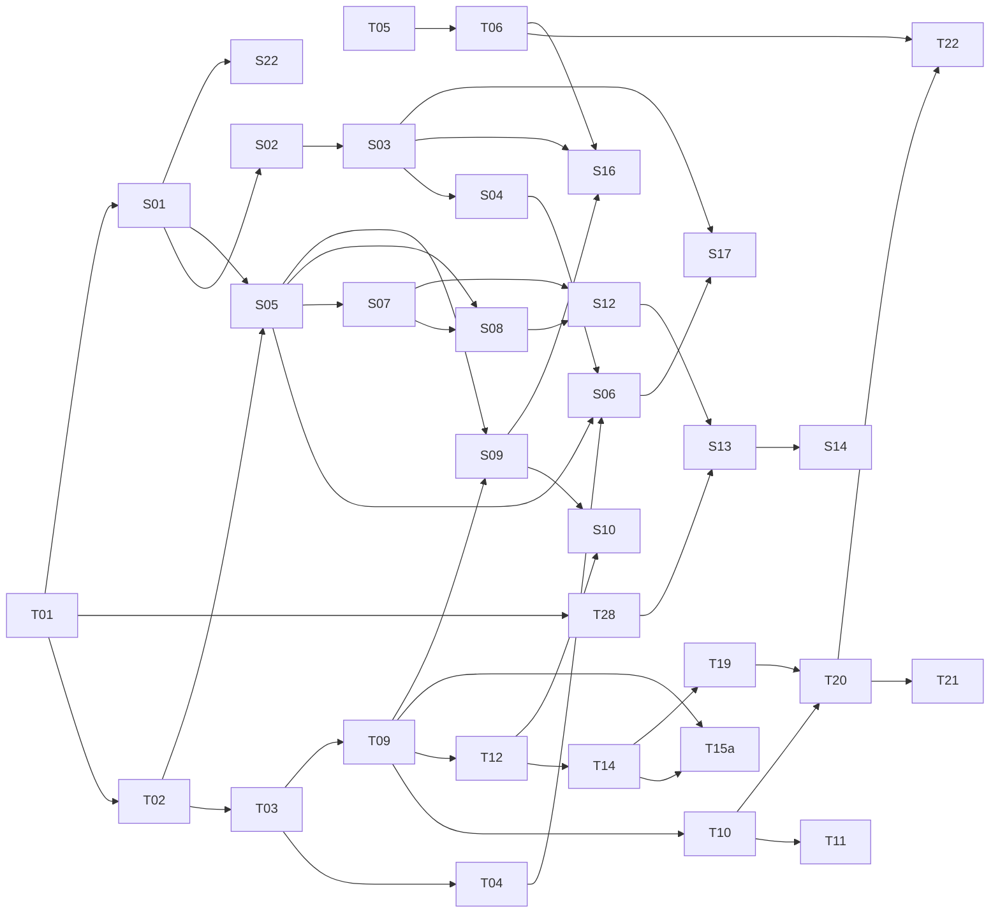

# Find Your Pitch: curriculum

Season 1 in full, the topic graph it is cut from, and the outline of Seasons 2 and 3. Companion
to [MASTER-PLAN.md](MASTER-PLAN.md); every lesson follows the
[teaching playbook](TEACHING-PLAYBOOK.md) and the episode and page templates in the master plan.

## 1. Principles that set the order

1. **Sound before symbol.** Every serious music method (Pestalozzi and Mason, Kodály, Orff,
   Gordon, Suzuki) has learners hear and sing before they name, and name before they read. The
   benchmark split is the same: notation-first syllabi (ABRSM, Trinity, musictheory.net, Open
   Music Theory, Coursera Edinburgh) against sound-first courses (Ableton Learning Music,
   Hooktheory, 12tone's Building Blocks; see
   [research/curriculum-benchmark.md](research/curriculum-benchmark.md)). MercuryPitch's own
   representation is a live pitch line, the sound-first choice. **Season 1 teaches by ear and by
   pitch line; staff notation is Season 2.** Theory lessons may offer a "see it on the staff"
   toggle as an extra, never as a requirement.
2. **Theory and voice alternate**, after two opening theory lessons, so each idea is sung soon
   after it is understood and each vocal skill has the theory it needs. Cross-links that justify
   the interleave: octave equivalence (L1) is what makes pitch matching forgiving (L3); cents (L2)
   is the unit a steady note is measured in (L5); the major scale (L4) is the material of sung
   steps and leaps (L9); harmonics (L13) explain vowels and resonance.
3. **Each episode's closing question is the next episode's cold open.** Lesson 1 ends on "seven
   letters, but twelve notes": Lesson 2 opens there.
4. **The consensus spine, in both tracks.** Theory: pitch and octave, twelve notes, major scale,
   scale degrees, intervals, major and minor, triads, chord function, progressions. Voice:
   how the voice makes pitch, pitch matching, breath and a steady note, glides and range, steps
   then leaps, registers, resonance and vowels, phrasing. Leaps are taught in the exam-board and
   Kodály order: thirds, fifth, fourth, octave, sixths.
5. **Pitch first, rhythm in the middle.** A singing app's core loop is pitch (RCM, Kodály,
   Yousician and Singing Carrots all start there); rhythm arrives at Lesson 8, early enough for
   the phrasing lesson that needs it.
6. **No labels.** Hooks and copy never call a singer "tone deaf", wrong, bad or failed; voice
   lessons are non-diagnostic and carry the "comfortable, never push" rule
   ([playbook rule 21](TEACHING-PLAYBOOK.md)). From Lesson 3, a voice lesson may open with a 60 to
   90 s gentle warm-up (sigh glides, an optional lip trill) at the vocal coach's discretion. Before
   any segment beyond a comfortable hum (holds, sirens, range) it says "Sore, hoarse or unwell
   today? Just listen along." (the playbook's house rules). Holds are 5, 10 or 15 s; 30 s is only
   ever an optional advanced length with "breathe whenever you need", never a checkpoint. A vocal
   coach signs off every voice lesson at the script and publish gates (MASTER-PLAN § 7).

## 2. Season 1: "Find Your Pitch" (14 lessons and a trailer)

Arc A, **Hear it** (Lessons 1 to 7): pitch, the twelve notes, the first sung notes, the scale,
breath, intervals, range. Arc B, **Shape it** (Lessons 8 to 14): rhythm, leaps, major and minor,
registers, chords, vowels, a whole song.

Target length 6 to 9 minutes; tiny topics 4 to 5; cap at 10 (3Blue1Brown's curriculum series
runs 4:27 to 17:16, median 11:34; MOOC engagement medians sit at about 6 minutes). Lesson 1 runs
5:14 (314.2 s on its cue sheet, with the owner's ElevenLabs voices).

The hook is the cold open, not necessarily the YouTube title. A YouTube title has at most 100
characters (aim for about 60) and may shorten the hook as long as it stays accurate; the full hook
goes in the thumbnail text, the first line of the description and the cold open (MASTER-PLAN
§ 4.1).

| #   | Track            | Title                                 | Topics                 | Hook question (the cold open)                                                                                                                               |
| --- | ---------------- | ------------------------------------- | ---------------------- | ----------------------------------------------------------------------------------------------------------------------------------------------------------- |
| 0   | Trailer          | Find your pitch                       | all                    | What if you could see every note you sing? (2 to 3 minutes: the promise and the map of all 14 hooks)                                                        |
| 1   | Theory           | What is a note? **(in production)**   | T01, T02               | If 440 Hz shakes the air twice as fast as 220 Hz, why do musicians call them the same note?                                                                 |
| 2   | Theory           | Twelve notes                          | T03, T04: cents        | Musicians only use seven letters, so where do the other five notes come from?                                                                               |
| 3   | Voice            | Match a note                          | S01, S05, T04: in tune | Asked, most of 1,105 students said they couldn't copy a tune. Tested, only about one in ten to one in six missed by a semitone or more. So what's going on? |
| 4   | Theory           | The major scale and home              | T09, T10               | Why does do-re-mi sound finished when it lands on do, and restless when it stops on ti?                                                                     |
| 5   | Voice            | Breath and a steady note              | S02, S03, S04, S06     | Singers are told to "support" a long note. If that doesn't mean pushing, what keeps it steady?                                                              |
| 6   | Theory           | Intervals: the distance between notes | T11, T12               | Why can you start "Twinkle, Twinkle" on any note and it is still the same tune?                                                                             |
| 7   | Voice            | Slides, sirens and your range         | S07, S08               | How many notes can your voice reach, and why is the comfortable middle worth more than the extremes?                                                        |
| 8   | Theory           | Beat, tempo and the backbeat          | T05, T06               | Why does the same song feel different when you clap on 2 and 4 instead of 1 and 3?                                                                          |
| 9   | Voice            | Landing a leap                        | S09, S10               | Why is jumping to a note so much harder than stepping to it?                                                                                                |
| 10  | Theory           | Major and minor                       | T14, T15a, T19 (intro) | Which single note turns a bright major chord into a dark minor one?                                                                                         |
| 11  | Voice            | Registers and the break               | S12                    | Why does your voice flip at roughly the same note every time you slide up?                                                                                  |
| 12  | Theory           | Chords and the four-chord song        | T19, T20, T21          | How can hundreds of songs share the same four chords and still sound different?                                                                             |
| 13  | Voice            | Resonance and vowels                  | T28, S13, S14          | If "ee" and "ah" sung on the same note draw the same pitch line, what makes them sound different?                                                           |
| 14  | Voice and theory | Phrasing: sing a whole song           | S16, S17, T22 (light)  | If you can hit every note of a song, what is still missing between correct and compelling?                                                                  |

### 2.1 Lesson cards

Each card is what a script writer needs before the first draft. "Misconception" is orange Merc's
sincere wrong guess (playbook rule 3); "Signature" is the episode's persistent object and its
transformation (rule 6); "Checkpoint" is the sung moment (rule 16); "Practise" is the app link
(see § 4 for what exists and what needs engineering).

**Lesson 1. What is a note?** (made: the film's master, `rc-07`, passed its last critic round and
waits on a person's listen to the new voices; the web lesson is built at `/learn/01`; 5:14)

- Objectives: say what makes a note higher (faster vibration, more hertz) and that loudness is
  something else; recognise that doubling the frequency gives the same note an octave up; read
  octave numbers (A3, A4, C4) and know they change at C.
- Misconception: "A high note is just a loud note" (refuted). Orange's cold-open guess, "Same
  note", is half right, so the reveal settles it rather than refuting it: "Higher, yes. But
  together, they melt into one note."
- Signature: the pitch line winds into a spiral; the spiral unrolls into the keyboard.
- Checkpoint: Merc sings an A; hum along with Merc in any octave (unscored). To be scored, sing it
  back on "ooh" in Voice Mirror. The Phase 1 re-voice changes the film's "Hum it back" to "Sing it
  back, or hum along".
- Practise: `mercurypitch.com/mirror` (Voice Mirror's match scoring is octave-folded,
  `src/lib/mirror/metrics.ts:261`).
- Facts: [lessons/01-what-is-a-note/FACTS.md](lessons/01-what-is-a-note/FACTS.md).

**Lesson 2. Twelve notes** (made: the film's master, `rc-04`, passed its last critic round and waits
on a person's listen and watch; the web lesson is built at `/learn/02`, from its spec in
[lessons/02-twelve-notes/](lessons/02-twelve-notes/); 7:11)

- Objectives: find the twelve notes on a keyboard and on the spiral; tell a semitone from a whole
  tone by ear; know why one key has two names (C sharp, D flat); know a semitone is 100 cents, the
  unit MercuryPitch scores in.
- Misconception: "Black keys are sharps and white keys are naturals." "B to C is the same step as
  C to D: on the keyboard they look just as far apart." (Refuted by: every neighbouring key, white
  or black, is one semitone, so B to C is half of C to D.)
- Signature: the five "?" beads from Lesson 1's spiral light up; on screen, twelve equal steps make
  an octave, each 100 cents. Writer's note (or a "Go deeper" drawer): each semitone is a 2^(1/12)
  step (a ratio of about 1.0595), so twelve equal steps multiply to exactly 2.
- Checkpoint: slide up one semitone from a held note and back.
- Practise: Ear Lab Leap with only Minor 2nd and Major 2nd (`leap:m2`, `leap:M2` in
  `src/lib/ear/banks.ts`); needs the `ear-drill` launch kind to accept a bank subset, until then
  `/ear-lab`, then tap Leap. Contour (tiers "Half steps" and "Whole steps") only as an easier
  first drill for direction: it asks up, down or same, never semitone or tone.
- Facts: 12-TET ratio; 100 cents per equal-tempered semitone (Ellis, 1885); keyboard layout;
  the app's pitch line labels notes with sharps only (its sheet-music view spells flats in flat
  keys).

**Lesson 3. Match a note** (written: the lesson, its facts and its page spec are in
[lessons/03-match-a-note/](lessons/03-match-a-note/), reviewed; no film yet; its page is built at
`/learn/03` as a draft, on the dev site only, until the vocal coach signs off its voice lines)

- YouTube title: "Can you really be tone deaf?" (the full hook goes in the thumbnail, the
  description's first line and the cold open).
- Objectives: know how the voice makes pitch: the vocal folds vibrate, and faster, more tensed
  folds give a higher note (a callback to Lesson 1); look after it: sing at about speaking volume,
  drink water, rest when it feels tired, and stop if it feels scratchy or hoarse; understand that
  matching is a hear, try, compare, adjust loop; know an octave match counts; get a first success
  at a slow pace in a comfortable range; read "in tune" in cents: how far the voice sits from the
  target note, and the target band it should land in (T04's second half; Lesson 2 teaches the cent).
- Misconception: "Some people are just tone deaf." (Orange voices "I can't sing" once; blue
  answers with the evidence: congenital amusia is about 1.5 % of people; poor-pitch singing is
  mostly a mapping skill between ear and voice, and it improves with practice.)
- Signature: the singer's line chasing Merc's target band, with the gap shrinking in cents.
- Checkpoint: three notes, Merc first, viewer second, each slow and in the viewer's register,
  after the optional warm-up (principle 6).
- Practise: `/mirror` (octave-folded); Pitch Hold (needs a slug with `durationSec`). Pitch Hold
  scores raw cents against the written octave, so it also needs the octave-folded option, or the
  lesson says in writing that this drill scores the written octave (§ 4).
- Facts: Pfordresher and Brown (2007); Peretz and Vuvan (2017); Dalla Bella et al. (2007);
  Hutchins and Peretz (2012). Name what was asked and what was tested: "most" is a questionnaire
  of 1,105 students (59 % said they couldn't imitate a melody accurately); the two singing
  experiments (79 and 45 participants) found 13 % and 16 % missing by a semitone or more (the
  abstract says 10 to 15 %).

**Lesson 4. The major scale and home** (written: the lesson, its facts and its page spec are in
[lessons/04-major-scale/](lessons/04-major-scale/), reviewed; no film yet)

- Objectives: build a major scale from the tone-tone-semitone-tone-tone-tone-semitone pattern (two
  tone-tone-semitone groups joined by a tone); feel the tonic as home; name scale degrees with
  movable do.
- Misconception: "A scale is a fixed set of notes that starts on C."
- Signature: a staircase whose steps are uneven (two semitone steps) that you can slide to start
  on any note and still sound the same.
- Checkpoint: sing do-re-mi-fa-so and back, then stop on ti and feel the pull.
- Practise: Scale Runner at a beginner tempo (needs a data-only slug: `/exercises/<slug>` with
  `scale-major-c4`, low difficulty).
- Facts: major-scale step pattern T-T-S-T-T-T-S (two T-T-S groups joined by a tone); stable and
  unstable degrees (Hooktheory I, ch. 3).

**Lesson 5. Breath and a steady note** (written: the lesson, its facts and its page spec are in
[lessons/05-breath-steady-note/](lessons/05-breath-steady-note/), reviewed; no film yet; its voice
lines wait on the vocal coach's sign-off, and its page publishes after `/learn/02` and `/learn/03`)

- Objectives: breathe low and quietly; start a note cleanly (balanced onset); hold a note steadily
  for a comfortable fixed length (5, 10 or 15 s, principle 6).
- Misconception: "Support means pushing or squeezing." Refute the harmful belief, not the anatomy:
  the diaphragm mostly works on the in-breath, and at the start of a phrase it can gently "check"
  the out-breath so the sound starts steady (inspiratory checking). Cue the effect (rule 24): a
  low, quiet inhale and a steady, unforced flow. "Support" has no agreed definition (Salomoni et
  al. 2016).
- Signature: the pitch line of a held note settling from a wobble into a narrow band.
- Checkpoint: hold one comfortable note for 10 seconds, then 15, after the "Sore, hoarse or unwell
  today? Just listen along." line.
- Practise: Long Note with a fixed 10 or 15 s length (needs the `durationSec` launch field; today
  the length is the viewer's saved timer preference). No Ascent link until its "Breath & Power"
  week is rewritten (§ 4).
- Facts: Hixon on respiratory function in singing, including inspiratory checking; Leanderson,
  Sundberg and von Euler (1987) on the diaphragm during singing; Sundberg's review of breathing in
  singing; onset types (Arneson, Estill). Never rate breath support (the app's guided-voice claims
  rules).

**Lesson 6. Intervals: the distance between notes** (written: the lesson, its facts and its page
spec are in [lessons/06-intervals/](lessons/06-intervals/), reviewed; no film yet; its sing-along
waits on the vocal coach's sign-off, and its page publishes after `/learn/04`)

- Objectives: hear that a melody is a pattern of distances, not of particular notes; recognise
  steps and leaps; anchor a few intervals to familiar tunes.
- Misconception: "A tune is a list of notes, so changing the notes changes the tune."
- Signature: a tune's contour lifted off the chart and slid up and down while it keeps its shape.
- Checkpoint: sing a short phrase starting on two different notes.
- Practise: Interval Trainer (listen first; picking the anchored intervals needs the `intervals`
  launch field, § 4); Ear Lab Leap (identify).
- Facts: melody defined by intervals; song anchors per interval (choose public-domain tunes).

**Lesson 7. Slides, sirens and your range** (written: the lesson, its facts and its page spec are
in [lessons/07-slides-sirens-range/](lessons/07-slides-sirens-range/), reviewed; no film yet; its
voice lines wait on the vocal coach's sign-off, and its page publishes after `/learn/03`)

- Objectives: warm up with sirens, lip trills and "ng" glides gently; find your comfortable middle;
  understand voice types as labels, not boxes.
- Misconception: "A good singer has the widest range."
- Signature: the siren's glowing line sweeping the chart, with the comfortable band lit and the
  edges dimmed.
- Checkpoint: one gentle siren up and down on "ng", after the "Sore, hoarse or unwell today?"
  line.
- Practise: Vocal Range Test (`/vocal-range-test`); the warm-up's lip trill (needs a `pattern`
  slug, and a warm-up that shows no grade and whose help makes no health claim: Lesson 7's
  WEB-SPEC). No Ascent link until its "Reach New Notes" week, which says "extend your range", is
  rewritten (§ 4).
- Facts: Titze's semi-occluded warm-ups (2006); voice-type ranges; SOVT evidence is modest. Never
  reward the widest span (the app's guided-voice rules).

**Lesson 8. Beat, tempo and the backbeat**

- Objectives: find the pulse; count bars of 2, 3 and 4; hear and clap a backbeat.
- Misconception: "Rhythm is just how fast the song goes."
- Signature: a metronome whose arm becomes the beat grid of a step sequencer (the stats site's
  metronome and sequencer motifs).
- Checkpoint: clap on 2 and 4 under a groove, then sing a phrase on the beat.
- Practise: Ear Lab Time drills (needs an `ear-drill` launch); Drum Night (`/drum-night`).
- Facts: backbeat (Ableton Learning Music). Show the march-versus-rock feel; don't state it as a
  statistic.

**Lesson 9. Landing a leap**

- Objectives: land thirds, the fifth, the fourth and the octave in tune; use an arpeggio as a
  ladder.
- Misconception: "You jump to the top note and hope."
- Signature: the leap drawn as an arc whose landing zone is the target band (amber, the app's
  pitch-canvas colour); slow leaps first.
- Checkpoint: do-mi-so-do, slowly.
- Practise: Interval Trainer (sing; needs the `intervals` launch field, and a minor third its
  fixed pool lacks); Arpeggio Jumper; the Ascent "Tuning & Ear" week. Interval Trainer scores
  raw cents against the written octave, so until the octave-folded option exists the lesson says
  so in writing (§ 4).
- Facts: RCM interval order; Kodály's sol-mi start.

**Lesson 10. Major and minor**

- Objectives: hear the difference between a major and a minor third; build major and minor triads;
  meet the natural minor scale.
- Misconception: "Minor means sad and major means happy, always."
- Signature: one bead (the third) sliding down one semitone and the whole chord's colour
  changing.
- Checkpoint: sing do-mi-so, then do-me-so.
- Practise: Drone Intonation (major and minor thirds against a drone; needs the `intervals` launch
  field to keep only its Major 3rd and Minor 3rd); Ear Lab Stack.
- Facts: major and minor thirds differ by one semitone; the RCM Preparatory chord-quality test.
- Decided (19 October 2026, MASTER-PLAN § 12 item 12): do-based minor, do-me-so as above, with
  the natural minor scale sung do re me fa so le te do. La-based minor (la-do-mi, the Kodály
  choice) is named once in Go deeper and never taught. Season 2's movable-do sight-singing (S11)
  inherits it.

**Lesson 11. Registers and the break**

- Objectives: know that voices switch between vibration modes and the switch is normal; smooth it
  with gentle glides.
- Misconception: "A crack means you're doing it wrong." (Register breaks are a normal transition,
  Henrich 2006.)
- Signature: the siren's line crossing a shaded seam, with the seam narrowing over repetitions.
- Checkpoint: a slow "ng" slide across your break, quietly.
- Practise: the Siren and Slide exercises (need slugs). The app does not detect registers; teach
  it conceptually.
- Facts: Henrich (2006); Arneson on register coordination. Never frame registers as a problem.

**Lesson 12. Chords and the four-chord song**

- Objectives: build the chords of a key from its scale; read Roman numerals; hear I-V-vi-IV.
- Misconception: "Songs with the same chords are the same song."
- Signature: four chords as four rooms on the spiral; a melody walking through them.
- Checkpoint: sing the root of each chord as the progression plays.
- Practise: Chord Stacker (needs major and minor triads; today it has only maj7, min7, dom7, dim7
  and maj6), Play Along.
- Facts: Ableton Learning Music's 1-5-6-4 lesson; Roman numerals (Hooktheory I).

**Lesson 13. Resonance and vowels**

- Objectives: understand that a vowel is a shape of the vocal tract that boosts different
  harmonics; keep pitch steady while changing vowels.
- Misconception: "Different vowels are different notes."
- Signature: one pitch line, with a harmonic spectrum underneath whose peaks move as the vowel
  changes (the stats site's LED analyser motif).
- Checkpoint: hold one note through "ee", "eh", "ah", "oh", "oo".
- Practise: Long Note on vowels; Analysis' spectrum view. The app must not claim to assess vowels
  or pronunciation.
- Facts: harmonics and timbre; vowels as vocal-tract shaping (formants).

**Lesson 14. Phrasing: sing a whole song**

- Objectives: plan breaths at phrase ends; shape a phrase with dynamics without pushing; put the
  season together in one song; record yourself and listen back (S22).
- Misconception: "If every note is in tune, the song is finished."
- Signature: a whole song's pitch line with breath marks and a swell drawn in light.
- Checkpoint: sing one phrase twice, the second time with a planned breath and a swell.
- Practise: Dynamic Swell; Karaoke Night or Play Along; daily routines.
- Facts: messa di voce (Titze); phrasing and breath planning (Arneson).

## 3. Topic graph

IDs are stable anchors for the lesson explorer. Prerequisites list the minimum. A Season 1 topic
only ever needs Season 1 topics, which is why T15 is split into T15a and T15b.

### 3.1 Theory

| ID   | Topic                                                                   | Prerequisites | Season       |
| ---- | ----------------------------------------------------------------------- | ------------- | ------------ |
| T01  | Sound and pitch: vibration, frequency, hertz; high is not loud          | none          | 1            |
| T02  | Octave and octave equivalence; seven letter names; octave numbers       | T01           | 1            |
| T03  | Twelve notes: semitones, tones, sharps and flats, keyboard, enharmonics | T02           | 1            |
| T04  | Cents and "in tune"                                                     | T03           | 1            |
| T05  | Pulse, beat and tempo                                                   | none          | 1            |
| T06  | Metre and bars; downbeat; backbeat                                      | T05           | 1            |
| T07  | Note values, rests, dots, ties, subdivision                             | T06           | 2            |
| T08  | Simple and compound metre; triplets; syncopation                        | T07           | 2            |
| T09  | Major scale; tonic as home                                              | T03           | 1            |
| T10  | Scale degrees and movable do                                            | T09           | 1            |
| T11  | Melody: contour, steps and leaps, transposition                         | T10           | 1            |
| T12  | Intervals by size and by sound                                          | T09           | 1            |
| T13  | Interval quality: major, minor, perfect; tritone; inversion             | T12           | 2            |
| T14  | Major and minor third; major and minor triads by ear                    | T12           | 1            |
| T15a | Natural minor scale                                                     | T09, T14      | 1            |
| T15b | Harmonic and melodic minor; relative keys                               | T15a, T13     | 2            |
| T16  | Pentatonic and blues scales                                             | T09           | 2            |
| T17  | Keys, key signatures, transposition                                     | T09           | 2            |
| T18  | Circle of fifths                                                        | T17, T13      | 2            |
| T19  | Triads: major, minor, diminished, augmented                             | T14           | 1            |
| T20  | Diatonic chords, Roman numerals, function                               | T19, T10      | 1            |
| T21  | Common progressions                                                     | T20           | 1            |
| T22  | Phrases and cadences                                                    | T20, T06      | 1 (light), 2 |
| T23  | Chord tones and non-chord tones                                         | T20, T11      | 2            |
| T24  | Seventh chords                                                          | T19           | 2            |
| T25  | Inversions and voicing                                                  | T19           | 2            |
| T26  | Modes                                                                   | T15b, T10     | 3            |
| T27  | Secondary dominants, borrowed chords, modulation                        | T21, T26      | 3            |
| T28  | Timbre, harmonics, overtones; spectrum                                  | T01           | 1            |
| T29  | Tuning systems: why twelve, equal temperament                           | T04, T28      | 2            |
| T30  | Staff notation: staff, clefs, ledger lines, grand staff                 | T03, T07      | 2            |
| T31  | Song form                                                               | T22           | 2            |
| T32  | Dynamics and articulation terms                                         | none          | 2            |

### 3.2 Voice

| ID  | Topic                                                      | Prerequisites | Season            |
| --- | ---------------------------------------------------------- | ------------- | ----------------- |
| S01 | How the voice makes pitch; vocal health basics             | T01           | 1                 |
| S02 | Posture, alignment, tension release                        | S01           | 1                 |
| S03 | Breath: low, quiet inhale; managed exhale                  | S02           | 1                 |
| S04 | Onset and offset                                           | S03           | 1                 |
| S05 | Pitch matching; octave counts                              | S01, T02      | 1                 |
| S06 | Steady tone                                                | S04, S05, T04 | 1                 |
| S07 | Glides, sirens, lip trills, "ng"                           | S05           | 1                 |
| S08 | Range and comfortable zone; voice types as labels          | S05, S07      | 1                 |
| S09 | Singing steps: five-note scales, then the octave           | S05, T09      | 1                 |
| S10 | Singing leaps: thirds, fifth, fourth, octave; arpeggios    | S09, T12      | 1                 |
| S11 | Echo and sight-sing short melodies                         | S10, T10      | 2                 |
| S12 | Registers: chest, head, falsetto, mix; the break           | S07, S08      | 1                 |
| S13 | Resonance and brightness                                   | S12, T28      | 1                 |
| S14 | Vowels                                                     | S13           | 1                 |
| S15 | Consonants and diction                                     | S14           | 2                 |
| S16 | Legato and phrasing; breath planning                       | S03, S09, T06 | 1                 |
| S17 | Dynamics without pushing: messa di voce                    | S03, S06      | 1                 |
| S18 | Agility: staccato, runs, pentatonic patterns               | S09, S04, T16 | 2                 |
| S19 | Vibrato                                                    | S06, S17      | 2                 |
| S20 | Harmony singing                                            | S06, T13, T19 | 2                 |
| S21 | Style and qualities (speech, twang, belt, falsetto)        | S12, S13, S17 | 3                 |
| S22 | Practice habits, warm-up and cool-down, recording yourself | S01           | 1 (woven through) |

S22 is woven through from Lesson 3: the optional warm-up opener (principle 6), then recording
yourself in Lesson 14.

The Season 1 graph, generated from the two tables: every Season 1 topic and every prerequisite
edge between them (T22 for its light Season 1 part). Season 2 and 3 topics are left out; no
Season 1 topic points at one.

### 3.3 Lesson prerequisites (for the explorer)

The explorer draws lessons, not topics. Each lesson needs the lessons that teach its topics'
prerequisites; an edge already implied through another prerequisite is left out, so the explorer
draws the fewest lines. Every prerequisite is an earlier Season 1 lesson.

| Lesson                            | Needs       | Because                                                                               |
| --------------------------------- | ----------- | ------------------------------------------------------------------------------------- |
| 0 Find your pitch (trailer)       | none        | It previews every lesson                                                              |
| 1 What is a note?                 | none        | T01 and T02 start the graph                                                           |
| 2 Twelve notes                    | 1           | T03 needs T02                                                                         |
| 3 Match a note                    | 1           | S01 needs T01; S05 needs T02. Lesson 2 helps, but Lesson 3 explains the cent again    |
| 4 The major scale and home        | 2           | T09 needs T03                                                                         |
| 5 Breath and a steady note        | 2, 3        | S06 needs T04 (cents in 2, in tune in 3) and S05 (3); S02 needs S01 (3)               |
| 6 Intervals                       | 4           | T11 needs T10; T12 needs T09                                                          |
| 7 Slides, sirens and your range   | 3           | S07 and S08 need S05                                                                  |
| 8 Beat, tempo and the backbeat    | none        | T05 has no prerequisite: rhythm starts fresh                                          |
| 9 Landing a leap                  | 3, 6        | S09 needs S05 (3) and T09 (4, via 6); S10 needs T12 (6)                               |
| 10 Major and minor                | 6           | T14 needs T12 (6); T15a needs T09 (4, via 6)                                          |
| 11 Registers and the break        | 7           | S12 needs S07 and S08                                                                 |
| 12 Chords and the four-chord song | 10          | T19 needs T14 (10); T20 needs T10 (4, via 10)                                         |
| 13 Resonance and vowels           | 11          | S13 needs S12 (11); T28 needs T01 (1, via 11)                                         |
| 14 Phrasing                       | 5, 8, 9, 12 | S16 needs S03 (5), T06 (8) and S09 (9); S17 needs S03 and S06 (5); T22 needs T20 (12) |

A lesson's recall check asks about an earlier lesson. When that lesson is a prerequisite (Lesson 4
recalls Lesson 2), the recall shows to everyone: it checks what the lesson builds on and links
back. When the earlier lesson only helps (Lesson 3 recalls Lesson 2), the recall shows once that
lesson is marked done.

## 4. Practise links: what exists and what needs building

The app can open these today: `/mirror`, `/vocal-range-test`, `/voice-type-test`,
`/which-singer-has-my-vocal-range`, `/free-sing`, `/pitch-training`, `/ear-lab`, `/drum-night`,
`/piano-night`, `/karaoke-night`, tab hashes (`#/exercises`, `#/path`, `#/singing`,
`#/learn/<chapterId>`), and three exercise slugs (`/exercises/speed-scales` and two that open
tabs). `/exercises/perfect-octave` also opens, but it only sets Interval Trainer's start note, so
it does not drill an octave yet (item 3).

Data alone is not enough. A slug launch carries only `exercise`, `notes`, `scaleId` and
`difficulty` (`ExerciseLaunch` in `src/features/exercises/slug-map.ts`), and most drills read
only the first note and the difficulty. Interval Trainer shuffles a fixed pool (M2, M3, P4, P5,
M6, P8, no minor third), Drone Intonation shuffles its own intervals, and Long Note's length is
the viewer's saved timer preference. Everything else therefore needs one of these changes
(detail in MASTER-PLAN § 7: the Phase 1 App and App content tracks, and the Phase 2 engineering
track for item 4 and for the Lesson 9 and 10 interval sets in item 2); items 2 to 7 are code with
tests, estimated as such:

1. Data-only slugs for drills that need only a start note, a scale or a difficulty (Scale Runner
   at a beginner tempo, Pitch Hold's start note, Siren and Slide).
2. New launch fields: `intervals` (semitones and direction) for Interval Trainer and Drone
   Intonation (Lessons 6, 9 and 10; Lesson 9 also needs a minor third in Interval Trainer's pool),
   and `durationSec` for Long Note and Pitch Hold (Lessons 3 and 5). A `pattern` field on slug
   launches for warm-up patterns such as lip trill and sirens (`launch-override.ts` already
   exposes `launchPattern`, which the warm-up reads; `ExerciseLaunch` lacks it), and a scale-type
   field for Scale Runner.
3. Fix `perfect-octave` so Interval Trainer honours the full note list and drills the octave.
4. Chord Stacker triad chord types (major and minor) for Lesson 12.
5. New launch kinds: `ear-drill` (accepting a bank subset, such as `leap:m2` and `leap:M2` for
   Lesson 2), `zen`, `learn`.
6. A lesson marker (`?lesson=`) that skips First Light for visitors arriving from a lesson and
   records attribution.
7. An octave-folded scoring option for Pitch Hold and the other pitch-matching drills (Pitch Hold
   scores raw cents against the written octave today), or an explicit written-octave note in
   Lessons 3 and 9.
8. A rewrite of the Ascent's weeks 2 and 3 in `src/features/path/path-content.ts` ("Breath &
   Power" says "Build breath support"; "Reach New Notes" says "Extend your range"), focus, goals
   and curated videos, checked against the playbook's claims rules (the Phase 1 App content
   track). Until then Lessons 5 and 7 do not link the Ascent.

Phase 1's App exit is every Lesson 2 to 7 link opening its drill. The Arc B items (the Lesson 9
and 10 interval sets, Chord Stacker triads) are in the Phase 2 engineering track, and Phase 2's
exit includes every Lesson 8 to 14 link opening its drill (MASTER-PLAN § 7).

Gaps with no drill today (candidates for new content): straw phonation, register work, vowels,
keyboard and note-naming drills, sharps and enharmonics, the circle of fifths, sung minor and
descending intervals, sung triads, rhythm scored while singing, solo harmony lines, major-versus-
minor scale by ear.

## 5. Seasons 2 and 3 (outline)

**Season 2, "Read it, harmonise it"** (12 to 14 lessons): the staff and clefs (T30), note values
and rhythm reading (T07, T08), sight-singing with movable do (S11), interval quality and the
tritone (T13), minor scales properly (T15b), keys and the circle of fifths (T17, T18), harmony
singing against a drone and a second voice (S20), vibrato (S19), agility and pentatonic runs (S18,
T16), cadences and song form (T22, T31), seventh chords and inversions (T24, T25), why twelve notes
(tuning, T29).

**Season 3, "Make it yours"**: modes (T26), borrowed chords and modulation (T27), style and vocal
qualities (S21), diction (S15), arranging a cover, writing a melody over a progression.
