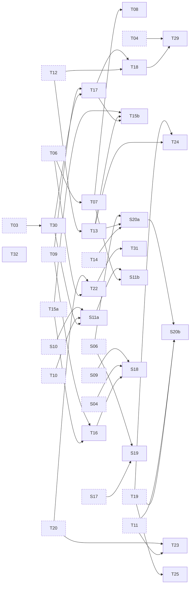

# Find Your Pitch: Season 2

Season 2, "Read it, harmonise it", planned at Season 1's depth: the promise and the shape, the
lesson table and cards, the topic graph, the practise links, production, the owner's decisions,
and the risks and production order. Companion to [CURRICULUM.md](CURRICULUM.md), which holds
Season 1 and the topic graph this extends, and to [MASTER-PLAN.md](MASTER-PLAN.md), whose formats
(§ 4), visual and sound language (§ 5) and decision register (§ 12) hold unless § 7 below proposes
otherwise. Every lesson follows the [teaching playbook](TEACHING-PLAYBOOK.md).

Status: proposed, 29 October 2026. Nothing here is decided until the owner answers § 7. Claims
about the app were read on main at `b803c7d43` (0.9.25) and cite file and line there. Sources
marked "abstract" or "summary" were read only that far, and a claim this plan could not check is
marked **not verified**: a writer checks it before it reaches a script.

Lead review, 29 October 2026: every one of the 138 file-and-line citations was read at `b803c7d43`
and says what this plan says it does. Five edits followed: above a drone the beats stop only at
the pure intervals (§ 1.1, Lesson 24); the pentatonic climbs 2, 2, 3, 2, 3, so its steps are not
even (Lesson 20); Lesson 21's hook asks why the sharps pile up, since Lesson 4 already slides the
scale to G and D (Lessons 20 and 21); Lesson 16's refutation no longer leans on the mixed evidence
for movable do; and Lesson 22's example extent sits inside the range the card cites.

## 1. The promise and the shape

### 1.1 What a learner can do by the end of Season 2

**Read.** Name any note on the treble and the bass staff, with up to two ledger lines, and find it
on the keyboard. Read whole, half, quarter, eighth and sixteenth notes, their rests, dots and ties,
in 2/4, 3/4, 4/4 and 6/8, and count a bar aloud. Read a key signature of up to three sharps or
three flats and find do from it. Read the marks a song sheet carries: p and f, a hairpin, a
staccato dot, a slur, a breath mark.

**Hear.** Tell a perfect interval from a major or a minor one, and hear the tritone. Hear harmonic
minor's raised seventh, a dominant seventh's pull home, a chord in inversion. Hear perfect,
imperfect, plagal and interrupted cadences, and a song's sections. Hear the beats between two held
notes slow down and stop as a unison or an octave comes into tune, and hear that above a drone the
piano's fifth beats slowly and its major third quickly, while the pure ones are still.

**Sing.** Sight-sing a short melody in movable do after hearing do: steps and the tonic triad
first, then in time. Sing a pentatonic pattern lightly and evenly at a comfortable tempo. Hold a
note against a drone, then a fifth and a third above it. Sing a second part against a melody, and
one part of a two-part song read from the staff. Hold a note with or without vibrato, and read
what the app reports about it.

What the season never promises: perfect pitch, a vibrato on demand, more range, stronger
"support", or a sight-reading grade. Its voice lessons stay non-diagnostic (playbook rule 21).

"Up to three sharps or three flats" is this plan's scope, not a standard: the circle shows all
twelve keys (Lesson 21), and the reading tasks stop at three so each signature comes round more
than once. How it compares with an exam board's grade was not checked.

### 1.2 Two arcs, fourteen lessons and a trailer

Arc C, **Read it** (Lessons 15 to 21): the staff, sight-singing, note values, reading a line in
time, compound metre and syncopation, runs and the pentatonic scale, keys and the circle of fifths
(with why there are twelve notes). Arc D, **Harmonise it** (Lessons 22 to 28): vibrato, interval
quality and the tritone, harmony against a drone, minor properly, a second voice, seventh chords
and inversions, cadences and form with a song in two parts. The letters carry on from Season 1's
A and B, so "Arc A" never means two things.

Vibrato opens Arc D because Arc D is made of held notes: Lesson 22 takes Lesson 5's steady note
and Lesson 14's swell (S19 needs S06 and S17, CURRICULUM § 3.2) and closes on two notes held
together, Lesson 23's cold open. That is a sequencing choice, not a claim about vibrato in harmony.

A Season 2 trailer, 2 to 3 minutes, carries no lesson number (§ 7 item 9).

### 1.3 Lengths

**Films:** Season 1's targets hold: 6 to 9 minutes, tiny topics 4 to 5, a cap of 10 (CURRICULUM
§ 2). Lessons 15 (two clefs and the grand staff), 21 (keys, the circle and why twelve) and 28 (four
cadences, form and a two-part song) will press on the cap, and their cards say what moves to Go
deeper if a script runs long. Lessons 22 and 23 may be tiny.

**Pages:** MASTER-PLAN § 4.2's budget holds, 8 to 12 minutes of active time and 500 to 900 words
(MASTER-PLAN.md:137), with Season 1's later practice: chips show real run times and the word cap is
2,379 (HANDOFF.md:262-267). Reading takes longer than listening, so each staff toy is timed in its
lab before its lesson's chip is set.

### 1.4 What carries over unchanged

1. **Sound before symbol** (CURRICULUM § 1 principle 1) still holds. The staff arrives, but every
   staff idea arrives after the sound it writes down, inside the same lesson: the learner hears and
   sings a pattern on the pitch line first, then sees it written. Every staff example plays, and
   every staff toy has a "see it on the pitch line" toggle, the reverse of Season 1's "see it on
   the staff" extra.
2. **Theory and voice alternate** (principle 2): Lessons 15 to 27 odd theory, even voice; Lesson 28
   is both.
3. **Each closing question is the next cold open** (principle 3). Lesson 15 opens on its own
   question, since Lesson 14 teases nothing (HANDOFF § 4.5; CURIOSITY-MOMENTS § 5 item 4), and
   Lesson 28 teases nothing either unless Season 3 is committed (§ 7 item 8).
4. **No labels, and the voice-safety house rules** (playbook rule 21 and its house rules,
   TEACHING-PLAYBOOK.md:65-82): no "tone deaf", wrong, bad or failed for a singer; feedback
   describes the sound, never the singer; "comfortable, never push"; the comfort check, "Sore,
   hoarse or unwell today? Just listen along.", before anything beyond a comfortable hum; the stop
   line, "Stop immediately if anything feels uncomfortable.", with its referral line; holds of 5,
   10 or 15 s, with 30 s never a checkpoint; any octave counts; no score for the longest hold, the
   widest range, a lip trill, a hum or a straw; no rating of breath "support" and no claim to extend
   range; registers never framed as a problem; no claims about vowels or pronunciation; "How did
   that feel?" (Easy, Workable, Effortful, Uncomfortable) with a rest card after Effortful. A vocal
   coach signs off every voice lesson at the script and publish gates (MASTER-PLAN § 7). These are
   written once here; each card's checkpoint applies them and names only what differs.
5. **The page template** (MASTER-PLAN § 4.2): the cold open before the recall (§ 12 item 13),
   predict before reveal, one misconception refuted or shown half right, a persistent object,
   retrieval, a sung checkpoint (a theory lesson may offer an unscored sing-along instead), the
   practise link.
6. **Every musical example is synthesised at its exact frequency in code** (MASTER-PLAN.md:36), and
   the colour code, with one meaning for violet per film, holds (MASTER-PLAN § 5).
7. **Do-based minor** (MASTER-PLAN § 12 item 12): minor is sung do re me fa so le te do, and Season
   2's sight-singing inherits it. Letter names belong to the keyboard and the staff, movable do to
   singing ([pedagogy-research § 3.7](research/pedagogy-research.md)).
8. **British English**, semitone and tone leading (MASTER-PLAN § 12 item 5), with the note-value
   names as a proposed exception (§ 7 item 4).

### 1.5 What changes now that the staff arrives

1. **A second picture of pitch.** Season 1 had one, the pitch line. Season 2 adds the staff and
   teaches the translation: height is still pitch (MASTER-PLAN § 5), but the staff counts letters,
   not semitones, so the two pictures disagree at E to F and B to C, and Lesson 15 shows where.
2. **Two clefs, each learner in their own** (§ 7 item 2): lower voices read the bass clef, higher
   voices the treble. Merc's demonstrations are written in the bass clef, Tavi's in the treble.
3. **Rhythm is read, not only felt.** Lesson 8 counted bars of 2, 3 and 4
   (lessons/08-beat-tempo-backbeat/LESSON.md:32); Season 2 writes them down.
4. **Do is on the page.** The house that marks do (`src/features/lessons/kit/home-glyph.ts:1-13`)
   sits on do's line or space, and the learner finds do from the key signature.
5. **Two voices at once.** Arc D needs two parts sounding together, on screen and on the page, and
   the colour code gains a rule for them (§ 6.1).
6. **Checkpoints read from the page.** A sight-singing checkpoint plays do first, never the melody.
   A harmony checkpoint asks for headphones (§ 6.2).
7. **Decorative staves become notation.** The series ground carries faint five-line staves and the
   pages engrave decorative clefs (MASTER-PLAN.md:189; `src/features/lessons/kit/page-chrome.ts:166-175`).
   In a season that teaches the staff, a decorative staff reads as music, so Season 2 drops them
   (§ 6.1).
8. **The kit and the app learn about seasons.** Today both are Season 1 throughout (§ 6.2).

## 2. The lesson table

Topic IDs are the benchmark's ([research/curriculum-benchmark.md](research/curriculum-benchmark.md)
§ 5; CURRICULUM § 3). Four IDs are **new**: S11 and S20 are each too big for one lesson, so S11
splits into S11a and S11b and S20 into S20a and S20b (§ 4.1). Lessons are numbered on from Season
1 (§ 7 item 1).

| #   | Track            | Title                                  | Topics                  | Hook question (the cold open)                                                                                     |
| --- | ---------------- | -------------------------------------- | ----------------------- | ----------------------------------------------------------------------------------------------------------------- |
| 0   | Trailer          | Read it, harmonise it                  | all                     | What if you could read a song you've never heard, then sing a harmony to it? (2 to 3 minutes; no lesson number)   |
| 15  | Theory           | The staff: where notes sit             | T30                     | A piano has 88 keys. How can five lines write down every one of them?                                             |
| 16  | Voice            | Sing what you see                      | S11a (new)              | Can you sing a tune you've never heard, just by reading it?                                                       |
| 17  | Theory           | How long is a note?                    | T07                     | Why is a quarter note not a quarter of a second?                                                                  |
| 18  | Voice            | Read and sing a whole line             | S11b (new), T32 (light) | How do singers read a tune they've never heard without stopping on every note?                                   |
| 19  | Theory           | Threes, offbeats and syncopation       | T08                     | Six notes in a bar, grouped two ways: why does one feel like two beats and the other like three?                 |
| 20  | Voice            | Runs and the pentatonic scale          | S18, T16                | How do singers sing a fast run without the notes smudging together?                                               |
| 21  | Theory           | Keys and the circle of fifths          | T17, T18, T29           | G major needs one sharp and D major two. Why does each key a fifth up keep its sharps and add one?                |
| 22  | Voice            | Vibrato                                | S19                     | If a singer's held note swings up and down six times a second, why do we still hear one note?                     |
| 23  | Theory           | Perfect, major, minor and the tritone  | T13                     | Which interval splits the octave exactly in half, and why does it want to move?                                   |
| 24  | Voice            | Harmony against a drone                | S20a (new)              | Hold a note against a drone: how can you hear when the two are in tune?                                           |
| 25  | Theory           | Minor, properly                        | T15b                    | Why does a minor key often raise one note just before it comes home?                                              |
| 26  | Voice            | A second voice                         | S20b (new), T23 (light) | Can you make a harmony by singing the tune a third higher?                                                        |
| 27  | Theory           | Seventh chords and inversions          | T24, T25                | Add one note to the V chord and it pulls towards home. Which note, and why?                                       |
| 28  | Voice and theory | Cadences, form and a song in two parts | T22, T31                | How can a song sound as if it's ending, then keep going?                                                          |

**The chain.** Each lesson closes on the next lesson's hook, set up by the tease in its card's
"Closes on" line. Lesson 15's hook needs nothing from Lesson 14, and Lesson 28 closes on its own
answer.

**Titles for YouTube** may shorten a hook (at most 100 characters, about 60 as the aim;
MASTER-PLAN.md:124-127); each card offers one draft for the Test & Compare set. Each draft, and
each tease, was written to keep the predict's answer out of it, the season's most common review
finding (HANDOFF § 5); the reviews still check them, with the meta description, the promise, the
share card and the thumbnail.

## 3. Lesson cards

Each card is what a script writer needs before the first draft, in CURRICULUM § 2.1's format.
"Misconception" is Tavi's sincere guess (playbook rule 3); "Signature" is the episode's persistent
object and its transformation (rule 6); "Checkpoint" is the sung moment (rule 16), under the house
rules in § 1.4 item 4; "Practise" is the app link (§ 5 says what exists and what needs building);
"Facts to check" lists the claims the lesson will make and where each is checked. No Season 2
lesson has a package yet: each card is status "proposed".

**Lesson 15. The staff: where notes sit** (theory; T30)

- Draft YouTube title: "88 keys, five lines: how does the staff work?"
- Objectives: read the five lines and four spaces as letters, one letter per step; know the treble
  clef curls round G4 and the bass clef's two dots sit either side of F3; add ledger lines; find
  middle C on the one ledger line between the two staves of the grand staff; find every staff note
  on the keyboard (Lessons 1 and 2); know a staff step is one letter, which may be a tone or a
  semitone.
- Cold open: Tavi's guess, "You'd need 88 lines." The reveal: a clef names one line, the others
  count letters from it, short ledger lines carry on past the edges, and a piano uses two staves
  joined at middle C.
- Misconception: "Every step up the staff is the same step in sound." (Shown half right. Each step
  is one letter, so the staff is even in letters; but E to F and B to C are semitones and the other
  letter steps are tones, the uneven staircase of Lesson 4, lessons/04-major-scale/LESSON.md:91, and
  Lesson 2's B to C. The staff counts letters; sharps and flats adjust the sound.)
- Signature: Season 1's pitch line over a grid of twelve equal semitone lanes (Lesson 2's steps);
  the five black-key lanes fold away, so the lanes now count letters and close up unevenly at E to F
  and B to C, the misconception made visible; every other letter lane becomes a line, E, G, B, D and
  F, with the spaces between; the line's dots condense into noteheads; Lesson 1's keyboard slides
  under the grand staff, and the treble and bass staves meet at middle C (the stats site's "living
  staff" and "treble and bass clefs meet at middle C" motifs, research/stats-motifs.md § 8). Pitch
  only: noteheads are drawn without stems, since durations wait for Lesson 17.
- Checkpoint (unscored sing-along, a theory lesson): after the comfort check, sing do re mi fa so in
  C as the notes light on the staff, in your own clef and octave; nothing listens.
- Practise: `/?lesson=15#/compose`, then choose Sheet Music or the split view (Compose's views,
  `src/App.tsx:2321-2345`): notes written in the piano roll appear on the staff, in the bass clef
  when the melody's middle note sits below middle C (`src/lib/sheet-music-renderer.ts:175-183`). A
  sandbox, not a drill. Needs building: a note-reading drill (§ 5 item 9); the app's only
  note-locating quiz is the guitar's (`src/features/guitar-practice/NoteLocatorQuiz.tsx`).
- Facts to check: the clefs' positions, ledger lines and the grand staff (Open Music Theory and
  ABRSM Grade 1, as the benchmark cites them for T30: OMT 1.2 to 1.4; chapter numbers to check
  against OMT's current edition); 88 keys, A0 to C8, on a modern piano (**not verified**: read a
  maker's or a reference source); middle C as C4 (Lesson 1's octave numbers; Wolfe, UNSW, as
  lessons/02-twelve-notes/FACTS.md:23 cites him); the app's clef rule (above).
- Go deeper if long: the octave treble clef tenors read (§ 7 item 2).
- Closes on: Lesson 16's hook. "Now you can see where any note sits. But can you sing a tune you've
  never heard, just by reading it?"

**Lesson 16. Sing what you see** (voice; S11a, new)

- Draft YouTube title: "Can you sing a song you've never heard?"
- Objectives: find do on the staff from the house mark; hear do first, then hear the next note in
  your head before singing it; sing stepwise notes and the tonic triad (do mi so) by syllable from
  the staff; know that reading needs a starting note and relative pitch, not perfect pitch.
- Misconception: "You need perfect pitch to sing from the page." (Refuted, and half right about one
  thing. Absolute pitch is rare and appears to depend on early learning, roughly before age 6
  (Takeuchi & Hulse 1993, pedagogy-research.md:614-617), while most listeners hear music
  relationally (the same lines), so reading needs a starting note, not a stored one. Whether
  movable or fixed do teaches sight-singing better is mixed and confounded evidence, graded Weak
  (Demorest & May 1995 against a 2012 dissertation, pedagogy-research.md:607-613), so the lesson
  claims nothing about methods.
  Half right: you do need a first note, which is why choirs take one from a piano and why the page
  plays do. Merc says "absolute pitch, often called perfect pitch", since the playbook asks lessons
  to keep absolute pitch, relative pitch and pitch accuracy apart, TEACHING-PLAYBOOK.md:81-82.)
- Signature: Lesson 4's staircase rotates into the staff; the house lands on do's line; syllables
  sit under the notes and fade as the lesson goes on (concreteness fading, Fyfe et al. 2014,
  pedagogy-research.md:491-493); each note lights a beat before it sounds, "hear it inside" (Gordon's
  audiation, pedagogy-research.md:575-577, a practitioner source; poor-pitch singing correlates with
  weaker auditory imagery, Pfordresher & Halpern 2013, :584-585, a correlation, not an intervention
  result).
- Checkpoint (scored on the page): comfort check first; the page plays do and do-mi-so-mi-do, then
  the learner reads and sings two five-note phrases, do re mi re do and do mi so mi do, in their
  own clef, at their own pace. A note passes when it stays in a generous band for about half a
  second (the app's Sight-Singing passes at 450 ms, `src/features/exercises/sight-singing/use-sight-singing-controller.ts:26`);
  octave-folded; names shown the first time and hidden the second, optionally. The feedback names
  the sound ("that so landed in the band"), and "How did that feel?" follows.
- Practise: `/pitch-training?lesson=16`, then tap Sight-Singing, with its limits said on the card:
  it draws six random notes from the Singing tab's scale inside the singer's range, each move at
  most 7 semitones (use-sight-singing-controller.ts:23, :103-127); it plays no audio first ("No
  audio preview", `src/features/exercises/sight-singing/SightSingingExercise.tsx:272-273`), so no
  do; it draws a treble staff only (:31-45, :317-327), every black key as a sharp
  (use-sight-singing-controller.ts:31-44; SightSingingExercise.tsx:116), and each note's letter and
  octave under it (:130-140); it scores against the written octave (use-sight-singing-controller.ts:192-198).
  Needs building: fixed phrases by data slug, and in code a "hear do" start, a bass clef by range, a
  key signature with spelling by key, a names-off option and octave-folded scoring (§ 5 item 10).
- Facts to check: Takeuchi & Hulse (1993) and Demorest & May (1995), as above; whether choirs'
  practice of taking a note is worth a source (practitioner); the app's behaviour (above); do-based
  minor does not arise here (major only).
- Closes on: Lesson 17's hook. "Same five notes, sung twice as fast: on the page, only the
  noteheads' shapes change. Why is a quarter note not a quarter of a second?"

**Lesson 17. How long is a note?** (theory; T07)

- Draft YouTube title: "Why isn't a quarter note a quarter of a second?"
- Objectives: read whole, half, quarter, eighth and sixteenth notes and their rests as fractions of
  a whole note; know a dot adds half the note's value and a tie joins two notes into one sound;
  count a 4/4 bar aloud, with "and" for eighths; know the tempo (Lesson 8) sets how long a beat
  lasts in seconds.
- Misconception: "A note value is a length of time." (Shown half right. Within one tempo each value
  has one length; but the values are fractions of each other, and the tempo sets the clock: at 60
  BPM a quarter note lasts 1 s, at 120 BPM half a second, Lesson 8's tempo. The same written bar
  plays at both.)
- Signature: Lesson 8's beat pads; each pad grows a notehead and a stem; halving a pad makes two
  eighths, which a beam joins; joining two makes a half note; the row lifts onto one line (as Ear
  Lab's The Chart writes it, `src/features/ear-lab/RhythmScore.tsx:1-12`) and then onto the five-line
  staff, on one pitch.
- Checkpoint (theory): tap a two-bar rhythm read from the page over the click, and the page shows
  each tap against its note. Optional and unscored: after the comfort check, sing it on one
  comfortable note.
- Practise: `/ear-lab?lesson=17`, then tap The Chart ("A written bar over the click. Tap it at
  sight.", `src/features/ear-lab/ChartDrill.tsx:49`), or Pulse, which plays a bar to tap back
  (`src/features/ear-lab/PulseDrill.tsx:53`); both draw on the same patterns, from quarters to
  sixteenths and triplets (`src/lib/ear/banks.ts:215-334`). Opening either on its own, or on only
  quarters, halves and eighths, needs the `ear-drill` launch kind (§ 5 item 12).
- Facts to check: note values, rests, dots and ties (OMT and ABRSM Grade 1, as the benchmark cites
  them for T07: OMT 1.8 to 1.11); the American and British names (§ 7 item 4; ABRSM's use of the
  British names **not verified**); the app writes only these values (`src/lib/ear/rhythm-notation.ts:57-70`)
  and only 4-beat bars (`WRITTEN_BAR = 4`, :24).
- Go deeper: the British names, crotchet, quaver and minim, once.
- Closes on: Lesson 18's hook. "Now you can read when each note comes, and where it sits. Put the
  two together: how do singers read a tune they've never heard without stopping on every note?"

**Lesson 18. Read and sing a whole line** (voice; S11b, new; T32 light)

- Draft YouTube title: "How do singers read a song at first sight?"
- Objectives: read a two-bar melody in time, keeping the beat going; see groups, not single notes:
  a run of steps, a repeated note, do-mi-so; take a breath at a breath mark (Lesson 14); read p, f,
  a hairpin, a staccato dot and a slur (T32, light).
- Misconception: "Sight-singing means working out each note's name, then singing it." (Shown half
  right. Names help at first, as in Lesson 16; but the teaching methods train patterns, the scale
  step and the tonic triad, so the eye takes in groups and the beat keeps going. Henry (2004) taught
  67 novice high-school singers 15 targeted pitch skills over 12 weeks, and both groups improved
  (JRME 52(3); abstract only). A meta-analysis of 92 sight-reading intervention studies found a
  small overall effect, with aural training and singing or solfège among the treatments that helped
  (Mishra 2014, Psychology of Music 42(2), 131-156, doi:10.1177/0305735612463770; abstract and
  summary only). How far ahead fluent readers look is **not verified** and not claimed.)
- Signature: Lesson 16's staff, now with Lesson 17's beat grid under it; a cursor moves at tempo (as
  the Singing tab's sheet view moves one, `src/App.tsx:4050-4098`); patterns bracket themselves
  as the cursor reaches them (a run, a repeat, do-mi-so); the marks of T32 appear one by one over
  the sound they ask for.
- Checkpoint (scored on the page): comfort check first; the page plays do and one bar of count-in at
  60 BPM, then the learner reads and sings two bars of 4/4 in quarters and halves, steps and
  do-mi-so, in their own clef. Pitch is scored per note, octave-folded, in a generous band; the
  beat is shown and timing is not scored (no app drill scores rhythm while singing, CURRICULUM § 4
  gaps). A breath mark sits at the bar line.
- Practise: Sight-Singing (`/pitch-training?lesson=18`, then tap Sight-Singing), which still
  advances on a held note, not on the beat (use-sight-singing-controller.ts:26); The Chart for the
  rhythm (`/ear-lab?lesson=18`, then tap The Chart). The Singing tab's sheet view plays a melody
  with a cursor (`src/App.tsx:4050-4098`), but no address opens it (`singingSheetView`,
  `src/stores/ui-store.ts:146`), and whether it scores in that view was **not verified**. Needs
  building: sight-singing in time (§ 5 item 11).
- Facts to check: Henry (2004) and Mishra (2014), past their abstracts, before a script quotes a
  number; the dynamics and articulation marks (ABRSM Grade 1 terms, as the benchmark cites them for
  T32); Lesson 14's breath mark; the app's behaviour (above).
- Closes on: Lesson 19's hook. "Every bar so far has walked in twos and fours. Six eighth notes can
  walk two ways: why does one feel like two beats and the other like three?"

**Lesson 19. Threes, offbeats and syncopation** (theory; T08)

- Draft YouTube title: "Six notes, two ways to count them".
- Objectives: tell simple from compound metre; feel 6/8 as two beats, each split into three, and
  3/4 as three beats, each split into two; count 6/8 as "1 and a, 2 and a" (§ 7 item 3); hear and
  read a triplet as three in the time of two; hear syncopation as an accent off the beat, and an
  offbeat as the "and".
- Misconception: "The top number is how many beats you feel." (Half right: in 2/4, 3/4 and 4/4 it
  is. In 6/8 the six eighths group in threes, so the bar has two dotted-quarter beats. The benchmark
  cites musictheory.net and ABRSM Grades 2 and 3 for T08; AP Music Theory exam reports list compound
  metre among recurring errors, pedagogy-research.md:677.)
- Signature: Lesson 8's six pads, regrouped: 3 + 3 lights two big beats, 2 + 2 + 2 lights three;
  the same six eighths, two feels; then a clap is pulled off the beat onto an "and" (syncopation),
  and three pads squeeze into the space of two (a triplet), with the bracket drawn over them.
- Checkpoint (theory, unscored): tap the beat under a 6/8 tune and then a 3/4 tune, two taps a bar
  against three; optionally, say the count aloud. A traditional 6/8 song would make the point, if
  one can be set in a new arrangement (§ 8, risk 11).
- Practise: `/ear-lab?lesson=19`, then tap Subdivide, which plays two bars of 3/4, 4/4, 5/4, 6/8 or
  7/8 and asks which (`src/features/ear-lab/SubdivideDrill.tsx:1-10`; `src/lib/ear/metre.ts:41-47`),
  with 6/8 played in two groups of three (metre.ts:77, :79) and 3/4 on a quarter-note grid (:74,
  :76); Pulse for the triplet and off-beat items (`src/lib/ear/banks.ts:232-275`). A run of only
  3/4 against 6/8 needs the `ear-drill` launch kind (§ 5 item 12).
- Facts to check: compound metre, triplets and syncopation (OMT's simple and compound metre
  chapters, musictheory.net; chapter numbers to check); the AP reports (as cited); the app (above);
  the 6/8 song's metre and rights, if one is used.
- Closes on: Lesson 20's hook. "Squeeze three notes into a beat, then four, then more. How do
  singers sing a fast run without the notes smudging together?"

**Lesson 20. Runs and the pentatonic scale** (voice; S18, T16)

- Draft YouTube title: "How do singers sing fast runs?"
- Objectives: sing a five-note pentatonic pattern lightly and evenly; know the major pentatonic as
  do re mi so la, the major scale without fa and ti, so without its two semitones; meet minor
  pentatonic, do me fa so te in do-based minor; know that accurate repetitions at a slow tempo come
  before speed.
- Misconception: "Speed comes from practising it fast." (Shown half right. Fast is the goal, but in
  a study of piano practice the amount of practice and the number of trials did not predict
  next-day retention; the proportion of correct trials did (Duke, Simmons & Cash 2009,
  pedagogy-research.md:693-695). The lesson's advice, a tempo slow enough to be accurate, nudged up,
  is an inference from that study for singing, and says so.)
- Signature: Lesson 4's staircase loses fa and ti, and both of its semitone risers go with them;
  what is left climbs 2, 2, 3, 2 and 3 semitones: no half steps (the app's own description,
  `src/lib/scale-data.ts:118`), but not even steps either, since mi to so and la to do are three
  semitones tall; the run is drawn as beads on a string, first spaced, then drawn together as the
  tempo rises, each bead still in its band.
- Checkpoint (scored on the page): comfort check first, after the optional warm-up (CURRICULUM § 1
  principle 6); sing do re mi so la so mi re do on "ah" or "oo", slowly, in a comfortable octave,
  each note scored octave-folded. Then, only if that felt Easy or Workable, once a little faster,
  unscored. No score ever rewards speed; "How did that feel?", with the rest card after Effortful.
- Practise: Scale Runner (`/pitch-training?lesson=20`, then tap Scale Runner and choose
  Pentatonic), whose types are Major, Minor, Pentatonic and Chromatic, up or down
  (`src/features/exercises/scale-runner/ScaleRunnerExercise.tsx:26-33`), with Pentatonic the major
  one and Minor the natural one (`src/lib/scale-data.ts:449-459`); Staccato Precision, eight short
  notes from the major scale, each a 200 ms reference and a 1.5 s window
  (`src/features/exercises/staccato-precision/use-staccato-precision-controller.ts:11-21`).
  `/exercises/speed-scales` is not linked: it opens Scale Runner at difficulty 8, fast
  (`src/features/exercises/slug-map.ts:62-67`). Needs building: Scale Runner's scale-type launch
  field and minor pentatonic (§ 5 item 13), then a beginner-tempo slug (data).
- Facts to check: the pentatonic's degrees (Kodály and Bennett, as the benchmark cites them for
  T16); Duke, Simmons & Cash (2009), as above; that no source read supports calling the pentatonic
  universal: Savage et al. (2015, PNAS 112(29), 8987-8992) report statistical, not absolute,
  universals (search summary only, **not verified** in the paper), so the lesson makes no
  universality claim; agility pedagogy (Arneson; Singing Success 9 to 10, as the benchmark cites
  them for S18).
- Go deeper: the blue note between fa and so in the blues scale (`src/lib/scale-data.ts:125-129`),
  with no syllable taught, since the app's Gravity drill names that semitone "Fi"
  (`src/lib/ear/item-bank.ts:68`).
- Closes on: Lesson 21's hook. "Every run today started on C. Lesson 4 slid the scale to G, which
  needs one sharp, and to D, which needs two. Why does each key a fifth up keep its sharps and add
  one?"

**Lesson 21. Keys and the circle of fifths** (theory; T17, T18, T29)

- Draft YouTube title: "Why do sharps pile up one key at a time?"
- Builds on Lesson 4, whose page builds D major with two black keys
  (lessons/04-major-scale/LESSON.md:122) and whose film also slides the pattern to G, which needs
  one (its facts' fact 12; the film's label "C 0 · D 2 · G 1 · E 4"), so the hook asks what
  Lesson 4 did not: why the sharps come in a fixed order, each key a fifth up keeping the last
  one's sharps and adding one on its new ti.
- Objectives: build a major scale on any note from Lesson 4's pattern (tone, tone, semitone, tone,
  tone, tone, semitone); know why G major needs F sharp and F major needs B flat; read a key
  signature of up to three sharps or flats and find do; know the order of sharps (F C G D A E B) and
  of flats (the reverse); walk the circle of fifths; know why twelve fifths almost come home, and
  how equal temperament closes the gap.
- Misconception: "A sharp and B flat are the same key, so a key can use either." (Half right: on a
  keyboard and in equal temperament they are one key and one sound. But a scale uses each letter
  once, so F major is F G A B flat C D E; with A sharp it would have two As and no B (Open Music
  Theory v2, Lavengood et al. 2023, as pedagogy-research.md:676 cites it).)
- Signature: Lesson 2's ring of twelve beads, re-threaded by fifths (C, G, D, A ...); the house walks
  round it, and each step lights one more sharp in the signature beside it; the flats light the
  other way. Then the thread is pulled taut: twelve pure fifths overshoot seven octaves by about
  23.46 cents, the Pythagorean comma, and equal temperament narrows each fifth by about 2 cents
  (701.96 to 700) so the ring closes. That is why twelve.
- Checkpoint (theory, unscored sing-along): after the comfort check, sing do re mi fa so in C, then
  in G, from the staff; do moves, the syllables stay (Lesson 6's transposition).
- Practise: the Singing tab's key and scale pickers, with its sheet view showing the key signature
  (`src/lib/sheet-music-renderer.ts:571-572`), though the key picker offers only C, G, D, A, E, B, F
  and B flat (`src/features/sidebar/panels/PlaybackSetupPanel.tsx:87-94`); Ear Lab's Home, scale
  degrees heard in a key (`/ear-lab?lesson=21`, then tap Home; `src/lib/ear/item-bank.ts:48-56`).
  Sight-Singing is not linked for flat keys: it would write F major's B flat as A sharp
  (use-sight-singing-controller.ts:31-44). Needs building: a circle-of-fifths toy (kit, § 6.2),
  all twelve keys in the picker (§ 5 item 20), and key-aware Sight-Singing (§ 5 item 10).
- Facts to check: the pattern and the order of sharps and flats (ABRSM Grades 1 to 5 and Coursera
  M2 for T17, Trinity Grade 1 and 12tone for T18, as the benchmark cites them); the comma, (3/2)^12
  / 2^7 = 1.01364, which is 23.46 cents, and a pure fifth of 701.955 cents, against equal
  temperament's 700 (arithmetic; Wolfe's circle notes, UNSW, and Rubinstein, Waterloo, as
  pedagogy-research.md:675 cites them); the app (above).
- Go deeper if long: why twelve and the comma, leaving the lesson on keys and the circle.
- Closes on: Lesson 22's hook. "The circle closes because each fifth is nudged two cents. A
  singer's held note can move far more than that: if a singer's held note swings up
  and down six times a second, why do we still hear one note?"

**Lesson 22. Vibrato** (voice; S19)

- Draft YouTube title: "If vibrato wobbles, why do we hear one note?"
- Objectives: know vibrato is a regular wave in a held note's pitch, heard as one note near its
  centre; know its two measures, rate (waves a second) and extent (how far it swings, in cents);
  read Voice Mirror's vibrato line; know a straight tone and a vibrato are both used in singing; know
  the lesson asks for no vibrato, and that a straight note is a finished answer.
- Misconception: "A wobbling note is out of tune." (Refuted, with what is true in it. Listeners
  match a long vibrato tone to a pitch close to the geometric mean of its two extremes (Shonle &
  Horan 1980, JASA 67(1), 246-252, through a secondary report; the primary **not verified**), so the
  note is heard at its centre. What is true: if the centre drifts, the note drifts, Lesson 5's band
  again (lessons/05-breath-steady-note/LESSON.md:184).)
- Signature: Lesson 5's steady-note band, zoomed in time until the line's wave shows; a counter ticks
  each cycle (rate); a ruler measures the swing (extent); a centre line draws itself through the
  wave and sits in the band. Then the app's own mark for a vibrato note, the ribbon on its piano
  roll, appears beside it and is labelled as a mark: its waves follow the note's width, one every
  22 pixels, not the singer's rate (`src/lib/effect-renderer.ts:216-241`, :226).
- Checkpoint (scored on the page): comfort check first; a 10 s hold on a comfortable note, straight,
  as in Lesson 5; then a second 10 s hold: "Let the note float. If a wave comes, let it; if it
  doesn't, the note is just as finished." Both holds are scored only on the note's centre staying
  in the band; a vibrato inside the band counts in full, and nothing scores a vibrato's presence,
  rate or width. If the page finds one, it describes the sound ("a wave about 5.5 times a second,
  about 50 cents either side of its centre", the ± form Voice Mirror uses; an example of the
  wording, which reports what was measured). No instruction for making a vibrato appears unless the coach writes it.
- Practise: Voice Mirror's hold (`/mirror?lesson=22`), which reports a vibrato's rate and extent and
  says "That's a feature, not scored against you" (`src/features/mirror/MirrorApp.tsx:2194-2199`),
  inside a 3.5 to 8.5 Hz band (`src/lib/mirror/metrics.ts:72-74`). Not linked: the Vibrato
  exercise, until its copy and default change (§ 5 item 14): its help says "A healthy natural
  vibrato is about 5-7 pulses per second" and "teachers build vibrato by oscillating about a
  semitone slowly" (`src/features/exercises/exercise-help.ts:96-97`), a health word and an unsourced
  method; its default style, "Fine & Fast", is "the polished sound"
  (`src/features/exercises/vibrato/vibrato-styles.ts:56-57`, :71); and it scores the vibrato itself,
  its rate, depth and evenness (`src/features/exercises/vibrato/use-vibrato-controller.ts:12-14`),
  which asks for one on demand. Long Note is not linked either: its help says "a vibrato counts as a
  wobble, so a straight tone scores highest" (exercise-help.ts:43), against Lessons 5 and 22.
- Facts to check: rate about 5.5 to 8 Hz and extent about 0.6 to 2 semitones, as Timmers & Desain
  (2000, ICMPC 6, Keele) summarise Seashore (1938), Sundberg (1987) and Meyer (1992), with
  whether that extent is peak to peak or either side of the centre to settle in the paper before a
  number goes on screen; that singers have been found to have little control over vibrato rate and
  some over extent (the same paper, summarising Seashore 1932, Sundberg 1987 and King & Horii 1993);
  that vibrato extent rose and its rate variability fell over two years of conservatorium training
  in 15 singers (Mitchell & Kenny 2010, J Voice 24(4), 427-434, doi:10.1016/j.jvoice.2008.12.003;
  abstract and summary); that rate rises towards the end of long tones (Bretos & Sundberg 2003,
  J Voice 17(3), 343-352, ten sopranos; abstract); that singers move between vibrato and a straight
  tone by style (Nix 2014, Journal of Singing 70(4), 411-418; summary only, **not verified**);
  Sundberg's chapter in Dejonckere, Hirano and Sundberg (eds.), Vibrato (1995), **not read**. The
  app's numbers: its analyser looks for a vibrato between 3 and 10 Hz
  (`src/lib/vocal-analyzer.ts:707-710`) and finds one when its peak stands out and its depth passes
  10 cents (:739); Voice Mirror's band is 3.5 to 8.5 Hz; the Vibrato drill's styles span 3 to 7 Hz
  (vibrato-styles.ts:31-65). The lesson quotes Voice Mirror's, the one it links. The coach signs off
  every vibrato line.
- Closes on: Lesson 23's hook. "One note, swinging. Now hold two notes together: some pairs sit
  still and one pair wants to move. Which interval splits the octave exactly in half, and why does
  it want to move?"

**Lesson 23. Perfect, major, minor and the tritone** (theory; T13)

- Draft YouTube title: "Which interval splits the octave in half?"
- Objectives: name an interval by its number (letters counted, both ends included) and its quality;
  know the unison, fourth, fifth and octave are "perfect" and the seconds, thirds, sixths and
  sevenths major or minor; know a perfect interval a semitone wider is augmented and a semitone
  narrower diminished; know the tritone, six semitones, half the octave; invert an interval (the
  two add up to an octave, and major turns minor while perfect stays perfect).
- Cold open: Tavi's guess, "The fifth: it's right in the middle of the scale." The reveal: the
  fifth is 7 semitones of 12; the half is 6.
- Misconception: "Every interval comes in a major and a minor." (Half right: seconds, thirds, sixths
  and sevenths do. The fourth, fifth and octave are perfect; and the augmented fourth and the
  diminished fifth are the same six semitones, the tritone.)
- Signature: Lesson 6's interval ruler folds at the octave, so each interval lies against its
  inversion and the two always add up to 12 semitones; on Lesson 2's ring the tritone is the
  diameter. In a key, the tritone sits between fa and ti, the two notes that lean hardest towards
  their neighbours, mi and do (Lesson 4's restless ti), a preview of Lesson 27.
- Checkpoint (theory, unscored sing-along): after the comfort check, sing do to so, then so up to do
  (a fifth, then its inversion, a fourth); listen to fa and ti together, the tritone, without
  singing it.
- Practise: Ear Lab's Leap (`/ear-lab?lesson=23`, then tap Leap): twelve choices from the minor
  second to the octave, the tritone among them (`src/lib/ear/banks.ts:36-109`, :72), up or down at
  random (`src/features/ear-lab/LeapDrill.tsx:112`). Needs building: an Interval Trainer slug
  `perfect-intervals` with intervals 5, 7 and 12 (data, one registry line; launch intervals are
  whole semitones 1 to 12, upward, `src/features/practice-intelligence/launch-override.ts:65-76`),
  and the `ear-drill` subset of perfect intervals and the tritone (§ 5 item 12).
- Facts to check: interval names, qualities and inversion (musictheory.net and ABRSM Grades 3 to 5,
  as the benchmark cites them for T13; Open Music Theory's intervals chapter); 6 of 12 semitones
  (arithmetic); the fourth and fifth as 4:3 and 3:2 (Lesson 13's harmonics; pedagogy-research.md:675);
  fa and ti as the scale's two strongest tendency notes (to check in Open Music Theory before the
  script says "hardest").
- Go deeper: the tritone's history. Its name "diabolus in musica" and the popular story of a church
  ban: Wikipedia's Tritone article cites Randel (2003), Werckmeister (1702) and Smith (1979);
  **not verified** in those sources, so nothing about a ban is said until they are read.
- Closes on: Lesson 24's hook. "Fifths and fourths sit still; the tritone leans. You can hear the
  difference with your own voice. Hold a note against a drone: how can you hear when the two are in
  tune?"

**Lesson 24. Harmony against a drone** (voice; S20a, new)

- Draft YouTube title: "How can you hear when you're in tune?"
- Objectives: hold a note against a drone and listen to both; hear beats slow down and stop as a
  unison or an octave comes into tune (Lesson 3's Go deeper); hear that the beats above a drone stop
  only at the pure intervals, 3:2 and 5:4, so the piano's fifth beats slowly and its major third
  quickly; hold do, then so, then mi above a drone on do; know that holding a harmony means
  listening to the other part, not shutting it out.
- Misconception: "To hold your part, shut out the other voice." (Shown half right. Singing against
  another part is harder: in eight pairs of singers, "singing with the same vocal part is more
  accurate than singing with a different vocal part" and "singing solo has less pPE than singing
  with a partner"; but singers listen and "adjust pitch to mitigate a partner's error and preserve
  harmonic intervals at the expense of melodic intervals and absolute pitch" (Dai & Dixon 2019,
  JASA 145, 663-675, doi:10.1121/1.5087817, abstract). Listening is what keeps the harmony.)
- Signature: Lesson 10's beads, do, mi and so, stand over a drone band on do; the singer's violet
  line arrives; the beats are drawn as a breathing glow at the beat rate, slowing to still as the
  unison settles; for so and mi the glow stills only at the pure interval, and keeps a slow pulse
  at the piano's fifth and a fast one at its third. The beats are shown with synthesised tones,
  where they can be heard and drawn exactly; the page never claims to hear the learner's beats.
  Last, a second singer's chrome line joins, the next lesson's world.
- Checkpoint (scored on the page): comfort check first; headphones (§ 6.2); the drone sounds on do;
  hold do, then so, then mi, for 5 s each, with 10 s offered for so and mi, in any octave. The band is wide enough
  that a pure interval and an equal-tempered one both land in it: a pure major third is 386.31
  cents, 13.69 below the equal-tempered 400.
- Practise: Drone Intonation, which holds a drone and scores a sung interval above it, from its own
  six (unison, minor and major third, fourth, fifth, octave,
  `src/features/exercises/drone-intonation/use-drone-intonation-controller.ts:18-25`):
  `/exercises/thirds-on-a-drone` opens it on the two thirds (`src/features/exercises/slug-map.ts:77-81`);
  a slug for the fifth, the major third and the octave is data (§ 5 item 15). It scores against
  equal temperament, 100 less 1.5 times the cents (use-drone-intonation-controller.ts:15-16), so a
  pure third scores about 79, and the card says so. Ear Lab's Beat Hunt (`/ear-lab?lesson=24`, then
  tap Beat Hunt) asks which of two pairs beats (`src/features/ear-lab/BeatHuntDrill.tsx:1-13`).
- Facts to check: beats (Wolfe, UNSW Physclips, as lessons/03-match-a-note/FACTS.md:83 cites him,
  for two tones of similar frequency); beats between harmonics above a drone, which that source does
  not cover: on A3 (220 Hz) the equal-tempered fifth, E4 at 329.63 Hz, beats about 0.75 times a
  second (its second harmonic, 659.26 Hz, against the drone's third, 660 Hz), and the
  equal-tempered major third, C♯4 at 277.18 Hz, about 8.7 times a second (1,108.73 against
  1,100 Hz), arithmetic for harmonic tones; a source on beating partials is to find and read, and
  whether the demo voice's and a singer's harmonics make those beats audible is for the lab;
  Dai & Dixon (2019), as above; a pure major third as 5:4, 386.31 cents (arithmetic); that an a
  cappella quintet tuned "closer to equal temperament than just intonation", with major thirds
  slightly nearer just (D'Amario et al. 2018, J Voice, doi:10.1016/j.jvoice.2018.07.015; abstract),
  for Go deeper; that Kodály's method brings in unaccompanied part singing from the start (the
  publisher's listing for Bicinia Hungarica, through a search summary, **not verified**).
- Closes on: Lesson 25's hook. "Do, mi and so against a drone: a major chord. Lower mi and it turns
  minor, Lesson 10. But minor keys hide another change: why does a minor key often raise one note
  just before it comes home?"

**Lesson 25. Minor, properly** (theory; T15b)

- Draft YouTube title: "Why do minor keys raise one note?"
- Objectives: know harmonic minor raises te to ti, so the chord on so is major and leads home; know
  melodic minor raises le and te going up and returns to the natural form coming down; hear te
  against ti before do; know relative keys: C major and A minor share a key signature, and in
  do-based minor do moves to A.
- Misconception: "There is one minor scale." (Half right: one minor key, but its sixth and seventh
  degrees change, natural, harmonic or melodic, by what the music needs. AP Music Theory exam
  reports list the raised leading tone in minor among recurring errors, pedagogy-research.md:677.)
- Signature: Lesson 10's minor staircase, do re me fa so le te do; te slides up a semitone to ti,
  and the gap from le to ti, three semitones, shows as a wider stair; then le slides up too, going
  up only.
- Checkpoint (theory, unscored sing-along): after the comfort check, sing so te do, then so ti do,
  in a minor key; listen for the pull.
- Practise: Ear Lab's Gravity, the chromatic twelve with Te and Ti both
  (`/ear-lab?lesson=25`, then tap Gravity; `src/lib/ear/item-bank.ts:61-74`); the Singing tab's
  scale picker offers Harmonic Minor and Melodic Minor
  (`src/features/sidebar/panels/PlaybackSetupPanel.tsx:145-156`), and Sight-Singing reads that
  scale (SightSingingExercise.tsx:190-195), with its sharps-only spelling (A harmonic minor's G sharp
  is right; C minor's flats are not). Scale Runner's Minor is the natural form only
  (`src/lib/scale-data.ts:449-459`), and the app's melodic minor is the ascending form only
  (:95-99). Needs building: harmonic and melodic minor in Scale Runner (§ 5 item 13), and the Te
  against Ti subset (§ 5 item 12).
- Facts to check: the three forms and relative keys (Open Music Theory's minor scales chapter;
  ABRSM Grades 2 and 3, Coursera M2 and Hooktheory II ch. 5, as the benchmark cites them for T15);
  do-based syllables (MASTER-PLAN § 12 item 12); the AP reports; the app's scale description "Sad
  and introspective" (`src/lib/scale-data.ts:88`), against Lesson 10's misconception, if it is
  shown on a screen (**not verified**).
- Closes on: Lesson 26's hook. "So far you've sung against a drone that never moves. Now let the
  other part be a tune: can you make a harmony by singing the tune a third higher?"

**Lesson 26. A second voice** (voice; S20b, new; T23 light)

- Draft YouTube title: "Can you harmonise by moving the tune up a third?"
- Objectives: sing a part a third above or below a melody, staying in the key; know each third in a
  key is major or minor by where it falls; hear a harmony note that passes between two chord notes
  (T23, light).
- Misconception: "A harmony is the tune moved up by the same distance everywhere." (Half right: a
  harmony in thirds moves with the tune, but the key decides each third's size. A fixed four
  semitones leaves the key: over re in C it gives F sharp, where the key's third is F. The app's own
  harmony code says the same, `src/lib/jam/jam-modes.ts:100-107`.)
- Signature: Lesson 6's "Twinkle" contour is copied a third higher, and the copy bends to the key's
  staircase, some thirds four semitones and some three; the melody is chrome and the learner's
  target band amber, on the pitch canvas's colours (MASTER-PLAN § 5).
- Checkpoint (scored on the page): comfort check first; headphones (§ 6.2); the page plays a
  five-note tune, do re mi re do, and the learner sings mi fa so fa mi with it, or the third below
  for a voice that sits lower, in any octave; scored per note, octave-folded. Then the roles swap:
  the page plays the harmony and the learner sings the tune.
- Practise: Jam's Harmony Stack (`/jam?lesson=26`), one voice per chord tone, for two or more
  people (`src/lib/jam/jam-modes.ts:45-51`); alone, Drone Intonation's thirds
  (`/exercises/thirds-on-a-drone`). Needs building: a harmony-line drill (§ 5 item 17).
- Facts to check: diatonic thirds (Open Music Theory; Hooktheory); chord tones and passing notes
  (musictheory.net and Hooktheory II ch. 3, as the benchmark cites them for T23); Dai & Dixon (2019),
  as Lesson 24; the app (above).
- Closes on: Lesson 27's hook. "Stack thirds and you get chords: three notes, Lesson 12. Add a fourth
  to the V chord and it pulls towards home. Which note, and why?"

**Lesson 27. Seventh chords and inversions** (theory; T24, T25)

- Draft YouTube title: "Which note makes a chord pull towards home?"
- Objectives: build a seventh chord by stacking one more third; tell the dominant seventh (V7) from
  a major seventh; hear V7 pull home as its tritone, ti and fa, closes inwards to do and mi; know a
  chord keeps its name when its notes change order (root position, first and second inversion);
  read an inversion on the staff.
- Misconception: "Adding a note just makes a chord richer." (Half right: on I, a major seventh
  colours the chord. On V, the added fa makes a tritone with ti, Lesson 23's leaning interval, and
  the chord pulls.) A second, briefer one: "A chord is named after its bottom note." (Refuted: C E G
  with E at the bottom is still C major, in first inversion.)
- Signature: Lesson 12's four rooms on the spiral; the V room gains a fourth bead; across Lesson 2's
  ring the tritone's diameter lights between ti and fa and folds inwards to do and mi. Then a
  chord's beads rotate, bottom to top, and its name stays.
- Checkpoint (theory, unscored sing-along): after the comfort check, sing so ti re fa slowly, then mi,
  then do: the dominant seventh's notes and where they go.
- Practise: Chord Stacker (`/pitch-training?lesson=27`, then tap Chord Stacker), which plays its
  five chords, maj7, min7, dom7, dim7 and maj6, in shuffled order, each note by note, and has the
  learner sing each note back (`src/features/exercises/chord-stacker/use-chord-stacker-controller.ts:13-19`, :86-99,
  :145-185); Ear Lab's Stack (`/ear-lab?lesson=27`, then tap Stack), which names major, minor,
  diminished, augmented, sus4 and dominant seventh chords (`src/lib/ear/banks.ts:115-157`). Needs
  building: a chord-type field and inversions for Chord Stacker (§ 5 item 18), and the `ear-drill`
  subset of major against dominant seventh (§ 5 item 12).
- Facts to check: seventh-chord qualities (Hooktheory II ch. 1 and Bennett L5, as the benchmark
  cites them for T24; Open Music Theory's seventh chords chapter); V7's resolution (the same, to
  check); inversions (Hooktheory I ch. 5 and OMT 1.18, as the benchmark cites them for T25).
- Closes on: Lesson 28's hook. "V7 to I: the strongest way home, and songs use it to end. So how
  can a song sound as if it's ending, then keep going?"

**Lesson 28. Cadences, form and a song in two parts** (voice and theory; T22, T31)

- Draft YouTube title: "How can a song fake its ending?"
- Objectives: hear and name four cadences, perfect (V to I), imperfect (ending on V), plagal (IV to
  I) and interrupted (V to vi); know a cadence ends a phrase, not only a song; hear a song's
  sections, verse, chorus and bridge, and read form as letters (A A B A); sing one part of a
  two-part song from the staff, recorded and played back with the other part (S22, as Lesson 14).
- Misconception: "When a phrase sounds finished, the song is over." (Shown half right. A perfect
  cadence does sound final, and songs usually end on one, Lesson 14's perfect and imperfect
  cadences (lessons/14-phrasing-whole-song/LESSON.md:182-184); but cadences end phrases all through
  a song, and the interrupted cadence, V to vi, sounds like an ending and swerves.)
- Signature: Lesson 14's song line, now written on a two-part staff, Merc's lower part blue and
  Tavi's upper part orange; a tag appears at each phrase end naming its cadence, and form letters
  gather above the sections. At the close the season's objects line up along the song: the staff,
  the beat grid, the ring, the beads.
- Checkpoint (scored on the page): comfort check first; headphones; the page plays the other part
  while the learner sings one part of an eight-bar two-part phrase read from the staff in time, in
  their own clef; pitch scored per note, octave-folded; the take is played back with the other
  part, and the page names the cadence that ends it. "How did that feel?" closes the season's last
  sung moment.
- Practise: Karaoke Night (`/karaoke-night?lesson=28`), a whole song with the singer's take played
  back, as Lesson 14 links it; Jam's Harmony Stack (`/jam?lesson=28`); Ear Lab's Cadence
  (`/ear-lab?lesson=28`, then tap Cadence), which names progressions, I-IV-V, I-V-vi-IV, ii-V-I and
  others, not cadence types (`src/lib/ear/progressions.ts:57-59`). Needs building: a cadence-type
  ear drill (§ 5 item 19) and the harmony-line drill (§ 5 item 17). The two-part song is written
  for the lesson (§ 8, risk 11).
- Facts to check: the four cadences, and that a song usually ends on a perfect cadence
  (Wikipedia's Cadence article at the revision Lesson 14's FACTS cites; musictheory.net and Coursera M5, as the benchmark cites them for T22; Open Music Theory's
  cadences chapter); song form (Ableton's Song structure and Coursera M3, as the benchmark cites
  them for T31); the app (above).
- Go deeper if long: plagal and interrupted cadences beyond one example each, and AABA.
- Closes on: its own answer. The season ends with the song, and teases nothing unless Season 3 is
  committed (§ 7 item 8; CURIOSITY-MOMENTS § 5 item 4).

**Season 2 trailer. Read it, harmonise it** (2 to 3 minutes, no lesson number)

- The promise and the map of Lessons 15 to 28's hooks, as Season 1's trailer maps its fourteen
  (CURRICULUM § 2). It also does what Lesson 14 does not: it tells a Season 1 viewer that Season 2
  exists. Its practise link is the explorer's Season 2 map.

## 4. Topic graph and prerequisites

### 4.1 Season 2's topics

The benchmark's IDs and prerequisites, with this plan's changes marked. A Season 2 topic may need
Season 1 topics; no Season 1 topic needs a Season 2 one, so the Season 1 graph in CURRICULUM § 3
stands as it is.

| ID   | Topic                                                                       | Prerequisites  | Lesson | Change from CURRICULUM § 3                                                                                              |
| ---- | --------------------------------------------------------------------------- | -------------- | ------ | ----------------------------------------------------------------------------------------------------------------------- |
| T30  | Staff notation: staff, clefs, ledger lines, grand staff                     | T03            | 15     | T07 dropped: Lesson 15 draws pitch only, noteheads without stems, before rhythm (Lesson 17)                             |
| T07  | Note values, rests, dots, ties, subdivision                                 | T06            | 17     | none                                                                                                                    |
| T32  | Dynamics and articulation terms                                             | none           | 18     | none (light)                                                                                                            |
| T08  | Simple and compound metre; triplets; syncopation                            | T07            | 19     | none                                                                                                                    |
| T16  | Pentatonic and blues scales                                                 | T09, T15a      | 20     | T15a added for minor pentatonic, as the benchmark notes ("T15 for minor pentatonic")                                    |
| T17  | Keys, key signatures, transposition                                         | T09, T30       | 21     | T30 added: a key signature is written on the staff                                                                      |
| T18  | Circle of fifths                                                            | T17, T12       | 21     | T13 replaced by T12: the circle needs the fifth's size (Lesson 6), not interval quality, which follows in Lesson 23      |
| T29  | Tuning systems: why twelve, equal temperament                               | T04, T18       | 21     | T28 replaced by T18: the lesson gives the fifth as 3:2 directly, as Lesson 1 gives the octave as 2:1; Lesson 13 helps     |
| T13  | Interval quality: major, minor, perfect; tritone; inversion                 | T12            | 23     | none                                                                                                                    |
| T15b | Harmonic and melodic minor; relative keys                                   | T15a, T13, T17 | 25     | T17 added: relative keys share a key signature                                                                          |
| T23  | Chord tones and non-chord tones                                             | T20, T11       | 26     | none (light)                                                                                                            |
| T24  | Seventh chords                                                              | T19, T13       | 27     | T13 added: the dominant seventh's pull is its tritone                                                                   |
| T25  | Inversions and voicing                                                      | T19            | 27     | none                                                                                                                    |
| T22  | Phrases and cadences                                                        | T20, T06       | 28     | none (its light part is Season 1's, Lesson 14)                                                                          |
| T31  | Song form                                                                   | T22            | 28     | none                                                                                                                    |
| S11a | Sight-singing pitch: steps and the tonic triad from the staff, after do     | S10, T10, T30  | 16     | **New**, the first half of S11 (S11 needed S10 and T10; reading from the staff adds T30)                                |
| S11b | Sight-singing in time: short melodies with rhythm                           | S11a, T07      | 18     | **New**, the second half of S11                                                                                         |
| S18  | Agility: staccato, runs, pentatonic patterns                                | S09, S04, T16  | 20     | none                                                                                                                    |
| S19  | Vibrato                                                                     | S06, S17       | 22     | none                                                                                                                    |
| S20a | Hold a part against a drone; beats                                          | S06, T13, T14  | 24     | **New**, the first half of S20; T19 replaced by T14: against a drone the third and fifth are intervals, not yet a chord |
| S20b | Sing a second part with a melody                                            | S20a, T11, T19 | 26     | **New**, the second half of S20                                                                                         |

Moved out of Season 2: S15, consonants and diction. CURRICULUM § 3.2 marks it Season 2, but § 5
already lists diction in Season 3; this plan keeps it in Season 3 (§ 7 item 12). Mixed voice gets no
ID unless it gets its own lesson (§ 7 item 7). S11 and S20 stay in the table as the parents of their
halves, so old references still resolve.

### 4.2 The graph

Season 2's topics and every prerequisite edge into them. The Season 1 topics they need are drawn
dashed.

### 4.3 Lesson prerequisites (for the explorer)

In CURRICULUM § 3.3's form: each lesson needs the lessons that teach its topics' prerequisites, an
edge already implied through another is left out, and a Season 2 lesson may need Season 1 lessons.
Every edge below was checked against the others for implication.

| Lesson                                    | Needs     | Because                                                                                                                               |
| ----------------------------------------- | --------- | ------------------------------------------------------------------------------------------------------------------------------------- |
| 15 The staff                              | 2         | T30 needs T03 (2)                                                                                                                     |
| 16 Sing what you see                      | 9, 15     | S11a needs S10 (9), T10 (4, via 9) and T30 (15)                                                                                       |
| 17 How long is a note?                    | 8         | T07 needs T06 (8). Lesson 15 helps: the last step moves the rhythm onto the five lines                                                |
| 18 Read and sing a whole line             | 16, 17    | S11b needs S11a (16) and T07 (17); T32 needs nothing                                                                                  |
| 19 Threes, offbeats and syncopation       | 17        | T08 needs T07                                                                                                                         |
| 20 Runs and the pentatonic scale          | 5, 9, 10  | S18 needs S04 (5) and S09 (9); T16 needs T09 (4, via 9) and T15a (10). Lesson 19 helps: many notes to a beat                          |
| 21 Keys and the circle of fifths          | 6, 15     | T17 needs T09 (4, via 6) and T30 (15); T18 needs T12 (6); T29 needs T04 (2, via 6). Lesson 13 helps: the fifth as a harmonic          |
| 22 Vibrato                                | 14        | S19 needs S17 (14) and S06 (5, via 14)                                                                                                |
| 23 Perfect, major, minor and the tritone  | 6         | T13 needs T12                                                                                                                         |
| 24 Harmony against a drone                | 5, 10, 23 | S20a needs S06 (5), T14 (10) and T13 (23)                                                                                             |
| 25 Minor, properly                        | 10, 21, 23 | T15b needs T15a (10), T17 (21) and T13 (23)                                                                                          |
| 26 A second voice                         | 12, 24    | S20b needs S20a (24), T19 (12) and T11 (6, via 24); T23 needs T20 (12)                                                                |
| 27 Seventh chords and inversions          | 12, 23    | T24 needs T19 (12) and T13 (23); T25 needs T19. Lesson 15 helps: inversions are read on the staff                                     |
| 28 Cadences, form and a song in two parts | 18, 26    | T22 needs T20 (12, via 26) and T06 (8, via 18); T31 needs T22; the two-part song needs S11b (18) and S20b (26). Lessons 14 and 27 help |

The recall rule carries over (CURRICULUM § 3.3): a recall check asking about a prerequisite shows to
everyone; one asking about a lesson that only helps shows once that lesson is marked done. Most
Season 2 recalls can ask Season 1 lessons, which also tells a newcomer what the season assumes
(§ 7 item 5).

## 5. Practise links: what exists and what needs building

### 5.1 By lesson

What each lesson can open on main today, and what it waits for. "Data" is a registry line or a bank
entry; "code" is code with tests. Items are numbered on from CURRICULUM § 4's eight.

| Lesson | Opens today                                                          | Waits for                                                                                      |
| ------ | -------------------------------------------------------------------- | ---------------------------------------------------------------------------------------------- |
| 15     | Compose, Sheet Music view (`/?lesson=15#/compose`), a sandbox          | Note-reading drill (item 9, code)                                                              |
| 16     | Sight-Singing, with its limits said                                  | Fixed phrases (item 10a, data); hear do, bass clef, key signature, names off, octave-folded (item 10b to 10f, code) |
| 17     | Ear Lab: The Chart, Pulse                                            | `ear-drill` and its subset (item 12, code then data)                                           |
| 18     | Sight-Singing (pitch only), The Chart                                | Sight-singing in time (item 11, code); a sheet-view address (item 20, code)                     |
| 19     | Ear Lab: Subdivide, Pulse                                            | `ear-drill` subset, 3/4 against 6/8 (item 12)                                                  |
| 20     | Scale Runner, Pentatonic; Staccato Precision                         | Scale-type launch field and minor pentatonic (item 13, code), then a beginner slug (data)      |
| 21     | Singing tab key picker and sheet view; Ear Lab: Home                 | Twelve keys (item 20, code); key-aware Sight-Singing (item 10, code); circle toy (kit, § 6.2)   |
| 22     | Voice Mirror's hold                                                  | Vibrato exercise copy, default and `durationSec` (item 14, copy and code)                       |
| 23     | Ear Lab: Leap                                                        | `perfect-intervals` slug (item 16, data); `ear-drill` subset (item 12)                          |
| 24     | Drone Intonation (`/exercises/thirds-on-a-drone`); Ear Lab: Beat Hunt | Drone slug for fifth, third and octave (item 15, data); a pure-tuning option (item 15, code)   |
| 25     | Ear Lab: Gravity; Singing tab's harmonic and melodic minor           | Harmonic and melodic minor in Scale Runner (item 13, code)                                     |
| 26     | Jam's Harmony Stack (two or more people); Drone Intonation's thirds  | Harmony-line drill (item 17, code)                                                             |
| 27     | Chord Stacker; Ear Lab: Stack                                        | Chord-type field and inversions (item 18, code); `ear-drill` subset (item 12)                   |
| 28     | Karaoke Night; Jam's Harmony Stack; Ear Lab: Cadence                 | Cadence-type drill (item 19, data and code); harmony-line drill (item 17)                       |

Every Season 2 link waits for one thing first: the lesson marker. `?lesson=` is read only for 01 to
14 (`SEASON_1_LESSON`, `src/lib/lesson-marker.ts:11-19`), so `?lesson=15` is today an ordinary visit,
and First Light does not step aside. Item 21 fixes it.

### 5.2 What needs building

9. **A note-reading drill** (code with tests): a note on the treble or bass staff, up to two ledger
   lines, answered on a keyboard or by letter; clef chosen by the singer's range. Lessons 15 and 21.
10. **Sight-Singing for the lessons.** (a) Fixed phrases by data slug: data, since a launch's `notes`
    already replace the random round when there are two or more
    (`src/features/exercises/sight-singing/SightSingingExercise.tsx:151-195`). The rest is code with
    tests: (b) a "hear do" start that plays do and do-mi-so-mi-do; (c) the bass clef for lower
    voices (it draws a treble staff only, :31-45, :317-327); (d) a key signature and spelling by key
    (every black key is a sharp today, `use-sight-singing-controller.ts:31-44`; the app already has
    the keys, `src/lib/scale-data.ts:29-44`, and the sheet renderer's key-aware spelling,
    `src/lib/sheet-music-renderer.ts:84-119`); (e) letter names off, and solfège on, as options
    (letters are drawn under every note, SightSingingExercise.tsx:130-140); (f) octave-folded scoring
    (it scores against the written octave, use-sight-singing-controller.ts:192-198; CURRICULUM § 4
    item 7); (g) a `key` launch field (key and scale come from the Singing tab,
    SightSingingExercise.tsx:276-279). Lessons 16, 18, 21, 25.
11. **Sight-singing in time** (code with tests, the largest item): a count-in and a click, notes that
    advance on the beat rather than on a 450 ms hold (use-sight-singing-controller.ts:26), pitch
    scored per note, timing shown. Lesson 18, then 28.
12. **The `ear-drill` launch kind** (CURRICULUM § 4 item 5; code with tests): Ear Lab has no launch
    of its own today (`pendingEarDrill` is set only from inside the app, `src/stores/ui-store.ts:578`).
    Once it exists, Season 2's subsets are data: quarters, halves and eighths (Lesson 17); the 3/4 and
    6/8 bars (Lesson 19); the perfect intervals and the tritone (Lesson 23); Te against Ti in Gravity
    (Lesson 25); major against dominant seventh in Stack (Lesson 27).
13. **Scale Runner's scale types** (code with tests): harmonic and melodic minor and minor
    pentatonic beside today's four (ScaleRunnerExercise.tsx:26-33; scale-data.ts:449-459), and the
    scale-type launch field CURRICULUM § 4 item 2 already asks for. The slugs are then data. Lessons
    20 and 25.
14. **The Vibrato exercise's copy and default** (app content, with a one-line default change and
    the claims and coach review): the help's health word and method claim
    (`src/features/exercises/exercise-help.ts:96-97`), the default "Fine & Fast", "the polished
    sound" (`src/features/exercises/vibrato/vibrato-styles.ts:56-57`, :71), and Long Note's help,
    "a vibrato counts as a wobble" (exercise-help.ts:43), made consistent with Voice Mirror's "That's
    a feature" (`src/features/mirror/MirrorApp.tsx:2194-2199`). Then `durationSec` (CURRICULUM § 4
    item 2). Whether the lesson should ever link a drill that scores the vibrato itself is the
    coach's call. Lesson 22.
15. **Drone Intonation for Lesson 24**: a slug with intervals 7, 4 and 12 (data, one registry line;
    its pool, use-drone-intonation-controller.ts:18-25, and launch intervals, :41-46). A "pure"
    scoring option, just fifths and thirds as targets, is code with tests; until it ships, Lesson 24
    says the drill scores to the piano's equal-tempered notes (:15-16).
16. **Interval Trainer's `perfect-intervals`** slug, intervals 5, 7 and 12 (data). Lesson 23.
17. **A harmony-line drill** (code with tests): the app plays a melody and the learner sings a
    diatonic third above or below it, scored per note, octave-folded, against the line computed with
    `diatonicStepUp` (`src/lib/jam/jam-modes.ts:108`), with a headphones prompt. Lessons 26 and 28.
18. **Chord Stacker's chord types and inversions** (code with tests): a chord-type launch field and
    triads (CURRICULUM § 4 item 4), and inversions; today it shuffles five four-note chords
    (`use-chord-stacker-controller.ts:13-19`, :86-99). Lesson 27.
19. **A cadence-type ear drill** (a bank of perfect, imperfect, plagal and interrupted cadences is
    data; a new drill, or a mode of Cadence, which names progressions today,
    `src/lib/ear/progressions.ts:57-59`, is code with tests). Lesson 28.
20. **Keys and the sheet view in the Singing tab** (code with tests): all twelve major keys and
    their relative minors in the key picker, with flat names (eight today,
    `src/features/sidebar/panels/PlaybackSetupPanel.tsx:87-94`); and an address that opens the sheet
    view (`singingSheetView` has none, `src/stores/ui-store.ts:146`). Lessons 18 and 21.
21. **Season 2 in the app's lesson plumbing** (code with tests, small): the lesson marker's range
    (`src/lib/lesson-marker.ts:19`); the lesson-answer bounds, which refuse any page or question
    lesson outside 1 to 14 (`workers/db-worker/src/mirror-metrics.ts:61-62`), so Season 2's answers
    would be dropped whole; the admin console's one row per Season 1 lesson
    (`src/features/admin/lessons/lesson-admin.ts:88`); `RELEASED_LESSONS`
    (`src/lib/current-lesson.ts:34-37`). The lesson pages' own route already takes any two digits
    (`src/lesson-gate.ts:128`), and the done list stores any lesson number
    (`src/lib/lesson-done.ts:17-24`).

The kit's own work (the staff, rhythm on the staff, the circle, two voices, the vibrato view,
headphones) is in § 6.2.

### 5.3 Gaps with no drill planned

Rhythm scored while singing, beyond item 11's one drill; recognising song form (Karaoke Night has
no song sections); a vibrato practice that neither scores the vibrato nor rewards a straight tone,
other than Voice Mirror's report; sung tritones and sung sevenths, deliberately left to listening;
compound-metre reading drills, since the app writes only 4-beat bars
(`src/lib/ear/rhythm-notation.ts:24`).

## 6. Production

### 6.1 The film kit

1. **An engraved staff with jumping notes.** The stats site's snippets are the start:
   `research/stats-snippets/staff-engraving.js` (staff, true-size clefs from Noto Music outlines,
   accidentals, notes, stems, flags, beams, ledgers, rests, and a seekable GSAP `jump()`), its 33
   glyphs in `noto-music-glyph-paths.json`, and `jumping-notes-demo.html`
   (research/stats-motifs.md:546-550). Known limits to carry: the F clef needs its bottom line at
   font y -88, as its dots centre at font y 644 (:405-406); a jump across the middle line does not
   flip the stem (:420); key signatures do not exist on the stats site (:389) and are built new
   (order of sharps and flats, positions per clef); dots, ties, tuplet brackets and time signatures
   are not listed in the snippet (:548) and are checked, then built. The snippets' tests lived in a
   scratchpad that was not kept (:558-561), so the kit PR writes its own, including seek
   determinism.
2. **The living staff** (`strings-and-waves.js`, stats-motifs.md § 8): five vibrating lines freeze
   into a staff on which the first note lands, Lesson 15's opener.
3. **Rhythm notation** on one line and on the staff, with beams by beat: 3 + 3 in 6/8, by quarter in
   4/4 (Lesson 19 turns on it).
4. **A circle of fifths**, grown from Season 1's ring of twelve (Lesson 2), so the object is
   familiar before it is re-threaded.
5. **Two simultaneous voices.** Two parts at once, in sound (two sung or synthesised lines mixed on
   one clock) and on screen. Colour: in explanatory diagrams Merc's part is blue and Tavi's orange
   (MASTER-PLAN § 5); on a pitch canvas the learner's target band is amber, the learner's line
   violet, and the other part chrome, "any other note", so violet still means only the singer.
6. **Vibrato as the app draws it.** Two drawings, labelled apart: the measured wave (a pitch trace
   whose rate and extent are the real ones), and the app's ribbon for a vibrato note, whose wave
   count follows the note's width (`src/lib/effect-renderer.ts:216-241`, :226). The kit's Merc voice
   has a fixed 5.5 Hz, ±14 cent vibrato (`src/features/lessons/kit/sound.ts:189-198`); Lesson 22's
   examples need rate and extent as parameters, which the demo voice already takes
   (`src/lib/demo-voice.ts:37`).
7. **Merc performances.** New passes for reading, conducting and a two-host duet, priced by the
   measured table (PRODUCTION-PIPELINE.md:93-101: 0.64 to 0.85 s a frame
   alone at shot sizes 480 to 560); Lesson 1's `m18-duo` shows a duet pass is possible.
8. **No decorative staves.** The film ground's faint five-line staves (MASTER-PLAN.md:189) come out
   of Season 2's films, and the pages' decorative clefs out of its pages: a staff on screen is always
   music.

### 6.2 The web toy kit

1. **Seasons.** The kit is Season 1 throughout: `season.ts` is the "Season 1 map"
   (`src/features/lessons/kit/season.ts:1-3`) with Season 1's topics (:50-83) and its lessons
   indexed by number (`LESSONS[n].n === n`, :109); the masthead's season is a constant
   (`src/features/lessons/kit/lesson-menu.ts:111`); the season's end card says "End of Season 1"
   (`src/features/lessons/kit/lesson-copy.ts:135-141`); the explorer is "Season 1 as a map"
   (`src/features/lessons/kit/explorer.ts:2`); the hub says Season 1 (`learn/index.html:264`). The kit
   gains a season per lesson, a season's end card per season, an explorer with a tab per season and
   cross-season prerequisite lines, and "Season 2 · Lesson 15" in the masthead. Every lesson page
   carries the season's data today, so the first paint grows with every lesson (HANDOFF § 5); Season
   2's data goes in its own module, which a Season 1 page does not load.
2. **A staff toy**: the engraving of § 6.1 item 1 as a page toy, with the F clef (the kit has only a
   G clef path, `src/features/lessons/kit/glyphs.ts:10`), the house on do (`home-glyph.ts`), the
   pitch-line toggle, and play on every example.
3. **Rhythm on the staff**: the Ear Lab's notation maths is pure and can be shared
   (`src/lib/ear/rhythm-notation.ts:57-70`), but it writes only 4-beat bars (:24); 3/4 and 6/8 need
   it generalised (code with tests).
4. **A circle-of-fifths toy** (Lesson 21).
5. **Two-voice playback**: the demo voice plays one line per call (`src/lib/demo-voice.ts:244`) and
   `allOf` starts runs together (`src/features/lessons/kit/run.ts:167`); two independent parts need
   one scheduler for both lines.
6. **A vibrato view** that draws the learner's wave, rate and extent from the app's analyser.
7. **Headphones, or turns.** The microphone runs with echo cancellation, noise suppression and
   automatic gain all off, so the detector hears the raw signal (`src/lib/mic-manager.ts:47-56`). A
   page that plays a part during a take therefore sends it into the microphone. Harmony checkpoints
   ask for headphones and offer a turn-taking fallback (the page plays, then the learner sings).
   Whether the detector locks onto the page's part without headphones was **not verified**; the
   harmony lessons' labs test it before their checkpoints are written.

### 6.3 Who sings the second part

The facts: the owner holds the rights to the synthesised voices, including Merc's sung notes,
which a voice actor replaces later; Tavi's name comes from Octavia, "as she sings an octave above
Merc" (MASTER-PLAN § 12 item 1, MASTER-PLAN.md:475-481). Every musical example is synthesised at exact
pitch in code (MASTER-PLAN.md:36). No sung set for Tavi was found in the repository (a search of
`src` finds her only in lesson copy); whether one exists on the owner's account was **not verified**.

The plan:

1. **The examples are synthesised.** Every harmony a learner must hear accurately (drone, thirds,
   cadences, the two-part song) is generated in code with the demo voice, at exact pitch, as Season
   1's examples are.
2. **The learner is the second voice.** Every harmony checkpoint has the page sing one part and the
   learner the other; that is the lesson's point, and it needs no cast.
3. **The hosts sing two parts only as characters.** Merc takes the lower part, Tavi the upper. Since
   Tavi sings an octave above Merc, a third between their parts is sounded as a tenth (an octave
   and a third). The film says so once ("a third, an octave apart: a tenth") and leans on Lesson 1:
   the letters are the same, so the harmony is the same. Writing Tavi down into Merc's octave would
   break the character.
4. **The cast is decided before Arc D's scripts** (§ 7 item 10): whether the hosts' sung parts stay
   synthesised for Season 2 or wait for the final sung cast. Arc C needs only single sung lines,
   so the decision is not on Arc C's path.

### 6.4 The 4K question

MASTER-PLAN § 12 item 4 decided 1080p for Season 1 and to look at 4K again for Season 2
(MASTER-PLAN.md:493). What has changed is the staff: staff lines, stems and ledger lines are thin
lines, which a 1080p encode may soften, and no Season 1 film had to show them.

- Cost: the renderer supersamples by an integer device scale only (research/production-research.md:334),
  so 2160p is the step above 1080p and 1440p is not available by that route; a 4K supersampled
  render quadruples the pixels, "expect two hours or more" for a film (:366-369). The Merc passes
  are 315 to 480 px and would need rendering again for true 4K, as the thumbnails already would
  (youtube/YOUTUBE.md:597-602; item 11 at :681-682).
- Upload: YouTube's recommended SDR bitrates are 8 and 12 Mbps for 1080p, and 35 to 45 and 53 to 68
  Mbps for 2160p, at standard and high frame rates (support.google.com/youtube/answer/1722171).
  That YouTube streams a 4K upload at a higher quality to 1080p viewers is often reported and
  **not verified**.
- **Recommendation: stay at 1080p60, and test.** Render one notation scene of Lesson 15 both ways,
  upload both unlisted, and compare the staff lines as viewers see them at 1080p and on a phone.
  Move to 4K only if the difference shows and a GPU render host is in place; a 4K master would still
  composite the 1080p Merc passes until they are re-rendered.

## 7. Decisions the owner needs to make

In MASTER-PLAN § 12's style: each item proposed, with a recommendation and its reason. When the
owner answers, the item is marked decided here and, where it changes them, in MASTER-PLAN § 12 and
CURRICULUM.

1. **Proposed: number on, Lessons 15 to 28 at `/learn/15` to `/learn/28`.** Recommended: global
   numbers, with "Season 2 · Lesson 15" in the masthead. Reason: everything already keys on one
   number: the done list (`src/lib/lesson-done.ts:17-24`), the `?lesson=NN` marker, the lesson-answer
   events, the page route, which takes any two digits (`src/lesson-gate.ts:128`), and the kit's
   lessons, indexed by number (`season.ts:109`). Cross-season prerequisites (Lesson 16 needs Lesson 9)
   are then plain edges. Numbering each season from 1 would need a season key in every one of those,
   and two lessons called "Lesson 1". The cost of numbering on is small and listed (§ 5 item 21).
2. **Proposed: treble and bass clef, each learner reading in their own.** Recommended: both, from
   Lesson 15; the grand staff once; the octave treble clef tenors read named once in Go deeper.
   Reason: a treble-only season would leave lower voices reading below the staff: the app's baritone
   range, G2 to G4 (`src/stores/settings-store.ts:132-136`), starts six ledger lines below the treble
   staff. The app already writes a low melody in the bass clef (`src/lib/sheet-music-renderer.ts:175-183`),
   and Merc's demonstrations sit low. The cost: Sight-Singing needs a bass clef (§ 5 item 10c). The
   octave treble convention itself is to check in a theory text before it is said.
3. **Proposed: count with numbers.** Recommended: "1 and 2 and" for eighths, "1 e and a" for
   sixteenths, "1 trip-let" for triplets, "1 and a, 2 and a" for 6/8, with Takadimi (Hoffman, Pelto &
   White 1996, Journal of Music Theory Pedagogy 10, 7-30) named once in Go deeper. Reason: it carries
   on Lesson 8's counting, needs no new syllables, and tells duple from triple division; the evidence
   between systems is thin (Colley 1987 found, with second and third graders, that a system marking
   duple against triple helped recognition, pedagogy-research.md:534-538, Weak to Moderate), so the
   choice rests on continuity. The counts themselves are to check against a standard text before a
   script uses them; a 2024 dissertation comparing systems was found and not read.
4. **Proposed: American note-value names lead.** Recommended: quarter, eighth, half and whole lead,
   with crotchet, quaver, minim and semibreve named once per lesson that introduces them. Reason: the
   American names say the fraction, which is Lesson 17's point and its hook; the app's labels use
   them ("3 quarters", `src/lib/ear/banks.ts:218`); MASTER-PLAN § 12 item 5 allows American wording
   case by case, as "half step" already is.
5. **Proposed: how much Season 1 is assumed.** Recommended: no recap film. Each lesson's
   prerequisite chips name the Season 1 lessons it needs (§ 4.3), the recall asks Season 1 questions,
   cold opens stand alone, and Lesson 15 needs only Lesson 2. The hub's Season 2 section says, in
   one line, which three Season 1 lessons a newcomer should watch first (1, 2 and 4). Reason:
   YouTube viewers arrive at any lesson, and the explorer already handles it.
6. **Proposed: release cadence.** Recommended: the Season 2 trailer and Lessons 15 and 16 together,
   then a fixed weekly day, as Season 1 does (MASTER-PLAN.md:133); a voice lesson only after the coach
   signs off; pages may go out before their films, as Season 1's have. Reason: the opening pair shows
   both tracks, and the weekly day keeps the chain of hooks intact. Because Lesson 16 waits on
   Sight-Singing work, the release date follows Lesson 16, not Lesson 15 (§ 8.2).
7. **Proposed: mixed voice gets no Season 2 lesson.** Recommended: Season 3, beside style and vocal
   qualities (S21), with its own topic ID only if it gets its own lesson. Reason: Season 2 is about
   reading and harmony, and mix belongs with belt, twang and the other qualities; the science is not
   settled, with Henrich (2006) placing "belting" and voix mixte in the first mechanism or between
   mechanisms (Logopedics Phoniatrics Vocology 31(1), pp. 10-11, as Lesson 11's FACTS reads him) and
   Herbst & Elemans (2025) discussing "mixing" or "blending" (Phil Trans R Soc B 380, 20240006, § 3);
   the app does not detect registers (CURRICULUM, Lesson 11's card); and Lesson 11 dropped "mix" for
   that reason (HANDOFF § 4.5). It would also need the coach more than any other lesson.
8. **Proposed: Season 2 ends as Season 1 does.** Recommended: Lesson 28 closes on its own answer and
   teases nothing, unless Season 3 is committed by the time its script is written (CURIOSITY-MOMENTS
   § 5 item 4). Reason: a tease for an uncommitted season is a loop never paid.
9. **Proposed: a Season 2 trailer, with no lesson number.** Recommended: a 2 to 3 minute trailer on
   the hub, outside the numbered lessons, since lesson 0 is Season 1's trailer and the kit indexes
   lessons by number (`season.ts:109`). Reason: Lesson 14 teases nothing, so a Season 1 viewer learns
   of Season 2 from the trailer and the hub.
10. **Proposed: the hosts' sung parts in the harmony lessons.** Recommended: synthesised examples
    throughout; the learner as the second voice in every checkpoint; Merc lower, Tavi upper (a tenth,
    labelled) in the films' character moments; the final sung cast decided before Arc D's scripts
    (§ 6.3). Reason: it keeps Arc C off the decision's path and every example at exact pitch.
11. **Proposed: 1080p60, with a 4K test.** As § 6.4. Reason: 4K's cost is known and large, and its
    benefit for thin staff lines is a guess until tested.
12. **Proposed: diction (S15) is Season 3.** Recommended: correct CURRICULUM § 3.2's "Season 2" to 3,
    matching § 5. Reason: Season 2 has no room for it, and diction sits with style.
13. **Proposed: reading stops at three sharps and three flats.** Recommended as in § 1.1. Reason: a
    beginner meets each signature several times; the circle still shows all twelve.

## 8. Risks and a production order

### 8.1 Risks

| #   | Risk                                                                                                                                                                 | What this plan does                                                                                                                                                      |
| --- | -------------------------------------------------------------------------------------------------------------------------------------------------------------------- | ------------------------------------------------------------------------------------------------------------------------------------------------------------------------ |
| 1   | The staff takes over and the season turns symbol-first                                                                                                               | Every staff idea after its sound, in the same lesson; every staff example plays; the pitch-line toggle (§ 1.4 item 1). Script critics check it                            |
| 2   | Sight-Singing contradicts the lessons: no do, sharps only, no key signature, letter names, treble only, written octave, no rhythm (§ 5 item 10)                       | Its cards say what it does; it is not linked for flat keys or as a timed drill until items 10 and 11 ship; Lessons 16 and 18 come after them in the order below           |
| 3   | Page audio bleeds into the microphone in harmony checkpoints (`src/lib/mic-manager.ts:47-56`)                                                                         | Headphones or turns (§ 6.2 item 7); tested in the labs before checkpoints are written                                                                                    |
| 4   | Vibrato: health claims, pressure to produce one, and the app's three voices on it (Vibrato, Long Note, Voice Mirror)                                                  | Lesson 22 asks for none and scores none; item 14 before the drill is linked; the coach signs off every line                                                              |
| 5   | Pure and equal-tempered tuning: a just third scores about 79 in Drone Intonation                                                                                      | A generous band on the page; the card says what the drill scores against; a pure option (item 15)                                                                       |
| 6   | The second singing voice: rights and cast unsettled                                                                                                                   | Synthesised examples, the learner as second voice, the cast decided before Arc D (§ 6.3, § 7 item 10)                                                                    |
| 7   | The coach is the critical path again: seven voice lessons (16, 18, 20, 22, 24, 26, 28)                                                                                | Theory lessons are written ahead; voice lessons go to the coach in batches (§ 8.2)                                                                                       |
| 8   | The kit is Season 1's, and every page carries the season's data, so first paint grows (HANDOFF § 5)                                                                   | A season structure and a per-season data module in the first Season 2 PR (§ 6.2 item 1)                                                                                  |
| 9   | Do-based minor and relative keys confuse: A minor shares C major's signature, but do moves to A                                                                       | Lesson 25 says it in words and shows the house moving; the app's sheet view uses the relative major's signature for minor, which matches (`sheet-music-renderer.ts:159-170`) |
| 10  | Long lessons: 15, 21 and 28 press on the 10 minute cap                                                                                                                | Each card names what moves to Go deeper                                                                                                                                  |
| 11  | Repertoire rights: a 6/8 song, a two-part song                                                                                                                         | Traditional tunes only in new arrangements, after a rights check; Lesson 28's song written for the lesson                                                                 |
| 12  | Citations drift as the app changes                                                                                                                                     | `pnpm plan:cites:check` on every package (HANDOFF § 4.6)                                                                                                                 |
| 13  | A title, tease, promise, share card or thumbnail gives the predict's answer away (HANDOFF § 5)                                                                       | The drafts here were written to that test (§ 2); every review checks each of those lines against the predict                                                            |
| 14  | The explorer at 28 lessons and two trailers is crowded on a phone                                                                                                      | A tab per season (§ 6.2 item 1); app-check at phone width                                                                                                                 |
| 15  | Several Season 2 sources were read only to the abstract (Mishra 2014, Henry 2004, Mitchell & Kenny 2010, Bretos & Sundberg 2003, D'Amario et al. 2018) or not at all (Shonle & Horan 1980, Nix 2014, Savage et al. 2015) | Each lesson's FACTS reads them in full before a number from them reaches a script, as Season 1's did                                                                     |
| 16  | The app's own copy contradicts a lesson, as "Sad and introspective" for natural minor (`src/lib/scale-data.ts:88`) would Lesson 10's and 25's point                  | Checked where it is shown, and fixed in the app content track before Lesson 25 links the scale                                                                           |

### 8.2 Production order

1. **The kit PR first**, before any Season 2 page: the season structure and per-season data, the
   staff toy with both clefs, rhythm on the staff generalised past 4-beat bars, the house on the
   staff, two-voice playback, and the lesson plumbing (§ 5 item 21). Each Season 2 lesson depends on
   it, so it is the critical path's first step.
2. **Lessons 15 and 17 next.** Both are theory, so no coach gate; both have real links today
   (Compose, The Chart and Pulse); and between them they prove the season's two new objects, the
   staff and rhythm on the staff. Lesson 15's film carries the 4K test (§ 6.4).
3. **Lessons 19, 21 and 23**, theory, written while the app work for Arc C lands: their links mostly
   exist (Subdivide, Home, Leap).
4. **Lessons 16 and 18** once Sight-Singing has its "hear do" start, bass clef, key signature and
   octave folding (item 10), and sight-singing in time for Lesson 18 (item 11); both then go to the
   coach together. The release starts when Lesson 16 is ready (§ 7 item 6), with Lessons 17 and 19
   already made to hold the weekly day.
5. **Lessons 20 and 22**, a coach batch; Lesson 22's page can go out with Voice Mirror's link, and
   the Vibrato drill's link follows item 14.
6. **Lessons 25 and 27**, theory, while Arc D's engineering lands.
7. **Lessons 24, 26 and 28 last**: the most engineering (items 15, 17 and 19), the headphones work,
   the second-voice decision and the two-part song; one coach batch for all three.
