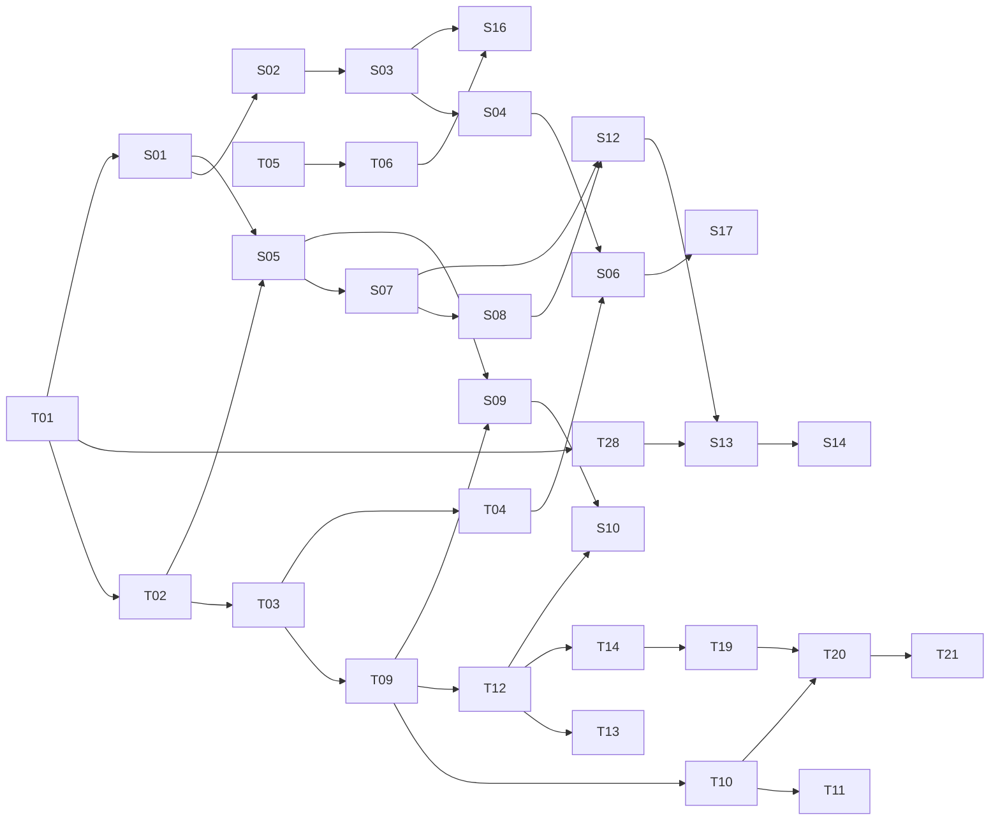

# Curriculum Benchmark: "Find Your Pitch" (MercuryPitch theory and singing series)

Research date: 2026-10-16. Scope: benchmark theory syllabi, singing curricula, interactive lesson formats and
YouTube education series, then derive (a) topic graphs with prerequisites, (b) a Season 1 order, (c) the web
lesson page pattern, (d) the video episode template.

Method: web search and page fetches; YouTube playlist and channel pages were parsed directly for exact episode
durations (watch pages were bot-blocked, so per-video descriptions and chapter lists were not readable); the
RCM 2019 Voice Syllabus PDF and the Arneson voice-exercise guide PDF were read in full text; the Guo et al.
(2014) MOOC paper was read in full text. Repository context read (not modified): the existing Lesson 1 script
and brief in `output/motion/lesson-01/`, the in-app guided path in `src/features/path/path-content.ts`, and
the exercise list in `src/features/exercises/`.

Confidence notes up front:

- Not found or not verifiable: an Andrew Huang video called "music theory in 16 minutes" (the widely shared
  one is "Learn music theory in half an hour", 2019, about 31 minutes); an app called "Erato" (no trace in
  App Store or web results; possibly a misremembered name); a Melodics voice course (Melodics covers keys,
  pads and drums only); a Music Matters free beginner playlist order (their graded sequence is in paid
  courses); a 12tone official "basics" order beyond the "Building Blocks" playlist; the full official Learning
  Synths chapter list (the site is JS-only).
- Open Music Theory's Pressbooks site returned HTTP 403; the chapter list below comes from the LibreTexts mirror
  of the 2nd edition.
- Third-party comparison tables (for example ABRSM vs Trinity) are flagged where used.

---

## 0. Decision summary

1. **Order by sound, not by symbol.** The benchmarks split into two families. Notation-first syllabi (ABRSM,
   Trinity, musictheory.net, Open Music Theory, Coursera Edinburgh) open with the staff, clefs and note values.
   Sound-first courses (Ableton Learning Music, Hooktheory, David Bennett's paid course, 12tone Building Blocks)
   open with hearing and making, and push the staff late or replace it with relative notation. MercuryPitch's
   native representation is a live pitch line (a piano roll), which is the same choice Hooktheory and Ableton
   made. Season 1 should teach by ear and pitch line and leave staff notation for Season 2.
2. **The core theory spine is near-universal:** pitch and octave, then twelve notes (half and whole steps),
   major scale, scale degrees, intervals, minor, triads, diatonic chords and function, progressions and
   cadences, then sevenths, inversions, modes, secondary and borrowed chords. Rhythm floats: first (Ableton),
   alongside pitch (ABRSM Grade 1), mid-course (Coursera week 3), or late (David Bennett lessons 8 to 9).
3. **The singing spine is also consistent:** posture and tension release, breath, onset, pitch matching,
   sustain, glides, range, intervals and scales, registers, resonance, vowels, diction, legato and phrasing,
   agility, dynamics, vibrato, style. Exam boards (RCM) teach singers leaps in the order thirds, fifth, fourth,
   octave, sixths, and only then seconds as an identification item, which matches Kodaly's sol-mi start.
4. **The two-mascot format is itself an evidence-backed choice.** Muller et al. (2008) found that a
   student-tutor dialogue that voices and then refutes misconceptions beat a clear lecture (effect sizes 0.83
   for dialogue, 0.79 for refutation). Orange Merc voicing the intuitive wrong answer and blue Merc resolving it
   is that condition. Keep it in every episode and every web lesson.
5. **Episode length:** the closest benchmark for a curriculum series is 3Blue1Brown's "Essence of linear
   algebra" (16 chapters, 4:27 to 17:16, median 11:34). Lesson 1 is 4:19. Target 6 to 9 minutes for Season 1,
   cap at 10, and let tiny topics run 4 to 5 minutes, as 3Blue1Brown did for its short "footnote" chapters.
6. **Web lesson page:** copy Ableton's tiny-page rhythm (one toy per step, 50 to 200 words, "Try changing...",
   N of M counter), Ciechanowski's "playable thing before explanation" opening and text-demo-text alternation,
   Brilliant's "question before procedure" with immediate feedback, 3Blue1Brown's lesson-page epigraph, in-page
   questions and one-sentence challenge, and The Pudding's pitch traces against a reference with click-to-play.
7. **Season 1 = 14 lessons**, alternating theory and voice after the two opening theory lessons, built so each
   episode's closing question is the next episode's cold open (Lesson 1 already does this).

---

## 1. Theory syllabi and sequences

### 1.1 ABRSM and Trinity theory grades 1 to 5

Source: a third-party side-by-side table at My Music Theory
(https://mymusictheory.com/exam-boards/abrsm-v-trinity-syllabus-comparison/), which itself warns that it
contains some inconsistencies; supplemental grade summaries from course vendors
(https://mymusictheory.com/?p=29475, https://courses.mymusictheory.com/courses/grade-1-course-pdf-abrsm). Both
syllabuses are cumulative.

| Grade | ABRSM new content (condensed)                                                                                                                                                                                                      | Trinity new content (condensed)                                                                                                                                                                                               |
| ----- | ---------------------------------------------------------------------------------------------------------------------------------------------------------------------------------------------------------------------------------- | ----------------------------------------------------------------------------------------------------------------------------------------------------------------------------------------------------------------------------- |
| 1     | Treble and bass clefs; semibreve to semiquaver; 2/4, 3/4, 4/4; C, G, D, F major; major scales; tones and semitones; accidentals; ties; single dots; intervals above the tonic by number; tonic triads; degrees of the scale; terms | Treble and bass; semibreve to quaver; 2/4, 3/4, 4/4, common time; C, G, F major; tones and semitones; intervals by number (no 6ths, 7ths); tonic triads, chord symbols, Roman numerals, arpeggios; circle of fifths; ostinato |
| 2     | 2/2, 3/2, 4/2, 3/8; A, Bb, Eb major; A, E, D minor; harmonic minor; triplets                                                                                                                                                       | Semiquaver; A, E, D minor; harmonic and natural minor; compose a melody to a rhythm; intervals M/m 2nd and 3rd, P4, P5, octave; first inversion; syncopation; sequences; voice ranges                                         |
| 3     | Demisemiquaver; 6/8, 9/8, 12/8; keys to 4 sharps or flats; melodic minor; transposition treble to bass; intervals by number and type                                                                                               | 6/8, 9/8, 12/8; melodic minor; bass line composition; M/m 6th and 7th; dominant triads; second inversion; perfect cadence; SATB; anacrusis; similar and contrary motion                                                       |
| 4     | Breve; alto clef; 2/8 to 12/4; chromatic scale; intervals above any note; dominant and subdominant triads; double dots; duplets; enharmonics; ornaments; orchestral instruments                                                    | Alto clef; 5/8, 7/8, 5/4; chromatic scale; augmented 4th, diminished 5th; dominant 7ths; plagal cadence; modulation; enharmonics; passing notes; form sections                                                                |
| 5     | Tenor clef; irregular meters; all keys; compound intervals; supertonic chords; inversions; cadences; full orchestral and voice knowledge                                                                                           | Tenor clef; pentatonic major; all intervals within the octave; supertonic triads; imperfect cadence; accented passing and auxiliary notes; strophic, verse and refrain, binary forms                                          |

Takeaways: both boards put notation and pitch-reading in Grade 1, which is the right call for an exam about
reading; Trinity front-loads functional ideas (chord symbols, Roman numerals, circle of fifths) earlier than
ABRSM. Neither is ear-first.

### 1.2 musictheory.net lesson order

Source: https://www.musictheory.net/lessons

1. The Basics: staff, clefs and ledger lines; note duration; measures and time signature; rest duration; dots
   and ties; steps and accidentals.
2. Rhythm and Meter: simple and compound meter; odd meter.
3. Scales and Key Signatures: major scale; minor scales; scale degrees; key signatures; key signature
   calculation.
4. Intervals: generic; specific; writing; inversion.
5. Chords: introduction; triad inversion; seventh chords; more sevenths; seventh inversion.
6. Diatonic Chords: diatonic triads; Roman numerals (triads); diatonic sevenths; Roman numerals (sevenths);
   composing with minor scales; voicing; analysis "O Canada".
7. Chord Progressions: nonharmonic tones; phrases and cadences; circle progressions; common progressions;
   first and second inversion triads; analysis "Auld Lang Syne".
8. Neapolitan Chords: building; using; analysis "Moonlight Sonata".

Format: one concept per slide-like page, step-through animation, paired drills (separate exercise pages).
Notation-first, then scales, then intervals, then chords.

### 1.3 Open Music Theory (Gotham et al., 2nd ed.) Fundamentals

Source (mirror): https://human.libretexts.org/Bookshelves/Music/Music_Theory/Open_Music_Theory_2e_(Gotham_et_al.)/01%3A_Fundamentals
(original Pressbooks: https://viva.pressbooks.pub/openmusictheory/, 403 to our fetcher). The book states that
each Fundamentals chapter assumes the preceding ones.

1.1 Introduction to Western Musical Notation; 1.2 Notation of Notes, Clefs, and Ledger Lines; 1.3 Reading
Clefs; 1.4 The Keyboard and the Grand Staff; 1.5 Half Steps, Whole Steps, and Accidentals; 1.6 American
Standard Pitch Notation; 1.7 Other Aspects of Notation; 1.8 Notating Rhythm; 1.9 Simple Meter and Time
Signatures; 1.10 Compound Meter and Time Signatures; 1.11 Other Rhythmic Essentials; 1.12 Major Scales, Scale
Degrees, and Key Signatures; 1.13 Minor Scales, Scale Degrees, and Key Signatures; 1.14 Introduction to
Diatonic Modes and the Chromatic "Scale"; 1.15 Intervals; 1.16 Triads; 1.17 Seventh Chords; 1.18 Inversion and
Figured Bass; 1.19 Roman Numerals and SATB Chord Construction; 1.20 Texture.

Later parts (top level, v2): Counterpoint and Galant Schemas; Form; Diatonic Harmony, Tonicization, and
Modulation; Chromaticism; Jazz; Popular Music; 20th and 21st Century Techniques; Twelve-Tone; Orchestration;
Rhythm and Meter. The v1 GitHub edition (https://openmusictheory.github.io/contents.html) orders Fundamentals
as: basic notation, meter, protonotation, rhythmic values, beams and borrowed divisions, pitches, scales and
scale degrees, key signatures, intervals, triads and seventh chords, types of motion.

### 1.4 Coursera "Fundamentals of Music Theory" (University of Edinburgh)

Source: https://www.coursera.org/learn/edinburgh-music-theory

1. Pitches, Scales, Modes and Chords: musical notes; octaves; more on scales; introduction to chords; primary
   chords; rudiments of duration notation.
2. Keys, Minor Scales, Intervals and Clefs: sharps and flats; keys and key signatures; minor keys; intervals;
   ledger lines and clefs.
3. Rhythm and Form: musical time, how we feel it; concepts; notating rhythm; counting subdivisions; dots and
   ties; metre and time signatures; phrase and form.
4. Harmony 1, Functional Harmony: listening to triads; triads and scales; building triads; harmonising a
   melody; seventh chords.
5. Harmony 2: inversions; cadences; chord names; common progressions; modulation.
6. Harmonic analysis practice (Bach Prelude in C) and final exam.

Notable: pitch and octave come first, and chords appear in week 1 ("primary chords") before intervals are
formalised, and rhythm waits until week 3.

### 1.5 Ableton "Learning Music" and "Learning Synths"

Sources: https://learningmusic.ableton.com/, sample lessons
https://learningmusic.ableton.com/make-beats/make-beats.html,
https://learningmusic.ableton.com/notes-and-scales/keys-and-scales.html,
https://learningmusic.ableton.com/chords/1-5-6-4.html

Chapters in order: Get started; Beats (make beats, what are these sounds, beat and tempo, tempo and genre,
backbeats, bars, rock and house, "We Will Rock You", "Single Ladies", play with beats); Notes and scales
(explore pitch, patterns with pitch, keys and scales, minor scales, adding more notes, play with notes and
scales); Chords (make chords, major triads, minor triads, two songs, 1-5-6-4, play with chords); Basslines;
Melodies; Song structure; The playground; Advanced topics (building major and minor scales, modes,
pentatonic, whole tone, octatonic, pelog, 19-tone, diatonic triads, triads in every key, inversions, voicings,
sevenths); Where to go from here.

Interaction pattern (measured on sample pages):

- Each lesson page is tiny: about 57 words on "1-5-6-4", about 185 words on "Keys and scales", two sentences on
  "Make beats".
- One interactive toy per page: an editable grid (piano-roll or drum grid) or toggleable pattern boxes.
- A single imperative: "Try changing (or even just reordering) these chords and listen to how the balance of
  tension and release changes."
- Real-song anchors as whole lessons ("We Will Rock You", "Get Up, Stand Up").
- Every chapter ends with a "Play with ..." free-play lesson.
- Navigation: chapter menu, "N/M" breadcrumb, Previous and "Next: <title>" links, "Reset all lessons", 18 to
  19 languages, no account.

Learning Synths (https://learningsynths.ableton.com/; reviews at
https://routenote.com/blog/learn-how-to-use-synths-with-this-fun-free-website-from-ableton/ and
https://musicteachermagazine.co.uk/articles/tech-column-playground-duty): a step-by-step interactive
explanation (oscillators, envelopes, filters, LFOs, recipes) plus a playground you can jump to from any point,
playable with a computer keyboard or pointer.

### 1.6 Hooktheory I and II

Sources: https://www.hooktheory.com/books, https://www.hooktheory.com/books/two

Hooktheory I: Building Blocks (major scale, relative notation, chords, chords and melody); Harmony I (I chord as
home base, basic chord function, vi); Melody (meter, stable vs unstable scale degrees, rhythmic patterns,
melodic themes); Harmony II (iii, ii); Inversions (I6, V6, cadential 6/4). 88 audiovisual song examples, 41
exercises, uses "relative notation" (scale-degree and chord-function based, readable without staff
literacy), linked to the Hookpad sketchpad.

Hooktheory II: Seventh Chords; Secondary Chords (V of V, V of IV, V of vi); Embellishments (extended chords,
add9, suspensions, V11); Creative Techniques (energy control, deception, harmonic scope); Songs in Minor;
Modes and Modal Mixture (Dorian, Mixolydian, borrowed chords, other modes). 228 examples, 83 exercises.

Takeaway: Hooktheory teaches scale degrees and chord function before anything else and never needs the staff.
That is the closest match to a pitch-line app.

### 1.7 Chrome Music Lab

Sources: https://musiclab.chromeexperiments.com/, open-source repo
https://github.com/googlecreativelab/chrome-music-lab (folders: arpeggios, chords, harmonics and strings,
melody maker, piano roll, sound spinner, sound waves, spectrogram), press coverage
https://9to5google.com/2016/03/09/chrome-music-lab/, https://www.techlearning.com/news/learning-music-art-science-math-and-more-with-chrome-music-lab

Experiments (about 13 to 14 depending on date): Song Maker, Rhythm, Spectrogram, Sound Waves, Arpeggios,
Kandinsky, Voice Spinner, Harmonics, Piano Roll, Oscillators, Strings, Melody Maker, Chords, Shared Piano.
Each is a single toy with no text, no lesson order, and no prerequisite structure. Value for us: the
"one toy, one idea" granularity, and several map directly onto Season 1 visuals (Sound Waves for Lesson 1,
Harmonics and Spectrogram for the vowels lesson, Chords for major and minor).

### 1.8 YouTube theory series ordering

Durations below were parsed from the live playlist pages on 2026-10-16.

**12tone "Building Blocks"** (https://www.youtube.com/playlist?list=PLMvVESrbjBWplAcg3pG0TesncGT7qvO06), 15
episodes, 2:51 to 5:00 each:
What's A Note? (2:51); Writing Music Down (3:09); How Notes Relate (3:24); What's A Scale? (3:03); The Circle
Of Fifths (4:27); What's A Chord? (2:59); Functional Harmony (4:30); The Job Of A Chord (4:21); Writing A
Progression (3:32); Functional Harmony In Minor (4:08); Changing The Key (3:23); Borrowing Chords (4:05); The
Modes (5:00); Secondary Dominants Revisited (4:06); Tritone Substitutions (3:34). The channel's long-form
"Understanding Music" playlist has 91 videos.

**Signals Music Studio "New to Music Theory? Start here!"**
(https://www.youtube.com/playlist?list=PLTR7Cy9Sv2871cnw9sw6p968TL1JE8J3s), 10 lessons, songwriting-first:
diatonic chord progressions (12:20, 2.3M views); chords and songs in minor (14:24); scale degrees (4:35);
motifs and chords (16:16); sevenths in progressions (17:57); relative modes (5:24); all 7 modes in parallel
(16:05); every mode with one shape (17:04); secondary dominants (11:38); intervals (12:40, added later).
Note the order: progressions first, intervals last.

**David Bennett.** Paid course order (https://www.artmaster.com/course/music-theory): 1 introduction and
finding notes on the piano; 2 major scales (TTSTTTS); 3 triads; 4 chord progressions (Roman numerals, the Axis
progression, 12-bar blues); 5 seventh chords; 6 minor scales; 7 pentatonic and blues; 8 notation (values,
rests, dots); 9 time signatures (4/4, 3/4, 5/4 with songs); 10 stave and clef, key signatures. Free YouTube
"Welcome to Music Theory!!" course playlist
(https://www.youtube.com/playlist?list=PLlx2eo2tD6Kpm4UFmz7VWAe11NRyyIpNc): 18 Rhythms (18:48), 1 Chord
Progression 5 Levels (11:19), Learn music theory in 29 minutes (30:40), US vs UK theory (16:33), 101 terms
(29:17), Music Theory Iceberg (43:09), Why Does Music Only Use 12 Different Notes? (17:41, 2.5M). His "Crash
Course" playlist adds "Music theory concepts ranked by importance (tier list)" (30:24, 1.1M), "4 levels of the
Circle of Fifths" (13:39) and "The Modes Ranked by Brightness" (14:38).

**Andrew Huang.** No "16 minutes" video found; "Learn music theory in half an hour" (2019, about 31 minutes,
announced at https://x.com/andrewhuang/status/1177949940489822211) is the widely shared one, framed as theory
for making your own songs (https://hellomusictheory.com/learn/best-music-theory-youtube-channels/).

**Music Matters** runs a step-by-step graded sequence only in paid ABRSM-aligned courses; the free channel is
tips and snippets (https://hellomusictheory.com/learn/best-music-theory-youtube-channels/).

**Adam Neely** is advanced and essayistic; his playlists are thematic ("How to get good at music", "New
Horizons in Music", Q and A), not a beginner order.

### 1.9 Cross-source synthesis (theory)

- Universal first idea: what a note is (pitch and octave). Coursera, 12tone, OMT 1.4 and David Bennett all
  open there or immediately after notation.
- Universal second idea: half and whole steps (semitones and tones) and the keyboard.
- Major scale always precedes intervals-with-quality; scale degrees sit right next to the major scale.
- Triads arrive either right after the major scale (Bennett, Coursera, Hooktheory) or after intervals
  (musictheory.net, OMT). The sound-first courses get to chords and progressions early because that is where
  music becomes recognisable; the "four chord" progression is a lesson in Ableton, Bennett and Signals.
- Minor comes after major everywhere, usually right after intervals or right after triads.
- Circle of fifths placement varies widely (Trinity Grade 1; 12tone episode 5; Bennett late). It is a
  key-signature tool and can wait.
- Staff notation is the biggest split. For a singing app whose screen already shows a pitch line, delaying
  the staff costs nothing and removes the commonest beginner barrier.

---

## 2. Singing curricula

### 2.1 Teacher pedagogy baseline (Arneson; Titze)

Source: Christopher Arneson, "A Basic Guide to Vocal Exercises for Beginning Singing Teachers"
(https://www.rider.edu/sites/default/files/docs/voiceteacher-basic_guide_for_beginning_teachers.pdf).

- "All voice teachers agree" technique must address: posture and alignment, respiration, phonation,
  registration, resonation and articulation.
- Areas most often trained with exercises: onset, placement, resonance, breath support, phrasing, legato,
  staccato, agility, range, vowel clarity, consonants, intonation, coordination of registers.
- First order of business: prephonatory work, releasing tension (jaw, tongue, neck) and alignment.
- Onset: repeated notes with a breath between; aspirate [h] staccato moving to an "imaginary" [h].
- Placement and resonance: nasal consonants, [e] and [i], humming, "m-hmm", [ng].
- Breath management: pulsed repeated notes, staccato, messa di voce, lip trills.
- Legato: glissandi first, then skips with slurs.
- Registers: work just above or below the break; two-note slow moves; closed vowels at the passaggio;
  descending arpeggios from head voice; sirens.
- Typical teaching sequence: "posture, respiration, phonation, resonance, support, registration,
  articulation."
- Titze's "five best vocal warm-up exercises" (NATS Journal of Singing 57(3), 2001, as cited by Arneson): lip or
  tongue trill; two-octave pitch glides; forward tongue roll and extension; messa di voce; staccato arpeggios.

Semi-occluded vocal tract (straw, lip trill) evidence is supportive but small and mixed (Titze 2006 rationale;
randomised trials in healthy adults and dysphonia patients, e.g. https://pubs.asha.org/doi/10.1044/2017_JSLHR-S-17-0017,
https://pmc.ncbi.nlm.nih.gov/articles/PMC4610291/). Present it as a gentle, widely used warm-up, not a proven
cure.

### 2.2 Estill Voice Training

Sources: https://en.wikipedia.org/wiki/Estill_Voice_Training, course listings such as
https://www.estillvoice.com/find-a-course?id=43, German overview https://www.bonedo.de/artikel/estill-voice-training-evt/

- Level One, "Figures for Voice": 13 structures trained for independent control: true vocal folds onset and
  offset; false vocal folds; true vocal folds body-cover; thyroid cartilage; cricoid cartilage; larynx
  height; velum; aryepiglottic sphincter; tongue; jaw; lips; head and neck anchoring; torso anchoring.
- Level Two, "Figure Combinations": recipes for six qualities: speech, falsetto, sob, twang, opera, belting.
- Onset types taught: aspirate, smooth (simultaneous), glottal.
- Lesson for us: Estill is anatomy-first and too granular for beginners, but three figures map cleanly to
  beginner lessons: onset (balanced start), thyroid tilt and body-cover (registers, thin vs thick folds), and
  aryepiglottic narrowing (twang, a brightness and efficiency tool).

### 2.3 Complete Vocal Technique (CVT)

Source: https://completevocalinstitute.com/complete-vocal-technique/

- Three overall principles: support; necessary twang; avoid protruding jaw and tightened lips.
- Four modes, defined by "metal": Neutral (non-metallic, includes breathy and falsetto variants), Curbing
  (half-metallic, restrained), Overdrive (full metal, shouty), Edge (full metal, sharp, formerly "belting").
- Sound colour shaped by the vocal tract (epiglottic funnel, larynx position, tongue, mouth, soft palate,
  nasal passages), each trained separately before combining.
- Ten effects (distortion, creak, rattle, growl, grunt, screams, intentional breaks, air, vibrato, runs).
- Implied order: principles, then modes at foundation level, then colour, then effects. Pain or discomfort
  means the technique is wrong.
- Lesson for us: a style lesson (Season 2) can use CVT's "everyday sound" anchors (lullaby, moan, shout "hey")
  without the jargon.

### 2.4 Royal Conservatory of Music voice syllabus (2019)

Source: https://teacherportal.rcmusic.com/getattachment/67afd37c-19d9-4016-85d5-9bb6163cba53/syllabus-voice-2019.pdf
(read in full text).

| Level       | Technical tests (unaccompanied, on vowels)                                  | Intervals to identify and sing                   | Sight-singing                                     |
| ----------- | --------------------------------------------------------------------------- | ------------------------------------------------ | ------------------------------------------------- |
| Preparatory | Major five-note scale; major triad                                          | none (singback on first three scale notes)       | 2-bar stepwise melody, C major, tonic to dominant |
| 1           | Major and minor five-note scales; major and minor triads                    | minor 3rd, major 3rd                             | 2-bar stepwise                                    |
| 2           | Triad with descending scale; 3rds exercise; major and minor arpeggios       | adds perfect 5th                                 | 4-bar, step or skip, C and F                      |
| 3           | Major scale; natural minor; arpeggios; chromatic scale                      | adds perfect 4th                                 | 4-bar with 2nds, 3rds, 5ths; C, G, F              |
| 4           | Harmonic and melodic minor; broken-triad exercise; chromatic                | adds perfect octave                              | 4-bar with up to 5ths; full-octave range          |
| 5           | Adds interval exercise, legato and staccato arpeggio, dominant 7th exercise | adds minor and major 6th                         | four-note chord context                           |
| 6           |                                                                             | adds minor and major 2nd as identification items |                                                   |

Ear tests at every level: clapback (rhythm), chord quality (major or minor from Preparatory), singback of a
short melody (three notes at Preparatory, five at Level 1, up to eight at Level 5). Two contrasting memorised
songs from Preparatory.

Takeaways: a sung curriculum starts with five-note stepwise patterns and the triad, introduces leaps as thirds
first, then fifth, fourth, octave, sixths. Chord-quality listening (major or minor) is a Preparatory skill,
which supports putting major vs minor in Season 1.

### 2.5 ABRSM singing

Sources: https://www.chimesmusic.com/latest/abrsm-singing-for-musical-theatre-grade-1,
https://www.newschool.ie/wp-content/uploads/2018/08/Your-Guide-to-ABRSM-Music-Exams.pdf

Singing for Musical Theatre Grade 1: three accompanied songs (Lists A, B, C) plus one unaccompanied song, all
from memory; sight-singing with the piano doubling the melody at Grades 1 to 2; aural tests from the piano
(pulse, echo-singing, features). The classical singing syllabus also includes an unaccompanied traditional
song. The structure (perform, sing unaccompanied, sight-sing, aural) is a useful map for what "can sing" means
at the first level.

### 2.6 Kodaly order

Sources: https://en.wikipedia.org/wiki/Kod%C3%A1ly_method, https://dynamicmusicroom.com/kodaly-method-first-interval,
https://wichita.edu/academics/fine_arts/music/kodaly/documents/G_2009_Wichita_A_KODALY_SEQUENCE_FINAL.pdf

Starts with the minor third sol-mi, then adds la, do, re (pentatonic) before fa and ti, because children
struggled to sing half steps in tune and to manage wide ranges. Movable do (syllables encode function).

### 2.7 Apps and commercial programs

- **Yousician singing** (https://americansongwriter.com/yousician-singing-review/, help centre
  https://support.yousician.com/hc/en-us/articles/360000550025-How-the-singing-learning-path-works): linear
  path of missions (songs, video tutorials, games); five levels in Singing and Knowledge. First exercises: glide
  up to a note and hold it (synth guide tone), two- and three-note runs echoed after a guide, find lowest and
  highest notes, a short three-note song. Learn tab groups: resonance, knowledge, breathing, pitch, rhythm,
  performance. Games: "Note Catcher" (sing to steer), "Chase the Notes" (echo segments with pitch shown).
- **Singing Success 360 Quick Start** (https://singingsuccess.teachable.com/courses/60152): three principles,
  then: humming 5-tone scale; lip rolls 5-tone; "goo" long scale; vocal fry "ng" 9-note scale; "nay" octave
  arpeggio; "wee" head-voice Rossini scale; "mum" scale; introduction to style and psychology; descending
  triplets slow to fast; major pentatonic pattern. Male and female versions of every exercise; lessons unlock
  by day.
- **Singing Carrots "From Zero to Singing Hero"** (https://singingcarrots.com/docs/from-zero-to-singing-hero):
  onboarding with range test, pitch-accuracy test and stats; Week 1 breathing (inhalation, controlled
  exhalation, combine); Week 2 pitch and intonation (half and whole steps, major thirds and fifths, octaves
  and scales, each with a familiar song); Week 3 resonance (chest, head, mix); Week 4 registers and the break
  (awareness, smooth transitions, twang). Re-test range and accuracy at the end of every week; before and after
  video.
- **Simply Sing** (https://screensdesign.com/showcase/simply-sing-my-singing-app,
  https://preply.com/en/blog/best-singing-learning-apps/): song-first; multi-step vocal range test at onboarding,
  then songs transposed to the singer's range, difficulty tiers Basic to Extreme. More practice tool than
  course.
- **Melodics**: no voice product found (keys, pads, drums only; https://melodics.com/how-it-works).
- **Erato**: not found under that name in app stores or the web.

### 2.8 Short-course syllabi ("Singing 101")

- University of Oxford, Learn to Sing: Vocal Technique, 10 weeks
  (https://lifelong-learning.ox.ac.uk/courses/learn-to-sing-vocal-technique): inhale; use the breath;
  resonance; vowels; repertoire; consonants; tone colour and expression; repertoire; preparing a song;
  repertoire.
- Musicians Institute, Vocal Fundamentals, 4 weeks (https://www.mi.edu/mi-online/short-courses/vocal-fundamentals/):
  practice habits, physiology, pitch matching, breathing, warm-ups; vocal health, registers, range discovery;
  diction, five vowels, other languages; tone, timbre, resonance, breath support, a whole song.
- Sydney Community College, 8 weeks (https://www.sydneycommunitycollege.edu.au/course/SGBO): breathing, posture,
  vowels, jaw and tongue, registers, pitch matching and intervals, optional performance.

### 2.9 Research facts usable as hooks (all verified to abstract or full text)

- Pfordresher and Brown (2007), Music Perception 25(2): 95 to 115
  (https://www.acsu.buffalo.edu/~pqp/pdfs/Pfordresher&Brown_2007_MP.pdf): in a survey of 1,105 students, 59%
  said they could not imitate melodies by singing; in the experiments only 10 to 15% were poor-pitch singers
  (one semitone or more off), and those did not perceive pitch worse than good singers. The problem is mapping
  pitch onto vocal action, not hearing.
- Dalla Bella, Giguere and Peretz (2007), JASA 121(2) (https://pubmed.ncbi.nlm.nih.gov/17348539/): 62
  occasional singers; only a minority made many pitch errors; much of the difference was tempo; at a slow tempo
  most sang in tune.
- Breathing: the diaphragm is an inspiratory muscle; expiratory force for singing comes from the abdominal wall
  and other muscles (Hixon 2006 as summarised by McGill's Music Performance and Body lab,
  https://sites.music.mcgill.ca/mpbs/out-of-breath/breathing-myths-debunked).
- Speaking fundamental frequency is about 120 to 125 Hz for adult men and about 200 to 250 Hz for adult women
  (https://www.iis.fraunhofer.de/en/ff/sse/mbv/prod/stimmlippenanalyse.html); Lesson 1's FACTS.md cites
  Titze (1994).
- Typical voice-type ranges (bass E2 to E4, tenor C3 to C5, alto G3 to F5, soprano higher), with large
  individual variation (https://courses.lumenlearning.com/suny-musicappreciationtheory/chapter/introduction/,
  https://human.libretexts.org/Bookshelves/Music/Music_Appreciation/Music_Appreciation_II_(Kuznetsova)/05%3A_Classification_of_Human_Voices/5.01%3A_Vocal_Types_and_Ranges).

### 2.10 Consensus "Singing 101" order

Across Arneson, Oxford, MI, Singing Carrots, Yousician, Singing Success and RCM, the de-duplicated order is:

1. What the voice is and how to keep it safe (physiology light, "never push").
2. Posture, alignment, tension release.
3. Breath: inhale low and quiet; manage the exhale ("support").
4. Onset and a steady tone.
5. Pitch matching (single note, then echo short patterns).
6. Glides and sirens (connecting pitches; lip trills and "ng" as semi-occluded warm-ups).
7. Range discovery and comfortable zone.
8. Steps (five-note scales), then leaps (thirds, fifth, octave), then arpeggios.
9. Registers and the break; smoothing the transition.
10. Resonance and brightness (twang, "ng", forward sensation).
11. Vowels (five pure vowels; shape vs pitch).
12. Consonants and diction.
13. Legato and phrasing (breath planning).
14. Dynamics (messa di voce, volume without pushing).
15. Agility (staccato, runs).
16. Vibrato.
17. Style and qualities (CVT modes, Estill qualities), performance and practice habits.

Note on existing app content: the in-app guided path "The Ascent" (`src/features/path/path-content.ts`)
already orders weeks as Foundations (Find Your Instrument), Breath and Power, Reach New Notes (range), Tuning and
Ear, Flexibility and Runs, Tone and Vibrato, Recovery. That matches the consensus above, so the series' voice
lessons can point into the matching week.

---

## 3. Interactive lesson web formats

### 3.1 Bartosz Ciechanowski (ciechanow.ski)

"Sound" (https://ciechanow.ski/sound/): opens with a playable keyboard before any explanation; sections Air,
Making Sounds, Pure Tones, Masses and Springs, Pressure Waves, Further Reading, Final Words; roughly four dozen
inline demos (sliders for frequency, amplitude, time speed; play buttons and keyboards; draggable listener
position and pluck point; draw-your-own waveform; live microphone analysis; time scrubbing). Rhythm: a short
setup, a demo with a caption saying what to adjust, then a paragraph interpreting what you saw. Warns the reader
to check volume before audio demos, slows visuals down and says when real timing differs, colour-codes parts.

"Mechanical Watch" (https://ciechanow.ski/mechanical-watch/): about 40 demos; drag to rotate 3D models; sliders
for winding, gear ratios, zoom, time speed; frame-by-frame scrubbing for fast interactions; a global pause and
resume for all animations; each section adds one part to a working whole (power, gears, escapement, balance,
mainplate, click, motion works, date, keyless works, automatic winding), then scale perspective, further
reading, final words.

Patterns: playable before explained; one variable per demo; cumulative build; global animation pause; audio
warning; slow motion with honesty about real speed; final reflection plus further reading.

### 3.2 Nicky Case

Source: https://blog.ncase.me/how-i-make-an-explorable-explanation/ (and The Evolution of Trust,
https://ncase.me/trust/).

- Start with a question the reader cares about, posed as a story or a game.
- Climb the ladder of abstraction one rung at a time from a concrete experience (drag shapes, play a round).
  "Smart the people up", do not dumb down.
- Narrative logic "this, THEREFORE that, BUT..." rather than "and then"; a counterintuitive twist every few
  minutes.
- End with a question the reader explores: a sandbox mode.

### 3.3 Bret Victor, "Explorable Explanations"

Source: http://worrydream.com/ExplorableExplanations/

- Reactive documents: numbers in prose are draggable and the text recomputes (Tangle).
- Explorable examples: let readers vary parameters and discover behaviour the author did not state.
- Contextual information: look-ups without leaving the page.
- Simulate the real system rather than plotting a formula; show several representations side by side; keep
  interactivity inside the guided argument rather than a detached sandbox.

### 3.4 Red Blob Games (Amit Patel)

Sources: https://www.redblobgames.com/pathfinding/a-star/introduction.html,
https://www.redblobgames.com/making-of/line-drawing/

- Opens with a live demo and one bold instruction ("move the start and the goal").
- Per-section rhythm: short explanation, bold instruction to interact, code or rule that matches the figure,
  interpretation paragraph.
- Controls: drag the inputs, never the outputs; scrubbable numbers; play and step-through for processes;
  side-by-side comparisons; mode toggles.
- Craft rules: handles must look draggable (cursor, shadow); large invisible hit areas; bounded drags; consistent
  control size for touch; give handles visual priority; anchor links per section.

### 3.5 Distill (Hohman, Conlen, Heer, Chau, 2020)

Source: https://distill.pub/2020/communicating-with-interactive-articles/ (also
https://distill.pub/2017/research-debt/ on interpretive labour).

Five affordances: connecting people and data; making systems playful; prompting self-reflection;
personalising reading; reducing cognitive load. Concrete guidance:

- Scrollytelling and step-based slideshows were both preferred to static articles; comprehension was better in
  slideshow layouts; mobile may need swipe navigation.
- Prediction prompts (NYT "You Draw It": draw the line before the data is revealed).
- Low-stakes quizzes with feedback (retrieval practice); optional spaced repetition.
- Segmenting with play, pause and scrub controls so readers set the pace.
- Details on demand (tooltips, selectable diagram parts, stretchtext).
- Multiple representations; avoid redundancy between narration and on-screen text.
- Self-explanation helps; social comparison of predictions did not clearly help recall.
- Costs: interactive articles are expensive, fragile over time, and hard to make accessible; not everything
  needs interactivity.

### 3.6 The Pudding

Sources: https://www.storybench.org/?p=8613 (how The Pudding structures visual essays), https://pudding.cool/2024/02/anthems/

- Visual essays carry the narrative with data and design, sparse text, clear conclusions; shape varies per story
  (narrowing "V", inverted "V"); personalised entry points (your own city).
- Most relevant precedent, "The Diva Score" national anthem piece: an audio-enable prompt; two contrasting
  performances as the hook; pitch lines transposed to a common key; one scroll section per phrase (16) with
  pitch traces against a standard reference; click a singer's headshot to play that phrase; commentary on
  scoops, vibrato and doubled-back phrases; comparison charts; a sortable heatmap; a methodology section (melody
  extraction, hand-cleaned, Dynamic Time Warping). This is exactly the visual vocabulary of MercuryPitch's pitch
  canvas, proven at publication quality.

### 3.7 Brilliant

Source: https://brilliant.org/resources/choosing-brilliant/how-brilliant-teaches-math/

- Ask a question before presenting a procedure; the attempt gives the explanation a purpose.
- One small idea per section, simplest useful case first, complexity added gradually.
- Concrete manipulable objects before formal notation.
- Feedback while reasoning is fresh, answering "where am I going, how am I doing, what next".
- Mistakes treated as information; low stakes.
- Practice with scaffolds removed afterwards (retrieval, interleaving, spacing). No videos.

### 3.8 3Blue1Brown lesson pages (the video's twin on the web)

Sources: https://www.3blue1brown.com/lessons/vectors, https://www.3blue1brown.com/lessons/span,
https://www.3blue1brown.com/lessons/determinant

Each video exists as a text lesson: epigraph quote at the top (Weyl, Rodgers, Hamming); a recap; 3 to 6 headed
sections; embedded multiple-choice questions and "reveal" prompts; a closing one-sentence challenge ("can you
explain why in just one sentence?"); a "next lesson" card that teases the next topic. This is the direct
precedent for a paired video plus web lesson.

### 3.9 Pattern table

| Pattern                                   | Who does it                                      | Evidence                                  | Use in MercuryPitch lessons                                   |
| ----------------------------------------- | ------------------------------------------------ | ----------------------------------------- | ------------------------------------------------------------- |
| Playable before explained                 | Ciechanowski, Red Blob, Nicky Case, Ableton      | Brilliant's "question before procedure"   | Cold-open toy above the fold: tap to hear the puzzle          |
| Predict, then reveal                      | NYT You Draw It, Brilliant, Lesson 1 script      | Distill review; self-explanation evidence | Tap a prediction (same note or different?) before audio plays |
| Voice the misconception, then refute      | Veritasium, Muller dialogue                      | Muller et al. 2008: d = 0.79 to 0.83      | Orange Merc's guess card, blue Merc's answer                  |
| One toy per step, tiny text               | Ableton, Chrome Music Lab                        | Mayer segmenting and coherence            | 50 to 120 words plus one visual per step                      |
| Bold "Try:" instruction                   | Red Blob, Ableton                                | Signalling                                | Each toy carries exactly one imperative                       |
| Drag inputs, not outputs                  | Red Blob, Victor                                 |                                           | Drag frequency or interval; pitch line responds               |
| Scrubbable numbers in prose               | Victor (Tangle), Red Blob                        |                                           | "Double [220] Hz and you get [440] Hz"                        |
| Play, pause, scrub, slow motion           | Ciechanowski, Distill                            | Segmenting                                | Every animated visual has a scrubber and 0.25x                |
| Global pause, audio warning               | Ciechanowski, Pudding                            | Accessibility                             | One sound gate; one "pause all motion" toggle                 |
| Pitch traces vs reference, click to hear  | Pudding anthems                                  |                                           | The learner's own trace against Merc's target                 |
| Cumulative build to a whole               | Ciechanowski watch, 3Blue1Brown                  | Ladder of abstraction                     | Line to spiral to piano (Lesson 1), repeated per lesson       |
| Step slideshow over free scroll on mobile | Distill review                                   | Better comprehension                      | Sticky stage with step cards; swipe on phones                 |
| Retrieval quiz with explanatory feedback  | Brilliant, 3Blue1Brown, Distill                  | Retrieval practice                        | Three questions, answer explained in one line                 |
| Sandbox ending                            | Ableton "Play with", Nicky Case, Learning Synths |                                           | "Playground" toy at the end of each lesson                    |
| One-sentence challenge plus next teaser   | 3Blue1Brown                                      | Curiosity gap                             | Final card: challenge question and next hook                  |
| Chapter menu, N of M, reset               | Ableton                                          |                                           | Lesson explorer plus per-lesson step counter                  |

---

## 4. YouTube education series structures

Durations parsed from playlist and channel pages on 2026-10-16.

### 4.1 3Blue1Brown

"Essence of linear algebra" (https://www.youtube.com/playlist?list=PLZHQObOWTQDPD3MizzM2xVFitgF8hE_ab), 16
chapters:

| Ch  | Title                                                    | Length |
| --- | -------------------------------------------------------- | ------ |
| 1   | Vectors                                                  | 9:52   |
| 2   | Linear combinations, span, and basis vectors             | 9:59   |
| 3   | Linear transformations and matrices                      | 10:59  |
| 4   | Matrix multiplication as composition                     | 10:04  |
| 5   | Three-dimensional linear transformations                 | 4:46   |
| 6   | The determinant                                          | 10:03  |
| 7   | Inverse matrices, column space and null space            | 12:09  |
| 8   | Nonsquare matrices as transformations between dimensions | 4:27   |
| 9   | Dot products and duality                                 | 14:12  |
| 10  | Cross products                                           | 8:54   |
| 11  | Cross products in the light of linear transformations    | 13:10  |
| 12  | Cramer's rule, explained geometrically                   | 12:12  |
| 13  | Change of basis                                          | 12:51  |
| 14  | Eigenvectors and eigenvalues                             | 17:16  |
| 15  | A quick trick for computing eigenvalues                  | 13:13  |
| 16  | Abstract vector spaces                                   | 16:46  |

Median 11:34; range 4:27 to 17:16. Episodes lengthen as ideas deepen; short "footnote" chapters (5 and 8) are
under 5 minutes. Release cadence (TheTVDB listing, https://www.thetvdb.com/series/3blue1brown/seasons/absolute/1):
a preview "chapter 0" on 4 August 2016, then chapters 1 to 6 on six consecutive days (5 to 10 August), then
roughly weekly, ending late September. Each lesson opens with an epigraph and a recap of the previous idea, and
ends by naming the next topic ("In the next chapter we'll get into matrices and transforming space. See you
there!"); the web lesson adds embedded questions and a one-sentence challenge.

"Essence of calculus" (https://www.youtube.com/playlist?list=PLZHQObOWTQDMsr9K-rj53DwVRMYO3t5Yr): 12 chapters,
5:39 to 22:20, median 16:23. "Neural networks": 10:18 to 27:14. Recent 30 channel uploads: median 29:07 (7:58 to
60:24), so standalone flagship videos run long while series chapters stay near 10 to 17 minutes.

Grant Sanderson's stated advice for explainers (summaries of his SoME announcement,
https://3blue1brown.com/topics/some, https://rosetta.to/u/3blue1brown/2021): content over production, concrete
before abstract, pick a specific audience; the channel frames its approach as "inventing math" through
discovery (https://en.wikipedia.org/wiki/3Blue1Brown).

### 4.2 Veritasium

- Recent 30 long uploads (https://www.youtube.com/@veritasium/videos): median 33:51, range 5:08 to 58:54.
- Format: open with a counterintuitive question or popular misconception (often street interviews), then build
  to the explanation (https://en.wikipedia.org/wiki/Derek_Muller; corroborating but secondary:
  https://www.eevblog.com/forum/chat/veritasium-(yt)-the-big-misconception-about-electricity/).
- Research basis: Muller, Bewes, Sharma and Reimann (2008), "Saying the wrong thing: improving learning with
  multimedia by including misconceptions", Journal of Computer Assisted Learning 24(2): 144 to 155, DOI
  10.1111/j.1365-2729.2007.00248.x. 364 first-year physics students; refutation and dialogue conditions gave the
  largest gains (effect sizes 0.79 and 0.83 vs exposition); low-prior-knowledge students benefited most;
  high-prior-knowledge students were not disadvantaged.
- Titles and thumbnails: "Clickbait is Unreasonably Effective" (2021, about 19 minutes) argues for "legit bait"
  (enticing but accurate) and against "click traps", with iterative title and thumbnail testing
  (https://rosetta.to/person/jack-conti/2021, https://eprints.kingston.ac.uk/47719).

### 4.3 Kurzgesagt

- Recent uploads (https://www.youtube.com/@kurzgesagt/videos): median 12:49, most 9 to 18 minutes, one
  1:03:23 special.
- Process (https://www.lingq.com/nl/leer-engels-online/courses/689474/how-to-make-a-kurzgesagt-video-in-120-4887128/):
  weeks of research before writing; expert fact-checking of drafts; on average about 200 illustrated panels;
  two to three illustrators for 8 to 12 weeks; narration recorded after illustration.

### 4.4 Sebastian Lague, "Coding Adventures"

- Playlist (https://www.youtube.com/playlist?list=PLFt_AvWsXl0ehjAfLFsp1PGaatzAwo0uK), 32 videos, median 23:35.
  Early episodes (2019) ran 4:38 to 8:35; recent ones 21 to 71 minutes ("Rendering Text" 1:10:54). Includes
  audio topics: "Sound (and the Fourier Transform)" 43:31, "Analyzing Audio" 21:28, "Additive Synthesis" 35:30.
- Format: a diary of the train of thought toward a goal, mistakes kept in, calm narration
  (https://tildes.net/~comp/x14/coding_adventure_terraforming).

### 4.5 Steve Mould

- Recent 30 uploads (https://www.youtube.com/@SteveMould/videos): median 14:24, range 11:06 to 27:21; titles
  state a paradox or surprise ("The Lever Paradox", "Everyone Was Wrong About Maximum Siphon Height").
- Format: demonstrate the phenomenon on camera first, then propose and test an explanation (the chain fountain
  became a published paper; https://en.wikipedia.org/wiki/Steve_Mould).

### 4.6 Shorts and cutdowns

- All four of Veritasium, Steve Mould, Kurzgesagt and 3Blue1Brown run an active Shorts shelf (dozens on the
  first page alone). Titles are questions or curiosity statements: "When you lose weight where does it go?",
  "What If You Never Slept?", "Why clouds and foam are white", "The Phone Number puzzle".
- Several are direct cutdowns of long videos: Veritasium "The Scariest Chart In Engineering" (long: "The
  Scariest Chart in Electrical Engineering", 39:44); 3Blue1Brown "The last IMO problem AI could not solve" (long:
  51:56).
- Platform rules: Shorts can be up to 3 minutes for square or vertical uploads since 15 October 2024
  (https://www.socialmediatoday.com/news/youtube-expands-3-minute-shorts-to-all-users/736967/); a Short can
  carry one "related video" link to a video on the same channel, set in Studio (not via API)
  (https://www.socialmediatoday.com/news/youtube-previews-new-option-to-link-shorts-clips-to-longer-video-uploads/690603/,
  https://help.opus.pro/docs/article/link-shorts-to-original-video).

### 4.7 Chapters and end screens

- Chapters (https://support.google.com/youtube/answer/9884579): first timestamp 00:00, at least three, ascending,
  each at least 10 seconds; manual chapters override automatic ones.
- End screens (https://support.google.com/youtube/answer/6388789): last 5 to 20 seconds; video at least 25
  seconds; up to four elements on 16:9.

### 4.8 Learning-science constraints on video

- Guo, Kim and Rubin (2014), 6.9 million edX sessions
  (https://www.cs.rochester.edu/hci/pubs/pdfs/edX-MOOC-video-production-and-engagement_LAS-2014.pdf): median
  engagement time was at most 6 minutes regardless of video length; recommendation: segment into chunks under 6
  minutes; tutorials were watched only 2 to 3 minutes; faster speakers (up to 254 wpm) and enthusiasm increased
  engagement; talking head interleaved with visuals beat slides alone. Caveat: MOOC lectures, not YouTube
  edutainment, but it argues for chaptered, single-idea episodes and for web lessons segmented into short steps.
- Mayer's multimedia principles (https://ugc.futurelearn.com/uploads/files/7d/d6/7dd6188d-c343-4311-b064-ac98d2c95abc/Multimedia_Principles._R._E._Mayer__2020.pdf):
  coherence (cut extraneous sound and decoration), signalling, redundancy (do not caption-dump narration as
  on-screen prose in the visual area), segmenting, pre-training (name parts before using them), personalisation
  (conversational), voice.
- Voice: Mayer's classic voice effect favoured human over machine voices, but Craig and Schroeder (2017,
  Computers and Education 114: 193 to 205) found a modern TTS voice matched or beat a human voice for transfer,
  and their 2019 follow-up found no learning difference (human voice still rated more engaging and human). The
  Lesson 1 brief already plans to re-voice the scratch Kokoro narration with a final cast; that is the safer
  choice for persona and engagement.

---

## 5. Output (a): merged, de-duplicated topic graphs

Prerequisites list the minimum needed; "app" names existing MercuryPitch surfaces where practice can live.
IDs are stable references for the lesson explorer.

### 5.1 Theory graph

| ID  | Topic                                                                      | Prerequisites                  | Benchmark sources                                                          | App practice                      |
| --- | -------------------------------------------------------------------------- | ------------------------------ | -------------------------------------------------------------------------- | --------------------------------- |
| T01 | Sound and pitch: vibration, frequency, hertz; high vs loud                 | none                           | Coursera M1, OMT 1.4, 12tone BB1, Ciechanowski "Sound", Chrome Sound Waves | Pitch canvas                      |
| T02 | Octave and octave equivalence; seven letter names; octave numbers (A4, C4) | T01                            | Coursera M1, OMT 1.4 and 1.6, Lesson 1                                     | Voice Mirror                      |
| T03 | Twelve notes: semitones and tones, sharps and flats, keyboard, enharmonics | T02                            | OMT 1.5, musictheory.net Basics 6, ABRSM G1                                | Ear Lab higher or lower           |
| T04 | Cents and "in tune": 100 cents per equal-tempered semitone, tolerance      | T03                            | (product-specific; Ellis's cent)                                           | Ear Lab Hairline; long-note       |
| T05 | Pulse, beat and tempo                                                      | none                           | Ableton Beats, Coursera M3                                                 | staccato-precision, call-response |
| T06 | Meter and bars: 2, 3, 4; downbeat; backbeat                                | T05                            | Ableton Beats, musictheory.net Rhythm                                      | call-response                     |
| T07 | Note values, rests, dots, ties, subdivision                                | T06                            | ABRSM G1, OMT 1.8 to 1.11                                                  | (Season 2)                        |
| T08 | Simple vs compound meter; triplets; syncopation                            | T07                            | musictheory.net, ABRSM G2 to G3                                            | (Season 2)                        |
| T09 | Major scale: tone-tone-semitone pattern; tonic as home                     | T03                            | everywhere; Bennett L2 (TTSTTTS)                                           | scale-runner                      |
| T10 | Scale degrees and movable-do solfege; stable vs unstable degrees           | T09                            | Hooktheory I ch. 1 and 3, Signals, Kodaly                                  | sight-singing, mirror-melody      |
| T11 | Melody: contour, steps vs leaps, motifs, transposition invariance          | T10                            | Hooktheory I ch. 3, Signals "Motifs"                                       | mirror-melody, call-response      |
| T12 | Intervals by size (2nd to octave) and by sound (song anchors)              | T09                            | musictheory.net, OMT 1.15, Singing Carrots W2                              | interval-trainer                  |
| T13 | Interval quality: major, minor, perfect; tritone; inversion                | T12                            | musictheory.net, ABRSM G3 to G5                                            | interval-trainer                  |
| T14 | Major vs minor third; major and minor triads by ear                        | T12                            | RCM Prep chord quality, Ableton Chords                                     | chord-stacker, drone-intonation   |
| T15 | Minor scales: natural, harmonic, melodic; relative major and minor         | T09, T13                       | ABRSM G2 to G3, Coursera M2, Hooktheory II ch. 5                           | scale-runner                      |
| T16 | Pentatonic and blues scales                                                | T09 (T15 for minor pentatonic) | Kodaly, Bennett L7, Ableton Advanced                                       | Flexibility and Runs week         |
| T17 | Keys, key signatures, transposition                                        | T09                            | ABRSM G1 to G5, Coursera M2                                                | (Season 2)                        |
| T18 | Circle of fifths                                                           | T17, T13                       | Trinity G1, 12tone BB5                                                     | (Season 2)                        |
| T19 | Triads: root, third, fifth; major, minor, diminished, augmented            | T14                            | musictheory.net Chords, OMT 1.16                                           | chord-stacker                     |
| T20 | Diatonic chords, Roman numerals, function (home, away, tension)            | T19, T10                       | Hooktheory I, 12tone BB7 to 8, Coursera M4                                 | chord-stacker                     |
| T21 | Common progressions (I-V-vi-IV, 12-bar blues, ii-V-I)                      | T20                            | Ableton 1-5-6-4, Bennett L4, Signals 1                                     | play-along                        |
| T22 | Phrases and cadences                                                       | T20, T06                       | musictheory.net, Coursera M5                                               | (Season 2)                        |
| T23 | Chord tones vs non-chord tones (passing, neighbour, suspension)            | T20, T11                       | musictheory.net, Hooktheory II ch. 3                                       | (Season 2)                        |
| T24 | Seventh chords                                                             | T19                            | Hooktheory II ch. 1, Bennett L5                                            | (Season 2)                        |
| T25 | Inversions and voicing                                                     | T19                            | Hooktheory I ch. 5, OMT 1.18                                               | (Season 2)                        |
| T26 | Modes (Dorian, Mixolydian, others)                                         | T15, T10                       | Hooktheory II ch. 6, 12tone BB13, Bennett                                  | (Season 3)                        |
| T27 | Secondary dominants, borrowed chords, modulation                           | T21, T26                       | Hooktheory II, 12tone BB11 to 15                                           | (Season 3)                        |
| T28 | Timbre, harmonics and overtones; spectrum                                  | T01                            | Ciechanowski, Chrome Harmonics and Spectrogram, Lague "Additive Synthesis" | spectrum view (if available)      |
| T29 | Tuning systems: why twelve, equal temperament vs just intervals            | T04, T28                       | Bennett "Why 12 notes"                                                     | drone-intonation                  |
| T30 | Staff notation: staff, clefs, ledger lines, grand staff                    | T03, T07                       | ABRSM G1, OMT 1.2 to 1.4                                                   | sight-singing (Season 2)          |
| T31 | Song form: verse, chorus, bridge; repetition                               | T22                            | Ableton Song structure, Coursera M3                                        | karaoke-room                      |
| T32 | Dynamics and articulation terms                                            | none                           | ABRSM G1 terms                                                             | dynamic-swell                     |

Spine (shortest path to "understand a pop song you sing"): T01, T02, T03, T09, T10, T12, T14, T19, T20, T21.

### 5.2 Singing graph

| ID  | Topic                                                                 | Prerequisites | Benchmark sources                                         | App practice                                  |
| --- | --------------------------------------------------------------------- | ------------- | --------------------------------------------------------- | --------------------------------------------- |
| S01 | How the voice makes pitch (breath, folds, tract); vocal health basics | T01           | MI W1, Titze, Estill (simplified)                         | Voice Mirror                                  |
| S02 | Posture, alignment and tension release (jaw, tongue, neck)            | S01           | Arneson (first order of business), Oxford                 | warmup                                        |
| S03 | Breath: low, quiet inhale; managed exhale ("support" demystified)     | S02           | Oxford W1 to W2, Singing Carrots W1, CVT support          | long-note, Breath and Power week              |
| S04 | Onset and offset: balanced vs breathy vs pressed                      | S03           | Arneson, Estill onset figure                              | long-note, staccato-precision                 |
| S05 | Pitch matching: one note; octave counts; hear, compare, adjust        | S01, T02      | Yousician first exercise, MI W1, Pfordresher and Brown    | Voice Mirror, pitch-hold, Ear Lab             |
| S06 | Steady tone: holding a note within a few cents                        | S04, S05, T04 | RCM sustained vocalises, Singing Success                  | long-note, drone-intonation                   |
| S07 | Glides, sirens, lip trills, "ng" (semi-occluded warm-ups)             | S05           | Titze top 5, Singing Success 1 to 4                       | siren, slide, lip-roll, ng-slides             |
| S08 | Range and comfortable zone; voice types as labels, not boxes          | S05, S07      | Yousician, Simply Sing, Singing Carrots tests, MI W2      | range test, Reach New Notes week              |
| S09 | Singing steps: five-note scales, then the octave scale                | S05, T09      | RCM Prep to L3, Singing Success                           | scale-runner                                  |
| S10 | Singing leaps: thirds, fifth, fourth, octave; arpeggios               | S09, T12      | RCM interval order, Kodaly sol-mi, Singing Carrots W2     | interval-trainer, arpeggio-jumper             |
| S11 | Echo and sight-sing short melodies (call and response, solfege)       | S10, T10      | RCM singback and sight-singing, Yousician games           | call-response, mirror-melody, sight-singing   |
| S12 | Registers: chest, head, falsetto, mix; the break                      | S07, S08      | Arneson, Singing Carrots W3 to W4, Estill body-cover, CVT | siren, ng-slides                              |
| S13 | Resonance and brightness: twang, "ng", forward sensation              | S12, T28      | Arneson, CVT necessary twang, Estill AES                  | ng-slides                                     |
| S14 | Vowels: five pure vowels; vowel vs pitch; modification up high        | S13           | Oxford W4, MI W3, CVT colour                              | long-note on vowels                           |
| S15 | Consonants and diction                                                | S14           | Oxford W6, MI W3                                          | (Season 2)                                    |
| S16 | Legato and phrasing; breath planning                                  | S03, S09, T06 | Arneson, Oxford W9                                        | karaoke-room, play-along                      |
| S17 | Dynamics without pushing: messa di voce                               | S03, S06      | Titze top 5, Arneson                                      | dynamic-swell                                 |
| S18 | Agility: staccato, runs, pentatonic patterns                          | S09, S04, T16 | Arneson, Singing Success 9 to 10                          | staccato-precision, Flexibility and Runs week |
| S19 | Vibrato                                                               | S06, S17      | Ascent "Tone and Vibrato"                                 | vibrato                                       |
| S20 | Harmony singing: hold a part against a drone or another voice         | S06, T13, T19 | RCM chord tests, Yousician harmony workout                | drone-intonation, chord-stacker, jam          |
| S21 | Style and qualities (speech, sob, twang, belt, falsetto; CVT modes)   | S12, S13, S17 | Estill L2, CVT modes                                      | (Season 3)                                    |
| S22 | Practice habits, warm-up and cool-down routine, recording yourself    | S01 to S07    | MI W1, Singing Carrots before and after, Ascent Recovery  | routines, recording                           |

### 5.3 Cross-links that justify interleaving

- T02 octave equivalence is what makes S05 forgiving (an octave match counts).
- T04 cents is the unit S06 is scored in.
- T09 and T10 are the material of S09 and S11; T12 is the material of S10.
- T14 major vs minor third is the first interval pair RCM and Kodaly ask singers to sing.
- T28 timbre and harmonics explain S13 resonance and S14 vowels (same pitch line, different spectrum).
- T05 and T06 meter are required for S16 phrasing.

---

## 6. Output (b): Season 1, "Find Your Pitch" (14 lessons)

Design rules applied: Lesson 1 exists and its teaser fixes Lesson 2; strict theory and voice alternation from
Lesson 2 on; every prerequisite is taught earlier in the season; each closing question is the next cold open;
voice lessons point into the matching week of the in-app path "The Ascent"; no staff notation (Season 2); hooks
avoid labelling singers (the Lesson 1 brief bans "tone deaf" as a label and "wrong", "failed", "bad" about a
singer).

Arc A, "Hear it" (Lessons 1 to 7): pitch, steps, the scale, the first sung notes, breath, range.
Arc B, "Shape it" (Lessons 8 to 14): rhythm, leaps, major and minor, registers, chords, vowels, a whole song.

| #   | Track            | Title                                 | Graph nodes                                | Hook question (one sentence)                                                                                                        | Practise in app                                                     | Facts to source for FACTS.md                                                                            |
| --- | ---------------- | ------------------------------------- | ------------------------------------------ | ----------------------------------------------------------------------------------------------------------------------------------- | ------------------------------------------------------------------- | ------------------------------------------------------------------------------------------------------- |
| 1   | Theory           | What is a note? (made, 4:19)          | T01, T02                                   | If 440 Hz shakes the air twice as fast as 220 Hz, why do they sound like the same note?                                             | Voice Mirror                                                        | Lesson 1 FACTS.md                                                                                       |
| 2   | Theory           | Twelve notes                          | T03, T04                                   | Musicians only use seven letters, so where do the other five notes come from?                                                       | Ear Lab higher or lower; slide by semitones                         | 12-TET ratio 2^(1/12); 100 cents per semitone (Ellis); piano layout                                     |
| 3   | Voice            | Match a note                          | S01, S05                                   | Six in ten people say they cannot copy a tune, yet only about one in ten actually misses by a semitone, so what is really going on? | Voice Mirror; pitch-hold                                            | Pfordresher and Brown 2007 (59% of 1,105; 10 to 15%; perception intact)                                 |
| 4   | Theory           | The major scale and home              | T09, T10                                   | Why does do-re-mi sound finished when it lands on do, and restless when it stops on ti?                                             | scale-runner (five notes, then eight)                               | Major-scale step pattern; stable vs unstable degrees (Hooktheory I ch. 3)                               |
| 5   | Voice            | Breath and a steady note              | S02, S03, S04, S06                         | If the diaphragm is a breathing-in muscle, what are singers doing when they "sing from the diaphragm"?                              | long-note; Breath and Power week                                    | Hixon 2006 via McGill; onset types (Arneson, Estill)                                                    |
| 6   | Theory           | Intervals: the distance between notes | T11, T12                                   | Why can you start "Twinkle, Twinkle" on any note and it is still the same tune?                                                     | interval-trainer (listen)                                           | Melody defined by intervals; song anchors per interval                                                  |
| 7   | Voice            | Slides, sirens and your range         | S07, S08                                   | How many notes can your voice reach, and why is the comfortable middle worth more than the extremes?                                | siren, slide, lip-roll, ng-slides; range test; Reach New Notes week | Titze warm-ups (NATS 2001); voice-type range charts; SOVT evidence is modest                            |
| 8   | Theory           | Beat, tempo and the backbeat          | T05, T06                                   | Why does the same song feel completely different when you clap on 2 and 4 instead of 1 and 3?                                       | call-response; staccato-precision                                   | Backbeat (Ableton Learning Music "Backbeats")                                                           |
| 9   | Voice            | Landing a leap                        | S09, S10                                   | Why is jumping to a note so much harder than stepping to it, and how do singers land the top of a leap in tune?                     | interval-trainer (sing); arpeggio-jumper; Tuning and Ear week       | RCM interval order (3rds first); Kodaly on half steps and wide ranges                                   |
| 10  | Theory           | Major and minor                       | T14, T19 (intro), T15 (natural minor only) | Which single note turns a bright major chord into a dark minor one?                                                                 | chord-stacker; drone-intonation                                     | Major vs minor third differ by one semitone; RCM Preparatory chord-quality test                         |
| 11  | Voice            | Registers and the break               | S12                                        | Why does your voice flip at roughly the same note every time you slide up?                                                          | siren and ng-slides across the break                                | Arneson register coordination; Singing Carrots Week 4; Estill body-cover (simplified)                   |
| 12  | Theory           | Chords and the four-chord song        | T19, T20, T21                              | How can hundreds of hit songs share the same four chords and still sound like different songs?                                      | chord-stacker; play-along                                           | Ableton "1-5-6-4" lesson; Roman numerals (Hooktheory I)                                                 |
| 13  | Voice            | Resonance and vowels                  | T28, S13, S14                              | If "ee" and "ah" sung on the same note draw the same pitch line, what makes them sound so different?                                | long-note on five vowels; ng-slides                                 | Harmonics and timbre (Ciechanowski, Chrome Harmonics); vowels as vocal-tract shaping (CVT sound colour) |
| 14  | Voice and theory | Phrasing: sing a whole song           | S16, S17, T22 (light)                      | If you can hit every note of a song, what is still missing between correct and compelling?                                          | dynamic-swell; karaoke-room or play-along; routines                 | Messa di voce (Titze); phrasing and breath planning (Arneson)                                           |

Season 2 seed (teased in Lesson 14): reading the staff (T30, T07), harmony singing (S20), vibrato (S19),
agility and pentatonic runs (S18, T16), cadences and form (T22, T31), the circle of fifths (T18).

Notes on choices:

- Pitch matching (Lesson 3) comes before breath (Lesson 5) because the app's first promise is "find your pitch"
  and Lesson 1 already ends with a hum-back exercise; the evidence (Dalla Bella 2007) says most adults can match
  at a slow tempo, so an early win is realistic. Breath then explains why a matched note wobbles.
- Rhythm sits at Lesson 8, not Lesson 1: Ableton starts with beats because it is a production tool; a singing
  app's core loop is pitch, and RCM, Kodaly, Yousician and Singing Carrots all start pitch-first. Lesson 14
  needs meter, so it must land before then.
- Major and minor (Lesson 10) before chords (Lesson 12) follows RCM (chord quality at Preparatory) and Ableton
  (major and minor triads before progressions).
- The vowels lesson (13) carries the timbre theory (T28) because it is the clearest "same pitch line, different
  sound" demonstration in a pitch app, and it sets up style in a later season.
- Suggested "Episode 0" trailer (2 to 3 minutes), following 3Blue1Brown's linear algebra preview chapter: the
  promise of the season and the map of all 14 hooks.

---

## 7. Output (c): the lesson web page pattern to copy

### 7.1 Page anatomy (one lesson)

Budget: 8 to 12 minutes of active time; 500 to 900 words of prose in total; 6 to 10 motion visuals; 3 to 5
interactive toys; one sung checkpoint; one embedded episode.

1. **Header.** Season and lesson number, the hook question as the title (3Blue1Brown lesson pages put the
   framing first), estimated time, prerequisite chips from the topic graph, an epigraph or a one-line promise.
2. **Sound gate.** One tap enables audio (Pudding "enable audio" prompt; Ciechanowski volume warning). Mic
   permission is requested only at the sung checkpoint, never on load.
3. **Cold-open toy, predict then reveal.** A playable puzzle above the fold before any explanation
   (Ciechanowski's keyboard; Nicky Case "start with a question"; Brilliant "question before procedure"). Orange
   Merc's speech bubble states the intuitive guess; the learner taps a prediction; then the audio and the
   visual reveal play. Lesson 1's own script already contains this beat ("Before you listen, predict").
4. **Steps (4 to 6 scenes).** Sticky visual stage with step cards (desktop) and a swipeable step deck (phone),
   N of M counter (Ableton), Previous and Next. Each step: a heading, 50 to 120 words, one visual or toy, one bold
   "Try:" imperative (Red Blob, Ableton), one "Notice:" line after interaction. Inputs are draggable, outputs
   respond (Red Blob); key numbers in prose are scrubbable (Victor). Every animation has play, pause, scrub and a
   slow-motion toggle (Ciechanowski, Distill segmenting). Distill's review found step slideshows comprehend
   better than free scrolling, so default to steps with scroll as a fallback.
5. **Misconception card.** "You might have heard ..." then blue Merc's correction, written as a refutation
   (Muller 2008). One per lesson.
6. **Sung checkpoint.** Live pitch canvas: the learner's trace against Merc's target, like The Pudding's traces
   against a reference, with click-to-hear on both. Forgiving by design (octave matches count; generous cents
   window at "Learning" level), language about the sound, never the singer; "gentle, never push" copy.
7. **Quick check.** Three retrieval questions with one-line explanatory feedback, including what to try next
   (Brilliant; 3Blue1Brown's embedded questions; Distill on retrieval practice).
8. **Playground.** The lesson's main toy with all controls unlocked (Ableton "Play with ...", Learning Synths
   playground, Nicky Case sandbox).
9. **Watch the episode.** The video embedded with its chapter list mirroring the steps; transcript and captions.
10. **Wrap.** Three-line recap; one-sentence challenge (3Blue1Brown's "can you explain why in one sentence?");
    "Practise in the app" deep link to the mapped exercise or path week; next-lesson card showing the next hook
    question; further listening (two real songs that use the idea, Ableton-style).

### 7.2 Lesson explorer

- Two lanes, Theory and Voice, drawn from the graph in section 5 (IDs as anchors), with prerequisite edges and
  season arcs; node states: not started, in progress, done, recommended next.
- Click a node to open a card with the hook question, length, and "start" button; filter by lane.
- On phones, render as a vertical two-lane list with chips for prerequisites, not a zoomable graph.
- Keep Ableton's affordances: chapter menu reachable from every step, "Reset all lessons", no account needed to
  read (progress in local storage until sign-in).

### 7.3 House rules for every interactive

- One idea per toy; one imperative per toy.
- Handles look draggable; touch targets at least 44 px; bounded drags (Red Blob).
- Never autoplay audio; one global "pause all motion" control; honour reduced-motion (static keyframes with
  captions).
- Colour grammar fixed across the season: blue Merc explains, orange Merc asks; the gold "fit" highlight from
  the Lesson 1 brief marks the key relationship in each visual.
- Every visual has a text alternative and every audio example has a caption describing what is heard (Distill
  flags accessibility as the open problem of interactive articles).
- Interactivity only where it explains something; otherwise a looping motion graphic (Distill: not everything
  needs to be interactive).

---

## 8. Output (d): the video episode template

### 8.1 Length and cadence

- Target 6 to 9 minutes for Season 1 episodes; cap at 10; tiny topics may run 4 to 5 minutes. Rationale:
  3Blue1Brown's curriculum series median is 11:34 with short chapters under 5 minutes; 12tone's beginner
  "Building Blocks" run 3 to 5 minutes; MOOC data shows median engagement at most 6 minutes; Lesson 1 runs 4:19.
  Longer, Veritasium-style flagship videos (30 minutes or more) suit standalone deep dives, not a beginner
  curriculum.
- Launch: publish the trailer plus Lessons 1 to 3 together or on consecutive days (3Blue1Brown released six
  chapters on six consecutive days), then a fixed weekly day. The web lesson goes live with its episode.
- Two Shorts per episode: (1) the cold-open puzzle cut to 30 to 60 seconds, ending on the question, with the
  long video set as the Short's related video; (2) a vertical "try this" sing-along (one exercise, one note or
  pattern, sung gap for the viewer). Title Shorts as questions, as Veritasium, Kurzgesagt and Mould do.

### 8.2 Beat sheet (for a 7:30 episode; scale proportionally)

| Time         | Beat                  | Content                                                                                                           | Source of the pattern                                      |
| ------------ | --------------------- | ----------------------------------------------------------------------------------------------------------------- | ---------------------------------------------------------- |
| 0:00 to 0:30 | Cold open             | An audible puzzle, sound first; orange Merc gives the intuitive answer; blue Merc turns it into the hook question | Veritasium misconception-first; Mould demo-first; Lesson 1 |
| 0:30 to 0:34 | Title sting           | Series mark and episode title (no logo before the question)                                                       | Lesson 1                                                   |
| 0:34 to 1:00 | Promise               | What you will be able to hear or do by the end                                                                    | Mayer signalling                                           |
| 1:00 to 2:30 | Act 1: concrete model | One physical or visual model built from scratch; one object that transforms into the next idea                    | 3Blue1Brown; Nicky Case ladder                             |
| 2:30 to 2:50 | Predict               | "Before you listen, predict" with a visible pause beat                                                            | Distill prediction prompts; Lesson 1                       |
| 2:50 to 4:30 | Act 2: the twist      | Reveal; refute orange's guess explicitly; "but..."                                                                | Muller 2008; Nicky Case "BUT"                              |
| 4:30 to 5:30 | Act 3: name it        | Give the term only now; connect to the MercuryPitch pitch line                                                    | Brilliant concrete before formal; Mayer pre-training       |
| 5:30 to 6:30 | Act 4: sing it        | Call and response with sung gaps; gentle; octave counts                                                           | RCM singback; Yousician echo games                         |
| 6:30 to 7:05 | Recap                 | Three quick questions, beat, answer                                                                               | Retrieval practice                                         |
| 7:05 to 7:30 | Next and end screen   | Next episode's hook question; practise link; 5 to 20 second end screen with next episode and playlist             | 3Blue1Brown "next chapter"; YouTube end-screen rules       |

Lesson 1's script already follows this exactly (open, sting, act 1 to act 4, recap, next), so the template codifies
an existing house style.

### 8.3 Chapters template

Chapters must start at 00:00, number at least three, and be at least 10 seconds each. Name them as the beats the
viewer cares about, for example: 00:00 The puzzle; 00:34 What a note is; 02:30 Predict; 02:50 Why they match;
04:30 Octaves and note names; 05:30 Sing it; 06:30 Quick check. Mirror the same names as the web lesson's step
headings.

### 8.4 Production rules

- One idea per episode; one persistent visual object that transforms (line to spiral to piano).
- Every musical example synthesised at exact frequency, ducked music bed under listening examples (as in the
  Lesson 1 brief); coherence principle: no music under explanation of a sound.
- Narration conversational; pace brisk with no dead air (Guo: faster speakers held attention better), but leave
  silence where the viewer must listen or sing.
- Captions always on in the master; the picture must carry the idea with sound off.
- Every on-screen number or claim sourced in the episode's FACTS.md, as Lesson 1 does.
- Final voices: re-voice with the final human cast as planned; evidence on synthetic voices is mixed, and human
  voices rate higher for persona and engagement.
- Title and thumbnail: "legit bait" (the hook question itself, accurate), never a click trap.

---

## 9. Risks and open questions

- Claims in hooks must survive FACTS.md: Lesson 3's numbers come from one 2007 study population (students);
  phrase as "in one large study". Lesson 8's "march vs rock" feel is a common teaching claim, best kept as a
  demonstration rather than a statistic.
- The staff is deferred to Season 2; some learners will expect it. Offer a "see it on the staff" toggle as
  details on demand in theory lessons, without making it required.
- Lesson 11 (registers) and Lesson 13 (vowels) are where generic advice can harm; keep the "comfortable, never
  push" rule and avoid diagnosing voices.
- Interactive pages are expensive and fragile (Distill). Build a small shared toy kit (pitch canvas, tone
  player, interval ruler, keyboard strip, step deck) and reuse it across all 14 lessons rather than bespoke
  demos per page.

---

## Sources

Theory syllabi and courses

- https://mymusictheory.com/exam-boards/abrsm-v-trinity-syllabus-comparison/
- https://mymusictheory.com/?p=29475
- https://courses.mymusictheory.com/courses/grade-1-course-pdf-abrsm
- https://www.musictheory.net/lessons
- https://human.libretexts.org/Bookshelves/Music/Music_Theory/Open_Music_Theory_2e_(Gotham_et_al.)/01%3A_Fundamentals
- https://viva.pressbooks.pub/openmusictheory/
- https://openmusictheory.github.io/contents.html
- https://www.coursera.org/learn/edinburgh-music-theory
- https://classcentral.com/mooc/1358/coursera-fundamentals-of-music-theory
- https://learningmusic.ableton.com/
- https://learningmusic.ableton.com/make-beats/make-beats.html
- https://learningmusic.ableton.com/notes-and-scales/keys-and-scales.html
- https://learningmusic.ableton.com/chords/1-5-6-4.html
- https://learningsynths.ableton.com/
- https://routenote.com/blog/learn-how-to-use-synths-with-this-fun-free-website-from-ableton/
- https://musicteachermagazine.co.uk/articles/tech-column-playground-duty
- https://www.ableton.com/en/blog/dennis-desantis-on-learning-music-and-creative-strategies/
- https://www.hooktheory.com/books
- https://www.hooktheory.com/books/two
- https://www.musical-u.com/learn/review-hooktheory-book-ii-next-level-chords-melodies/
- https://musiclab.chromeexperiments.com/
- https://github.com/googlecreativelab/chrome-music-lab
- https://9to5google.com/2016/03/09/chrome-music-lab/
- https://www.techlearning.com/news/learning-music-art-science-math-and-more-with-chrome-music-lab
- https://www.artmaster.com/course/music-theory
- https://hellomusictheory.com/learn/best-music-theory-youtube-channels/
- https://x.com/andrewhuang/status/1177949940489822211
- https://www.youtube.com/playlist?list=PLMvVESrbjBWplAcg3pG0TesncGT7qvO06 (12tone Building Blocks)
- https://www.youtube.com/playlist?list=PLTR7Cy9Sv2871cnw9sw6p968TL1JE8J3s (Signals, Start here)
- https://www.youtube.com/playlist?list=PLlx2eo2tD6Kpm4UFmz7VWAe11NRyyIpNc (David Bennett, Welcome to Music Theory)
- https://www.youtube.com/playlist?list=PLlx2eo2tD6KqmxavTj7THMGPJ0T0v1F2H (David Bennett, Crash Course)
- https://www.youtube.com/@AdamNeely/playlists

Singing curricula and research

- https://www.rider.edu/sites/default/files/docs/voiceteacher-basic_guide_for_beginning_teachers.pdf
- https://en.wikipedia.org/wiki/Estill_Voice_Training
- https://www.estillvoice.com/find-a-course?id=43
- https://www.bonedo.de/artikel/estill-voice-training-evt/
- https://completevocalinstitute.com/complete-vocal-technique/
- https://teacherportal.rcmusic.com/getattachment/67afd37c-19d9-4016-85d5-9bb6163cba53/syllabus-voice-2019.pdf
- https://www.chimesmusic.com/latest/abrsm-singing-for-musical-theatre-grade-1
- https://www.newschool.ie/wp-content/uploads/2018/08/Your-Guide-to-ABRSM-Music-Exams.pdf
- https://en.wikipedia.org/wiki/Kod%C3%A1ly_method
- https://dynamicmusicroom.com/kodaly-method-first-interval
- https://wichita.edu/academics/fine_arts/music/kodaly/documents/G_2009_Wichita_A_KODALY_SEQUENCE_FINAL.pdf
- https://support.yousician.com/hc/en-us/articles/360000550025-How-the-singing-learning-path-works
- https://americansongwriter.com/yousician-singing-review/
- https://singingsuccess.teachable.com/courses/60152
- https://singingsuccess.teachable.com/courses/79294
- https://singingcarrots.com/docs/from-zero-to-singing-hero
- https://screensdesign.com/showcase/simply-sing-my-singing-app
- https://preply.com/en/blog/best-singing-learning-apps/
- https://melodics.com/how-it-works
- https://lifelong-learning.ox.ac.uk/courses/learn-to-sing-vocal-technique
- https://www.mi.edu/mi-online/short-courses/vocal-fundamentals/
- https://www.sydneycommunitycollege.edu.au/course/SGBO
- https://www.acsu.buffalo.edu/~pqp/pdfs/Pfordresher&Brown_2007_MP.pdf
- https://www.scientificamerican.com/article/tone-deafness-bad-singing/
- https://pubmed.ncbi.nlm.nih.gov/17348539/
- https://sites.music.mcgill.ca/mpbs/out-of-breath/breathing-myths-debunked
- https://www.iis.fraunhofer.de/en/ff/sse/mbv/prod/stimmlippenanalyse.html
- https://courses.lumenlearning.com/suny-musicappreciationtheory/chapter/introduction/
- https://pubs.asha.org/doi/10.1044/2017_JSLHR-S-17-0017
- https://pmc.ncbi.nlm.nih.gov/articles/PMC4610291/

Interactive formats

- https://ciechanow.ski/sound/
- https://ciechanow.ski/mechanical-watch/
- https://blog.ncase.me/how-i-make-an-explorable-explanation/
- https://ncase.me/trust/
- https://explorabl.es/
- http://worrydream.com/ExplorableExplanations/
- https://www.redblobgames.com/pathfinding/a-star/introduction.html
- https://www.redblobgames.com/making-of/line-drawing/
- https://distill.pub/2020/communicating-with-interactive-articles/
- https://distill.pub/2017/research-debt/
- https://www.storybench.org/?p=8613
- https://pudding.cool/2024/02/anthems/
- https://brilliant.org/resources/choosing-brilliant/how-brilliant-teaches-math/
- https://www.3blue1brown.com/lessons/vectors
- https://www.3blue1brown.com/lessons/span
- https://www.3blue1brown.com/lessons/determinant

YouTube series and platform rules

- https://www.youtube.com/playlist?list=PLZHQObOWTQDPD3MizzM2xVFitgF8hE_ab (Essence of linear algebra)
- https://www.youtube.com/playlist?list=PLZHQObOWTQDMsr9K-rj53DwVRMYO3t5Yr (Essence of calculus)
- https://www.youtube.com/playlist?list=PLZHQObOWTQDNU6R1_67000Dx_ZCJB-3pi (Neural networks)
- https://www.thetvdb.com/series/3blue1brown/seasons/absolute/1
- https://www.3blue1brown.com/lessons/eola-preview
- https://3blue1brown.com/topics/some
- https://en.wikipedia.org/wiki/3Blue1Brown
- https://www.youtube.com/@veritasium/videos and https://www.youtube.com/@veritasium/shorts
- https://en.wikipedia.org/wiki/Derek_Muller
- https://veritasium.com/publications
- https://rosetta.to/person/jack-conti/2021
- https://eprints.kingston.ac.uk/47719
- https://www.youtube.com/@kurzgesagt/videos
- https://www.lingq.com/nl/leer-engels-online/courses/689474/how-to-make-a-kurzgesagt-video-in-120-4887128/
- https://www.youtube.com/playlist?list=PLFt_AvWsXl0ehjAfLFsp1PGaatzAwo0uK (Coding Adventures)
- https://tildes.net/~comp/x14/coding_adventure_terraforming
- https://www.youtube.com/@SteveMould/videos
- https://en.wikipedia.org/wiki/Steve_Mould
- https://support.google.com/youtube/answer/9884579 (chapters)
- https://support.google.com/youtube/answer/6388789 (end screens)
- https://www.socialmediatoday.com/news/youtube-expands-3-minute-shorts-to-all-users/736967/
- https://www.socialmediatoday.com/news/youtube-previews-new-option-to-link-shorts-clips-to-longer-video-uploads/690603/
- https://help.opus.pro/docs/article/link-shorts-to-original-video
- https://www.cs.rochester.edu/hci/pubs/pdfs/edX-MOOC-video-production-and-engagement_LAS-2014.pdf
- https://ugc.futurelearn.com/uploads/files/7d/d6/7dd6188d-c343-4311-b064-ac98d2c95abc/Multimedia_Principles._R._E._Mayer__2020.pdf
- https://www.readspeaker.com/blog/elearning-voice (summary of Craig and Schroeder 2017, DOI 10.1016/j.compedu.2017.07.003)
